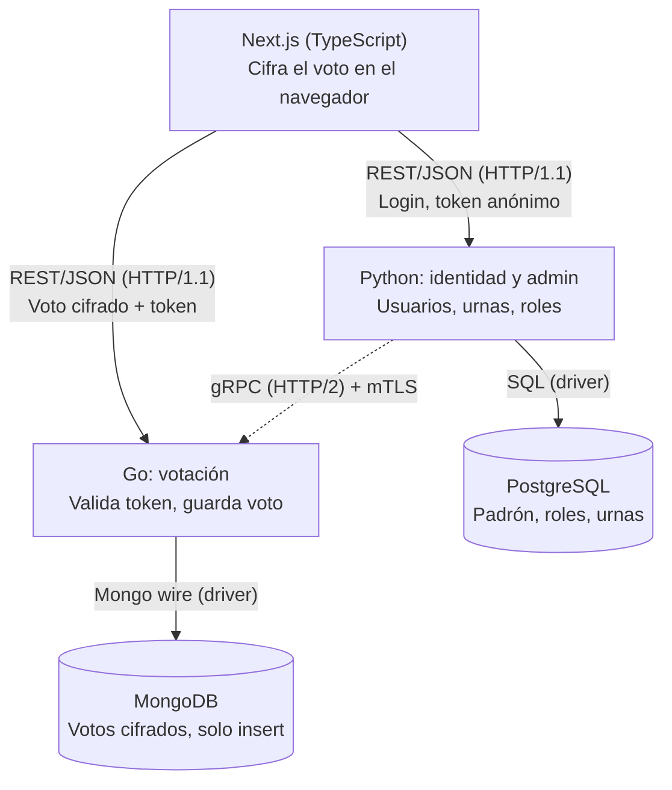
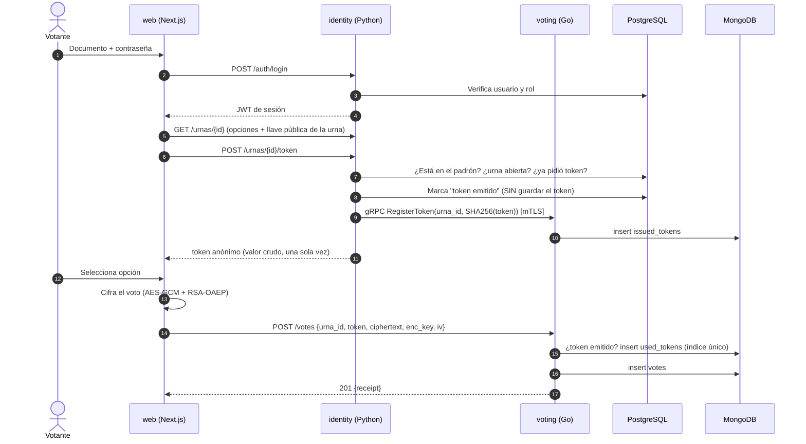

# Prototipo 1 — Sistema de Votaciones
## Plan de construcción y reparto de tareas

**Curso:** Software Architecture 2026-II · Universidad Nacional de Colombia
**Entrega del artefacto (`p1_X.pdf`):** lunes 12 de octubre de 2026 (MiCampus UNAL)
**Presentación:** martes 13 de octubre de 2026 (en clase)
**Equipo:** 8 integrantes

> Este documento es el plan **interno** del equipo (qué construir, quién lo construye y cuándo). El artefacto que se entrega al profesor (`p1_X.pdf`) se arma a partir de las secciones 2, 3 y 10.

---

## 1. Objetivo y alcance

Construir un **prototipo vertical** de un sistema de votaciones electrónicas: una rebanada funcional que atraviese todas las capas (presentación → lógica → datos) y que se ejecute completa con contenedores.

### 1.1 Alcance funcional del prototipo (dentro)

| # | Funcionalidad | Servicio principal |
|---|---|---|
| F1 | Login de usuarios con rol (`admin`, `votante`) | Python |
| F2 | Administración de usuarios y roles | Python |
| F3 | Creación de urnas (elecciones) con sus opciones/candidatos | Python |
| F4 | Padrón: asignar qué votantes pueden votar en cada urna | Python |
| F5 | Abrir / cerrar una urna (y propagarlo al servicio de votación) | Python → Go (gRPC) |
| F6 | Emisión de **token anónimo** de voto (un token por votante y urna) | Python → Go (gRPC) |
| F7 | Cifrado del voto en el navegador | Next.js |
| F8 | Recepción, validación del token y almacenamiento del voto cifrado | Go |
| F9 | Recibo de voto y verificación de que el voto fue registrado | Go / Next.js |

### 1.2 Fuera del alcance de P1 (se deja para prototipos posteriores)

- Escrutinio / descifrado y conteo de resultados (solo se expone el **conteo de votos recibidos**, no el resultado).
- Firmas ciegas (*blind signatures*) para desvincular totalmente token e identidad.
- Alta disponibilidad, balanceo, orquestación (Kubernetes), observabilidad avanzada.
- Recuperación de contraseña, correo electrónico, 2FA.

---

## 2. Arquitectura (vista de Componentes y Conectores)

La arquitectura parte del diagrama adjunto. Guardar la imagen como `docs/cc-view.png` para incluirla en el artefacto final.




### 2.1 Cumplimiento de los requisitos no funcionales

| Requisito (enunciado) | Cómo se cumple |
|---|---|
| Arquitectura **distribuida** | 3 procesos de aplicación + 2 bases de datos, cada uno en su contenedor y comunicados por red. |
| ≥ 1 componente de **presentación** (web front-end) | `web` — Next.js (TypeScript). |
| ≥ 2 componentes de **lógica** | `identity` (Python) y `voting` (Go). |
| ≥ 2 componentes de **datos** (relacional + NoSQL) | `postgres` (relacional) y `mongo` (NoSQL documental). |
| ≥ 2 tipos distintos de **conectores basados en HTTP** | **REST/JSON sobre HTTP/1.1** (navegador → Python y navegador → Go) y **gRPC sobre HTTP/2** (Python → Go). |
| ≥ 3 lenguajes de propósito general | TypeScript, Python y Go. |
| Despliegue orientado a **contenedores** | Un `Dockerfile` por servicio y un `docker-compose.yml` que levanta todo. |

> **Punto a defender en la presentación:** gRPC es un conector basado en HTTP porque usa HTTP/2 como transporte (con Protocol Buffers como formato). Es un tipo de conector distinto al REST/JSON. Dejarlo explícito en el artefacto.

### 2.2 Estilos arquitectónicos a describir en el artefacto

- **Cliente-Servidor** (navegador ↔ servicios).
- **Orientada a servicios / microservicios** (dos servicios con responsabilidades separadas).
- **Base de datos por servicio** (*database per service*) con **aislamiento**: PostgreSQL solo accesible desde `identity`; MongoDB solo desde `voting`.
- **Petición-respuesta (REST)** para la interacción con el cliente y **RPC (gRPC)** para la interacción servicio a servicio.
- **Separación de identidad y voto** como decisión de diseño: quien sabe *quién eres* (Python) no guarda *qué votaste*; quien guarda *qué votaste* (Go) no sabe *quién eres*.

### 2.3 Elementos y relaciones

| Elemento | Tipo | Tecnología | Responsabilidad |
|---|---|---|---|
| `web` | Presentación | Next.js + TypeScript | UI de votante y administrador; cifrado del voto en el navegador con Web Crypto. |
| `identity` | Lógica | Python (FastAPI) | Autenticación, roles, usuarios, urnas, padrón, emisión del token anónimo, cliente gRPC. |
| `voting` | Lógica | Go | API de voto, validación y consumo del token, servidor gRPC, persistencia de votos. |
| `postgres` | Datos (relacional) | PostgreSQL | Usuarios, roles, urnas, opciones, padrón. |
| `mongo` | Datos (NoSQL) | MongoDB | Configuración publicada de urnas, tokens emitidos/usados, votos cifrados. |

| Relación (conector) | Origen → Destino | Protocolo | Datos que viajan |
|---|---|---|---|
| C1 | `web` → `identity` | REST/JSON, HTTP/1.1 | Credenciales, sesión (JWT), urnas, solicitud de token. |
| C2 | `web` → `voting` | REST/JSON, HTTP/1.1 | Voto cifrado + token anónimo. |
| C3 | `identity` → `voting` | gRPC, HTTP/2 + mTLS | Publicar/abrir/cerrar urna, registrar hash de token. |
| C4 | `identity` → `postgres` | SQL (driver) | Datos relacionales. |
| C5 | `voting` → `mongo` | Mongo wire (driver) | Documentos de votos y tokens. |

---

## 3. Diseño del flujo de voto (decisiones que el equipo debe respetar)

### 3.1 Secuencia



### 3.2 Reglas de diseño

1. **Token anónimo:** 32 bytes aleatorios (base64url). `identity` solo envía a `voting` el **hash SHA-256**; `voting` recibe del navegador el valor crudo, lo hashea y lo compara. En PostgreSQL **no se guarda el token ni su hash**, solo el booleano `token_issued` por (usuario, urna).
2. **Un voto por votante:** `used_tokens` tiene **índice único** sobre `token_hash`; un segundo intento falla con `409 Conflict`.
3. **Cifrado híbrido en el navegador:** se genera una llave AES-GCM aleatoria, se cifra el voto con ella y la llave AES se cifra con la **llave pública RSA-OAEP de la urna** (generada por `identity` al crear la urna). La llave privada **nunca** se guarda en `web` ni en `voting` (en P1 queda en un archivo local del admin; el escrutinio es de P2).
4. **MongoDB "solo insert":** el usuario de aplicación de `voting` tiene un rol con permisos `insert` y `find` sobre `votes`, `issued_tokens` y `used_tokens` (sin `update` ni `remove`). Solo la colección `urna_config` admite `update` (para abrir/cerrar).
5. **Aislamiento de datos:** dos redes Docker de base de datos separadas (`net_pg`, `net_mongo`); ningún servicio comparte base de datos con otro.
6. **gRPC con mTLS:** `identity` actúa como cliente y `voting` como servidor, ambos con certificado emitido por una CA propia del proyecto. Sin certificado válido, `voting` rechaza la conexión.
7. **Orden de operaciones en `POST /votes`:** (a) urna abierta → (b) token emitido y no vencido → (c) insertar en `used_tokens` → (d) insertar en `votes`. Limitación conocida: si falla (d) tras (c), el token queda consumido (documentarlo; la solución real son transacciones con *replica set* de Mongo).

> **Limitación honesta a mencionar en la presentación:** como `identity` genera el token, en teoría podría correlacionarlo con el usuario. P1 mitiga no persistiendo el token; la solución robusta (firmas ciegas) queda para P2.

---

## 4. Contratos (se congelan el día 1)

Los contratos son lo primero que se escribe para que los 4 frentes trabajen en paralelo con *mocks*.

### 4.1 `identity` — REST/JSON (puerto 8000)

| Método | Ruta | Rol | Descripción |
|---|---|---|---|
| POST | `/auth/login` | público | `{document_id, password}` → `{access_token, role, user}` |
| GET | `/me` | autenticado | Datos del usuario actual |
| GET | `/urnas` | votante | Urnas en las que está en el padrón |
| GET | `/urnas/{id}` | votante | Opciones, ventana de tiempo y **llave pública** de la urna |
| POST | `/urnas/{id}/token` | votante | Emite el token anónimo (`409` si ya lo pidió; `403` si no está en padrón o urna cerrada) |
| GET / POST | `/admin/users` | admin | Listar / crear usuarios y asignar rol |
| POST | `/admin/urnas` | admin | Crear urna con opciones |
| PUT | `/admin/urnas/{id}/padron` | admin | Asignar votantes a la urna |
| PATCH | `/admin/urnas/{id}/status` | admin | `open` / `closed` (dispara gRPC a Go) |
| GET | `/healthz` | público | Salud del servicio |

### 4.2 `voting` — REST/JSON (puerto 8081)

| Método | Ruta | Descripción |
|---|---|---|
| POST | `/votes` | `{urna_id, token, ciphertext, enc_key, iv}` → `201 {receipt}`; `401` token inválido; `409` token ya usado; `403` urna cerrada |
| GET | `/votes/{receipt}` | Confirma que el recibo existe (`200` / `404`) |
| GET | `/healthz` | Salud del servicio |

### 4.3 `voting` — gRPC (puerto 50051, solo red interna)

```proto
syntax = "proto3";
package voting.v1;
option go_package = "votaciones/voting/gen/votingv1";

service VotingAdmin {
  rpc PublishUrna(PublishUrnaRequest)     returns (Ack);
  rpc SetUrnaStatus(SetUrnaStatusRequest) returns (Ack);
  rpc RegisterToken(RegisterTokenRequest) returns (Ack);
  rpc GetVoteCount(GetVoteCountRequest)   returns (VoteCountResponse);
}

message PublishUrnaRequest {
  string urna_id = 1;
  repeated string option_ids = 2;
  string public_key_pem = 3;
  int64 opens_at = 4;   // epoch seconds
  int64 closes_at = 5;
}
message SetUrnaStatusRequest { string urna_id = 1; string status = 2; } // "open" | "closed"
message RegisterTokenRequest { string urna_id = 1; string token_hash = 2; int64 expires_at = 3; }
message GetVoteCountRequest  { string urna_id = 1; }
message VoteCountResponse    { int64 count = 1; }
message Ack                  { bool ok = 1; string message = 2; }
```

### 4.4 Modelo de datos

**PostgreSQL (`identity`)**

```
users(id, document_id UNIQUE, full_name, password_hash, role, created_at)
urnas(id, name, description, opens_at, closes_at, status, public_key_pem, created_by)
urna_options(id, urna_id → urnas, label, position)
padron(urna_id → urnas, user_id → users, token_issued BOOL, issued_at, PRIMARY KEY(urna_id, user_id))
```

**MongoDB (`voting`)**

```
urna_config   { _id: urna_id, status, option_ids[], public_key_pem, opens_at, closes_at }   // admite update
issued_tokens { token_hash, urna_id, expires_at }                                           // insert-only
used_tokens   { token_hash (índice ÚNICO), urna_id, used_at }                               // insert-only
votes         { receipt, urna_id, ciphertext, enc_key, iv, created_at }                     // insert-only
```

---

## 5. Stack tecnológico propuesto

| Componente | Tecnología sugerida |
|---|---|
| `web` | Next.js (App Router) + TypeScript, Web Crypto API, cliente API tipado generado desde OpenAPI |
| `identity` | Python 3.12, FastAPI, SQLAlchemy + Alembic, `grpcio`, `argon2-cffi`, `pytest` |
| `voting` | Go 1.22+, `net/http` + `chi`, `mongo-driver`, `grpc-go`, `testing` |
| Datos | PostgreSQL 16, MongoDB 7 |
| Contenedores | Docker + Docker Compose, Dockerfiles *multi-stage* |
| Utilidades | `Makefile`, OpenSSL (certificados mTLS), `protoc` / `buf` |

---

## 6. Estructura del repositorio (monorepo)

```
votaciones/
├── README.md
├── Makefile
├── docker-compose.yml
├── .env.example
├── proto/
│   └── voting.proto
├── contracts/
│   ├── identity.openapi.yaml
│   └── voting.openapi.yaml
├── certs/
│   └── gen-certs.sh            # CA + certs de identity (cliente) y voting (servidor)
├── db/
│   ├── postgres/init.sql
│   └── mongo/init.js           # usuario/rol insert-only + índices
├── web/                        # Next.js + TypeScript
├── identity/                   # Python (FastAPI)
├── voting/                     # Go
├── scripts/
│   └── smoke_test.sh           # prueba E2E por curl
└── docs/
    ├── cc-view.png
    ├── logo.png
    └── p1_X.md                 # artefacto final → p1_X.pdf
```

---

## 7. Reparto de tareas (8 integrantes)

Reemplazar `M1…M8` por los nombres reales. Cada persona tiene un **revisor cruzado** para los *pull requests*.

| Rol | Integrante | Frente | Revisor cruzado |
|---|---|---|---|
| **M1** | _(nombre)_ | Líder técnico · arquitectura · integración · artefacto | M2 |
| **M2** | _(nombre)_ | DevOps · contenedores · mTLS | M1 |
| **M3** | _(nombre)_ | Frontend A · login y administración | M4 |
| **M4** | _(nombre)_ | Frontend B · votación y criptografía | M3 |
| **M5** | _(nombre)_ | Python A · identidad, roles, PostgreSQL | M6 |
| **M6** | _(nombre)_ | Python B · urnas, token anónimo, cliente gRPC | M5 |
| **M7** | _(nombre)_ | Go A · API HTTP de voto, MongoDB | M8 |
| **M8** | _(nombre)_ | Go B · servidor gRPC, tokens, QA | M7 |

### M1 — Líder técnico, arquitectura e integración

| ID | Tarea | Entregable / criterio de aceptación |
|---|---|---|
| T1.1 | Crear repo, estructura de carpetas, ramas protegidas, plantilla de PR | Estructura de la sección 6 en `main` el día 1 |
| T1.2 | Redactar `identity.openapi.yaml`, `voting.openapi.yaml` y `voting.proto` junto con M5, M6, M7, M8 | Contratos congelados (cambios solo vía PR con aprobación de M1) |
| T1.3 | Diagrama C&C final + descripción de estilos, elementos y relaciones | Secciones 2.2 y 2.3 pulidas para el artefacto |
| T1.4 | Pruebas de integración E2E (con M8): `smoke_test.sh` del flujo completo | Script que hace login → token → voto → recibo y falla si algo se rompe |
| T1.5 | Armar `docs/p1_X.md` y exportar a `p1_X.pdf` (nombre, logo, descripción, C&C, comandos) | PDF con todos los puntos de la sección 10 |
| T1.6 | Guion y ensayo de la presentación del martes 13 | Demo de ≤ 10 min ensayada (sección 12) |

### M2 — DevOps, contenedores y seguridad de transporte

| ID | Tarea | Entregable / criterio de aceptación |
|---|---|---|
| T2.1 | `Dockerfile` *multi-stage* para `web`, `identity` y `voting` | Imágenes que construyen sin errores y corren como usuario no root |
| T2.2 | `docker-compose.yml` con 5 servicios, healthchecks, volúmenes y dependencias | `docker compose up --build` deja todo en estado *healthy* |
| T2.3 | Redes aisladas: `net_pg` (identity+postgres), `net_mongo` (voting+mongo), `net_app` (web/identity/voting) | Verificar que `identity` **no** resuelve `mongo` y `voting` **no** resuelve `postgres` |
| T2.4 | `certs/gen-certs.sh`: CA propia + certificados de servidor (`voting`) y cliente (`identity`) | `make certs` genera los archivos; gRPC sin cert de cliente es rechazado |
| T2.5 | `.env.example`, `Makefile` (`up`, `down`, `certs`, `seed`, `test`, `logs`) | Un compañero levanta el sistema en limpio con 4 comandos |
| T2.6 | Prueba en máquina limpia y sección "Prototype" del artefacto (comandos de descarga y ejecución) | Comandos verificados por alguien que no escribió el código |

### M3 — Frontend A: login y administración

| ID | Tarea | Entregable / criterio de aceptación |
|---|---|---|
| T3.1 | Proyecto Next.js + TypeScript, layout, estilos base, variables de entorno de URLs de API | `web` corre en `:3000` y en contenedor |
| T3.2 | Cliente API tipado generado desde `identity.openapi.yaml` | Tipos compartidos con M4; sin `any` en llamadas a la API |
| T3.3 | Pantalla de login y manejo de sesión (JWT) | Login correcto/incorrecto; sesión guardada; cierre de sesión |
| T3.4 | Guardas de ruta por rol (`admin` vs `votante`) | Un votante no puede abrir `/admin/*` |
| T3.5 | Pantallas de admin: usuarios, crear urna con opciones, asignar padrón, abrir/cerrar urna | Todo el ciclo de administración se hace desde la UI |
| T3.6 | Pruebas de componentes críticos (login, guardas) | Pruebas pasando en CI/local |

### M4 — Frontend B: votación y criptografía

| ID | Tarea | Entregable / criterio de aceptación |
|---|---|---|
| T4.1 | Listado de urnas disponibles para el votante y detalle de urna | Muestra solo urnas del padrón del usuario |
| T4.2 | Flujo "solicitar token" (`POST /urnas/{id}/token`) y manejo de errores (`409`, `403`) | Mensajes claros al usuario |
| T4.3 | Módulo `crypto.ts`: cifrado híbrido AES-GCM + RSA-OAEP con Web Crypto | El texto plano del voto **nunca** sale del navegador (verificar en pestaña Red) |
| T4.4 | Pantalla de votación y envío a `voting` (`POST /votes`) con el token | Voto enviado; se muestra el recibo |
| T4.5 | Pantalla "verificar recibo" (`GET /votes/{receipt}`) | Confirma que el voto fue registrado |
| T4.6 | Pruebas unitarias del módulo `crypto.ts` (cifrar y descifrar con par de llaves de prueba) | Pruebas pasando |

### M5 — Python A: identidad, roles y PostgreSQL

| ID | Tarea | Entregable / criterio de aceptación |
|---|---|---|
| T5.1 | Proyecto FastAPI, configuración por entorno, `/healthz` | Servicio corre en `:8000` y en contenedor |
| T5.2 | Modelos SQLAlchemy de `users`, `urnas`, `urna_options`, `padron` + migraciones/`init.sql` | Esquema creado automáticamente al levantar `postgres` |
| T5.3 | `POST /auth/login` con hash de contraseña (argon2) y emisión de JWT con rol | Login funcional; contraseñas nunca en texto plano |
| T5.4 | Middleware/dependencias de autorización por rol (RBAC) y `GET /me` | `403` correcto para rutas de admin con rol votante |
| T5.5 | CRUD de usuarios (`/admin/users`) y *seed* (1 admin + N votantes de prueba) | `make seed` deja datos listos para la demo |
| T5.6 | Pruebas `pytest` de auth y RBAC | Cobertura de casos felices y de error |

### M6 — Python B: urnas, token anónimo y cliente gRPC

| ID | Tarea | Entregable / criterio de aceptación |
|---|---|---|
| T6.1 | `POST /admin/urnas` (crea urna + opciones + **par de llaves RSA** de la urna) y `PUT /admin/urnas/{id}/padron` | La urna queda en PostgreSQL con su llave pública |
| T6.2 | `GET /urnas` y `GET /urnas/{id}` filtrados por padrón del usuario | Un votante fuera del padrón recibe `403`/`404` |
| T6.3 | Generar código gRPC cliente desde `proto/voting.proto` y conexión **mTLS** a `voting` | Cliente conecta con certificados de `certs/` |
| T6.4 | `PATCH /admin/urnas/{id}/status` → llama `PublishUrna` / `SetUrnaStatus` | Abrir una urna la deja operativa en Go |
| T6.5 | `POST /urnas/{id}/token`: valida reglas, genera token, marca `token_issued`, llama `RegisterToken` con el **hash**, devuelve el token crudo una sola vez | Segundo intento → `409`; el token no queda guardado en PostgreSQL |
| T6.6 | Pruebas con servidor gRPC *mock* | Pruebas pasando sin depender de `voting` real |

### M7 — Go A: API HTTP de voto y MongoDB

| ID | Tarea | Entregable / criterio de aceptación |
|---|---|---|
| T7.1 | Proyecto Go, router HTTP, configuración, CORS (origen de `web`), `/healthz` | Servicio corre en `:8081` y en contenedor |
| T7.2 | `POST /votes`: validación de payload (tamaños, base64, campos obligatorios) | Payload inválido → `400` |
| T7.3 | Repositorio MongoDB para `votes` (**solo insert**) y generación de `receipt` (hash del voto cifrado) | Ninguna operación `update`/`delete` en el código de votos |
| T7.4 | Integrar el validador de token de M8 en el flujo de `POST /votes` (orden de la regla 7) | `401`, `409`, `403` y `201` según corresponda |
| T7.5 | `GET /votes/{receipt}` | `200`/`404` correctos |
| T7.6 | Limitación básica de tasa y límite de tamaño del *body* | Peticiones abusivas rechazadas |
| T7.7 | Pruebas unitarias y de integración con Mongo de prueba | Pruebas pasando |

### M8 — Go B: servidor gRPC, tokens y QA

| ID | Tarea | Entregable / criterio de aceptación |
|---|---|---|
| T8.1 | Generar código gRPC servidor desde `proto/voting.proto` y levantar servidor en `:50051` con **mTLS** (verifica certificado de cliente) | Cliente sin certificado válido es rechazado |
| T8.2 | Implementar `PublishUrna` y `SetUrnaStatus` sobre `urna_config` | El estado de la urna se refleja en `POST /votes` |
| T8.3 | Implementar `RegisterToken` sobre `issued_tokens` | Hash registrado con vencimiento |
| T8.4 | Paquete `internal/tokens` con interfaz `ValidateAndConsume(ctx, urnaID, token)` (acordar firma con M7 el día 1) | Usa `issued_tokens` + `used_tokens` con índice único |
| T8.5 | Implementar `GetVoteCount` | Devuelve el conteo de votos recibidos por urna |
| T8.6 | `db/mongo/init.js`: usuario de aplicación con rol **insert + find** (sin update/remove en `votes`, `issued_tokens`, `used_tokens`) e índices | Un intento de `update` sobre `votes` con el usuario de la app falla |
| T8.7 | Apoyo a M1 en pruebas E2E y casos negativos (doble voto, urna cerrada, token falso) | Matriz de pruebas negativas ejecutada |

---

## 8. Cronograma (hoy es miércoles 7 de octubre — quedan 5 días)

El plazo es corto, por eso el plan prioriza **contratos primero**, **integración temprana** y **congelamiento de código el domingo**.

| Fecha | Hito | Qué se espera al final del día |
|---|---|---|
| **Mié 7 oct** | Kick-off y contratos | Repo creado (T1.1); OpenAPI + `.proto` congelados (T1.2); firma de `ValidateAndConsume` acordada (M7/M8); cada quien con su esqueleto corriendo local; M2 con Dockerfiles base. |
| **Jue 8 oct** | Desarrollo en paralelo con *mocks* | `identity`: login + RBAC + urnas (T5.x, T6.1-6.2). `voting`: `POST /votes` + repositorio Mongo (T7.x). Frontend: login, cliente API, módulo crypto. `docker-compose` levanta 5 servicios (T2.2, T2.3). |
| **Vie 9 oct** | **Primera integración E2E** | gRPC con mTLS operativo (T2.4, T6.3, T8.1); token anónimo de punta a punta (T6.5, T8.3, T8.4); pantalla de votación conectada. Primer `smoke_test.sh` en verde (aunque sea con huecos). |
| **Sáb 10 oct** | Completar y endurecer | Pantallas de admin completas (T3.5); casos negativos (T8.7); pruebas unitarias; `make up` desde cero verificado por alguien ajeno al código (T2.6). Borrador del artefacto (T1.3, T1.5). |
| **Dom 11 oct** | **Congelamiento de código (12:00 m.)** | Solo se aceptan correcciones de errores. Artefacto final `.md` → `.pdf`; ensayo de la demo (T1.6). |
| **Lun 12 oct** | **Entrega** | Un solo integrante sube `p1_X.pdf` en MiCampus **temprano** (dejar margen ante fallas de la plataforma). |
| **Mar 13 oct** | Presentación en clase | Demo en vivo + plan B (video corto grabado el domingo). |

---

## 9. Convenciones de trabajo

- **Ramas:** `main` (protegida, siempre demostrable) y ramas `feat/<área>-<descripción>`; fusión solo por PR con **1 aprobación del revisor cruzado**.
- **Commits:** estilo *Conventional Commits* (`feat:`, `fix:`, `docs:`, `chore:`).
- **Cambios de contrato:** cualquier cambio en `contracts/` o `proto/` se avisa en el canal del equipo y requiere aprobación de M1.
- **Definición de "terminado" por tarea:**
  1. Funciona dentro de su contenedor (no solo en la máquina local).
  2. Tiene al menos una prueba automatizada o un caso en `smoke_test.sh`.
  3. Está documentado en el README de su carpeta (cómo correrlo y variables de entorno).
  4. Pasó revisión cruzada.
- **Sincronización:** reunión corta diaria (15 min) y una sesión de integración el viernes.
- **Secretos:** nada de contraseñas ni llaves privadas en el repositorio; usar `.env` (ignorado por Git) y `.env.example`.

---

## 10. Contenido del artefacto final `p1_X.pdf`

El enunciado pide que el artefacto se cree en `.md`, se exporte a `.pdf` y se nombre `p1_X.pdf` (X = nombre del equipo: 1a, 1b, 2a…).

Lista de verificación:

- [ ] **Team:** nombre del equipo (`1a`, `1b`, `2a`…) y nombres completos de los integrantes.
- [ ] **Software System:** nombre, logo y descripción.
- [ ] **C&C View:** diagrama de la sección 2 con leyenda de conectores.
- [ ] **Descripción de estilos arquitectónicos** usados (sección 2.2).
- [ ] **Descripción de elementos y relaciones** (sección 2.3).
- [ ] **Prototype:** comandos para descargar y ejecutar (sección 11).
- [ ] Exportado a `.pdf` y nombrado `p1_X.pdf`.
- [ ] Subido a MiCampus UNAL por **un solo** integrante antes del lunes 12 de octubre.

---

## 11. Comandos de ejecución (borrador para el artefacto)

```bash
# 1. Descargar el proyecto
git clone <URL_DEL_REPOSITORIO> votaciones
cd votaciones

# 2. Configurar variables de entorno
cp .env.example .env

# 3. Generar certificados para mTLS (CA, servidor Go, cliente Python)
make certs

# 4. Construir y levantar todos los contenedores
docker compose up --build -d

# 5. Cargar datos de prueba (1 admin + votantes)
make seed

# 6. (Opcional) Ejecutar la prueba de humo end-to-end
make test
```

| Servicio | URL |
|---|---|
| Frontend | http://localhost:3000 |
| API Identidad (Python) | http://localhost:8000 |
| API Votación (Go) | http://localhost:8081 |

Credenciales de prueba (definir en el *seed*): `admin / ********` y `votante1 / ********`.

---

## 12. Guion de demostración (≤ 10 minutos)

1. **Arquitectura (2 min):** mostrar la vista C&C, los tres lenguajes, los dos tipos de conectores HTTP y las dos bases de datos aisladas.
2. **Administración (2 min):** iniciar sesión como admin, crear una urna con 3 opciones, asignar padrón, abrirla.
3. **Votación (3 min):** iniciar sesión como votante, solicitar token, votar; mostrar en la pestaña **Red** del navegador que el voto viaja cifrado; mostrar el recibo.
4. **Seguridad (2 min):**
   - Intentar votar dos veces → `409`.
   - Mostrar un documento en MongoDB: contenido cifrado y sin identidad del votante.
   - Mostrar que `identity` no alcanza a `mongo` y `voting` no alcanza a `postgres`.
5. **Cierre (1 min):** limitaciones asumidas (sin escrutinio, sin firmas ciegas) y trabajo para P2.

**Plan B:** video corto de la demo grabado el domingo, y un `docker compose` ya levantado antes de entrar a clase.

---

## 13. Riesgos y mitigaciones

| Riesgo | Probabilidad | Mitigación |
|---|---|---|
| Poco tiempo (5 días) | Alta | Contratos el día 1; *mocks*; integración E2E el viernes; congelamiento el domingo a mediodía. |
| Integración tardía entre frentes | Alta | `docker-compose` desde el día 2; M1 y M8 integran continuamente. |
| mTLS mal configurado (CN/SAN de los certificados) | Media | M2 entrega `gen-certs.sh` el jueves; M6 y M8 prueban en pareja el viernes temprano. |
| CORS entre `web` y las dos APIs | Media | Definir orígenes permitidos por variable de entorno desde el día 1. |
| Web Crypto solo funciona en contexto seguro | Media | `localhost` cuenta como contexto seguro; si se despliega con otro host, usar HTTPS. |
| Pérdida de voto si falla el insert tras consumir el token | Baja | Documentarlo como limitación; mejora en P2 con *replica set* y transacciones. |
| Cambios de contrato a mitad de camino | Media | Cambios solo por PR aprobado por M1 y aviso al equipo. |
| Falla de la plataforma el día de la entrega | Baja | Subir el PDF el lunes temprano y conservar copia local. |
