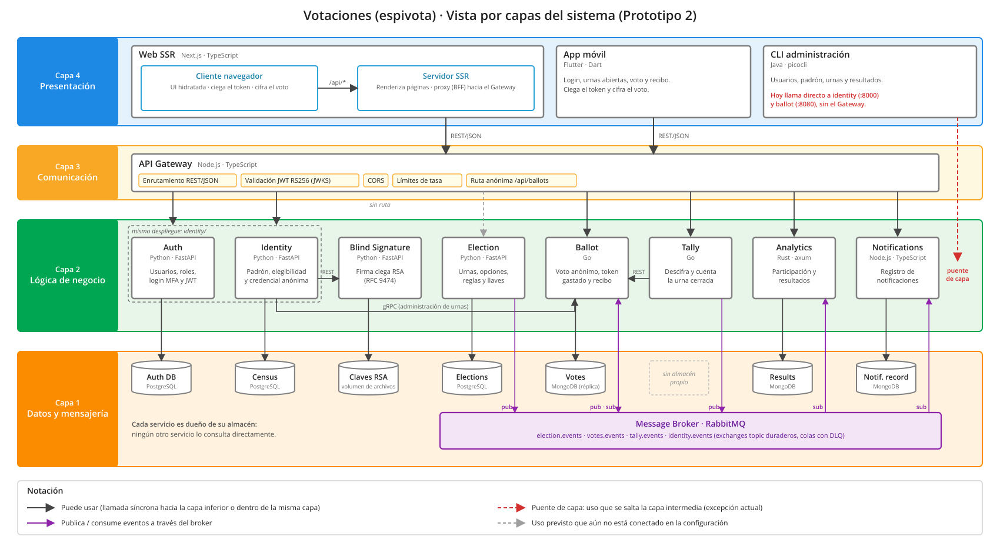
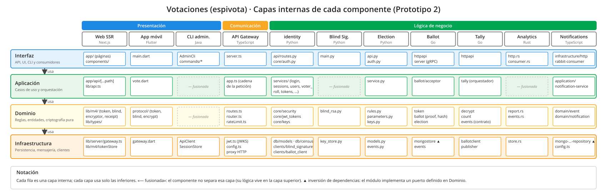
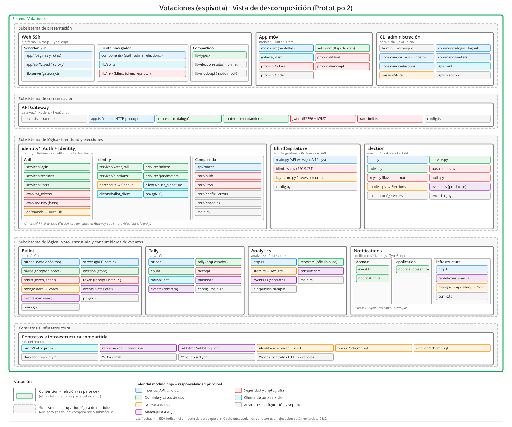

## Estructura por capas

La vista por capas agrupa los componentes según su responsabilidad y define
qué capa **puede usar** a cuál. Se presenta en dos niveles:

1. **Capas del sistema** (figura anterior): cómo se organizan presentación,
   comunicación, lógica y datos, y qué dependencias hay entre ellas.
2. **Capas internas de cada componente** (figura de más abajo): cómo se
   organiza cada servicio por dentro. Siguiendo el plan del prototipo, no se
   obliga a todos los servicios a tener las mismas capas internas: cuando un
   servicio no separa una capa, se indica.

### Descripción de los elementos

#### Capas del sistema

| Capa | Elementos | Responsabilidad | Puede usar |
|---|---|---|---|
| 4 · Presentación | Web SSR (Cliente navegador y Servidor SSR), App móvil, CLI administración | Interacción con votantes y administradores. El cliente genera y ciega el token y cifra el voto antes de enviarlo, así que ninguna capa inferior ve el voto en claro | Capa 3 |
| 3 · Comunicación | API Gateway | Punto de entrada único: enruta por REST/JSON, valida el JWT RS256 con el JWKS de identity, aplica CORS y límites de tasa, y expone `/api/ballots` como ruta anónima (sin credenciales ni cabeceras de sesión) | Capa 2 |
| 2 · Lógica de negocio | Auth, Identity, Blind Signature, Election, Ballot, Tally, Analytics, Notifications | Reglas del negocio: usuarios y sesiones, padrón y credencial anónima, firma ciega, ciclo de vida de las urnas, recepción del voto, escrutinio, analíticas y notificaciones | Capa 2 (llamadas indicadas) y capa 1 |
| 1 · Datos y mensajería | Auth DB, Census, Elections (PostgreSQL); Votes, Results, Notif. record (MongoDB); claves RSA (volumen); RabbitMQ | Persistencia de cada servicio e intercambio asíncrono de eventos | — |

#### Capas internas de cada componente

| Capa interna | Responsabilidad | Ejemplos |
|---|---|---|
| Interfaz | Recibe las peticiones o los eventos y traduce entre el protocolo y el dominio | `httpapi` y `server` (gRPC) en Ballot, `api.py` en Election, `http.rs` y `consumer.rs` en Analytics, `components/` en Web SSR |
| Aplicación | Casos de uso: coordina el dominio y la infraestructura para cumplir una petición | `services/` en identity, `service.py` en Election, `tally` (orquestador) en Tally, `notification-service` en Notifications |
| Dominio | Reglas, entidades y criptografía pura, sin E/S | `rules.py` en Election, `token` y `ballot` en Ballot, `count` y `decrypt` en Tally, `report.rs` en Analytics, `lib/m4/` en Web SSR |
| Infraestructura | Acceso a la base de datos, al *broker* y a otros servicios | `mongostore` en Ballot, `models.py` y `events.py` en Election, `ballotclient` y `publisher` en Tally, `clients/` en identity |

Blind Signature, Analytics y la CLI son lo bastante pequeños para no tener una
capa de aplicación propia: su orquestación vive en el módulo de interfaz
(`main.py`, `http.rs`/`consumer.rs`, `commands/*`). La CLI tampoco tiene dominio
propio: delega todas las reglas en el servidor.

### Descripción de las relaciones

- **Puede usar (*allowed-to-use*).** Una capa solo usa la inmediatamente
  inferior: presentación → comunicación → lógica → datos. Ninguna capa
  inferior conoce a una superior. Los servicios no llaman al Gateway ni a los
  clientes; responden a sus peticiones.
- **Uso dentro de la capa de lógica.** Se permite en tres casos, todos
  síncronos e internos (no publicados por el Gateway):
  - Identity → Blind Signature (REST, con el secreto `X-Internal-Token`) para
    firmar a ciegas la credencial.
  - Identity → Ballot (gRPC) para registrar, cerrar y consultar urnas.
  - Tally → Ballot (REST, con un *token* compartido) para leer las papeletas
    cifradas de una urna cerrada.
- **Comunicación asíncrona por la capa 1.** El resto de la coordinación entre
  servicios de lógica pasa por RabbitMQ, no por llamadas directas: Election
  publica `election.*`, Ballot publica `votes.cast` y consume `election.*`,
  Tally publica `tally.completed`, y Analytics y Notifications consumen esos
  eventos. Así los servicios de la misma capa no dependen unos de otros.
- **Propiedad de los datos.** Cada almacén de la capa 1 lo usa un solo
  servicio, el que está encima en la figura. Tally no tiene almacén propio:
  lee de Ballot y publica su resultado.
- **Dentro de cada componente**, cada capa interna usa solo las inferiores.
  La excepción intencional es la **inversión de dependencias** (▲): en Ballot
  y Notifications el dominio define la interfaz del repositorio
  (`CommitStore`, `NotificationRepository`) y la infraestructura la
  implementa, de modo que el dominio no depende de MongoDB.

#### Diferencias entre el diseño y el código actual

La figura muestra el código de `main` tal como está, incluidas tres
diferencias que quedan pendientes:

- **Puente de capa de la CLI.** La CLI usa por defecto
  `http://localhost:8000` (identity) y `http://localhost:8080` (ballot), con
  las rutas propias de esos servicios (`/login`, `/elections/…`), no las del
  Gateway (`/api/auth/login`, …). Se salta la capa de comunicación y, por
  tanto, la validación de JWT y los límites de tasa del Gateway. Para
  corregirlo, la CLI debe usar las rutas `/api/*` y apuntar al Gateway.
- **Election aún no recibe tráfico del Gateway.** En `docker-compose.yml`,
  `GATEWAY_ELECTION_URL` apunta a identity (que conserva las urnas del
  prototipo 1), no al servicio Election.
- **`identity.events` no tiene productor.** Analytics y Notifications se
  suscriben a `census.updated`, pero identity todavía no publica eventos.

### Descripción de los patrones arquitectónicos

- **Arquitectura por capas (*layered*).** Las cuatro capas del sistema separan
  presentación, comunicación, lógica y datos, y la relación «puede usar» va
  solo hacia abajo. Es una arquitectura por capas **relajada** en un solo
  punto controlado: los servicios de lógica pueden llamarse entre sí en los
  tres casos internos listados arriba.
- **Cliente-servidor y *n* niveles.** Las tres interfaces son clientes de un
  único servidor lógico (el Gateway). Cada capa se despliega en sus propios
  contenedores, así que las capas lógicas coinciden con niveles físicos
  separados.
- **API Gateway.** La capa de comunicación concentra las políticas
  transversales (JWT, CORS, límites de tasa) para que los servicios de lógica
  no las repitan y los clientes conozcan un solo punto de entrada.
- **Backend for Frontend.** Dentro de la capa de presentación, el Servidor SSR
  es el *backend* del Cliente navegador: le sirve las páginas y reenvía
  `/api/*` al Gateway. Así el navegador no conoce la URL del Gateway ni el JWT,
  que se guarda en una cookie `httpOnly`.
- **Base de datos por servicio.** En la capa 1, cada almacén pertenece a un
  único servicio de lógica, lo que permite elegir la tecnología adecuada a cada
  uno (PostgreSQL para datos relacionales, MongoDB para papeletas y
  proyecciones).
- **Publicar-suscribir.** RabbitMQ desacopla a los servicios de la capa de
  lógica: el productor no conoce a sus consumidores, y un consumidor caído no
  bloquea al productor (colas duraderas con DLQ).
- **Capas internas y arquitectura hexagonal.** Cada servicio repite la
  separación interfaz → aplicación → dominio → infraestructura. En
  Notifications y Ballot se aplica además la inversión de dependencias de la
  arquitectura hexagonal (puertos y adaptadores).

## Estructura de descomposición

La vista de descomposición muestra cómo se divide el sistema en **módulos**
(unidades de implementación) y qué responsabilidad tiene cada uno. Es una vista
estática: no muestra procesos ni conectores en ejecución (eso es la vista C&C),
sino cómo está organizado el código del repositorio. Los nombres de los
componentes coinciden con los de la vista C&C para poder cruzar las dos vistas.

La jerarquía tiene cuatro niveles:

| Nivel | Elemento | En el repositorio |
|---|---|---|
| 0 | Sistema Votaciones (espivota) | El repositorio completo |
| 1 | Subsistema | Agrupación lógica de componentes (presentación, comunicación, lógica, contratos) |
| 2 | Componente | Una carpeta de primer nivel con su propio `Dockerfile` (`ballot/`, `gateway/`, …) |
| 3 | Módulo y submódulo | Paquete o archivo de código (`internal/token`, `app/services/login.py`, …) |

### Descripción de las relaciones

- **Es parte de (contención).** Es la única relación de la vista: cada módulo
  pertenece exactamente a un módulo padre, así que la descomposición forma un
  árbol. En el diagrama se representa anidando un recuadro dentro de otro.
- **Responsabilidad del módulo hoja (color).** No es una relación entre
  módulos. Indica la responsabilidad principal del módulo: interfaz, dominio,
  acceso a datos, mensajería, seguridad y criptografía, cliente de otro servicio
  o arranque y soporte. Así se ve en cada componente la división API → lógica →
  persistencia → eventos que pide el plan del prototipo.
- **Encapsula un almacén (`→ BD`).** Señala el único módulo de cada componente
  que accede a su base de datos. Ningún otro módulo, ni de otro componente,
  conoce esa base.
- **Usa.** En las tablas de abajo, la columna *Usa* indica de qué módulos del
  mismo componente depende cada uno (según sus `import`). Las dependencias entre
  componentes no pasan por código compartido: ocurren en ejecución por HTTP o
  AMQP y se documentan en la vista C&C.

### Descripción de los elementos

#### Nivel 1: subsistemas

| Subsistema | Componentes | Responsabilidad |
|---|---|---|
| Presentación | Web SSR, App móvil, CLI administración | Interfaces de votante y administrador. Ciegan el token y cifran el voto en el cliente |
| Comunicación | API Gateway | Punto de entrada único: enrutamiento, validación de JWT, CORS y límites de tasa |
| Lógica: identidad y elecciones | identity (Auth + Identity), Blind Signature, Election | Usuarios y sesiones, padrón y elegibilidad, firma ciega de credenciales, ciclo de vida de las urnas |
| Lógica: voto, escrutinio y consumidores | Ballot, Tally, Analytics, Notifications | Recepción anónima del voto, escrutinio, analíticas y notificaciones a partir de eventos |
| Contratos e infraestructura | `proto/`, `rabbitmq/`, esquemas SQL, `docker-compose.yml` | Contratos compartidos entre componentes y su configuración de ejecución |

#### Nivel 2 y 3: componentes y módulos

**Web SSR** (`platform/`, Next.js · TypeScript). Se divide igual que en la vista C&C.

| Submódulo | Módulo | Responsabilidad | Usa |
|---|---|---|---|
| Servidor SSR | `app/` | Páginas y rutas: login, registro, panel de administración, votación y recibo | `components/`, `lib/server` |
| Servidor SSR | `app/api/[...path]/route.ts` | Proxy del navegador hacia el Gateway. Guarda la sesión en una cookie `httpOnly` y no reenvía la sesión en `/ballots` | `lib/server` |
| Servidor SSR | `lib/server/gateway.ts` | Cliente del API Gateway que solo se ejecuta en el servidor | — |
| Cliente navegador | `components/` | Componentes de UI por funcionalidad: `auth`, `admin`, `election`, `layout`, `m4`, `ui` | `lib/api.ts`, `lib/m4` |
| Cliente navegador | `lib/api.ts` | Cliente HTTP del navegador. Solo habla con el Servidor SSR | `lib/types` |
| Cliente navegador | `lib/m4/` | Protocolo de voto: `token` (sobre del token), `blind` (RSABSSA), `encryptor` (cifrado del voto), `receipt` (verificación del recibo), `tokenStore` (token en memoria), `api` (envío a Ballot) | — |
| Compartido | `lib/types/`, `lib/format.ts`, `lib/election-status.ts`, `lib/mock-api.ts` | Tipos de dominio, formato y estado de las urnas, y un modo *mock* para trabajar sin backend | — |

**App móvil** (`mobile/`, Flutter · Dart)

| Módulo | Responsabilidad | Usa |
|---|---|---|
| `lib/main.dart` | Pantallas: login, urnas abiertas, voto y recibo | `vote`, `gateway` |
| `lib/src/vote.dart` | Flujo del voto: pide el token con la sesión y envía la papeleta sin ella | `gateway`, `protocol` |
| `lib/src/gateway.dart` | Cliente del API Gateway, con un modo anónimo para la papeleta | — |
| `lib/src/protocol/` | `token` (mensaje canónico), `blind` (cegado RSA), `encrypt` (cifrado del voto), `codec` (base64url) | — |

**CLI administración** (`admin-cli/`, Java · picocli)

| Módulo | Responsabilidad | Usa |
|---|---|---|
| `AdminCli` | Punto de entrada y registro de subcomandos | `commands` |
| `commands/` | `login`, `logout`, `whoami`, `users`, `voters`, `elections`. Comparten la base `AdminCommand` | `ApiClient`, `SessionStore` |
| `ApiClient` | Cliente HTTP/JSON del Gateway (o de identity y Ballot) | `ApiException` |
| `SessionStore` | Persiste el JWT del administrador en `<home>/session.json` | — |
| `ApiException`, `NotLoggedInException` | Traducción de los errores de la API a mensajes de consola | — |

**API Gateway** (`gateway/`, Node.js · TypeScript)

| Módulo | Responsabilidad | Usa |
|---|---|---|
| `server.ts` | Arranque del servidor HTTP | `app`, `config` |
| `app.ts` | Cadena de cada petición: CORS → resolución de la ruta → límite de tasa → validación JWT según el acceso de la ruta → reenvío al servicio | `jwt`, `rateLimit`, `router`, `routes`, `config` |
| `routes.ts` | Catálogo de rutas hacia Auth, Election, Identity, Ballot, Tally, Analytics y Notifications, con su nivel de acceso (`public`, `user`, `admin` o `anonymous`) y su cuota | — |
| `router.ts` | Resuelve método y ruta contra el catálogo y sustituye los parámetros en la ruta del servicio | `routes` |
| `jwt.ts` | Valida el JWT RS256 de identity con su JWKS (`iss`, `aud`, expiración) | — |
| `rateLimit.ts` | Límite de tasa en memoria con ventana fija por cliente y cuota | `routes` |
| `config.ts` | Lee las URL de los servicios y las políticas de las variables de entorno | `routes`, `rateLimit` |

**identity** (`identity/`, Python · FastAPI). Un solo despliegue implementa los
componentes **Auth** e **Identity** de la vista C&C. Cada uno tiene su propia
base (Auth DB y Census) y su propio módulo de acceso a datos.

| Submódulo | Módulo | Responsabilidad | Usa |
|---|---|---|---|
| Auth | `services/login.py` | Login con contraseña y segundo factor (MFA) | `core/security`, `core/auth`, `db/models` |
| Auth | `services/sessions.py` | Sesiones y emisión del JWT de acceso | `core/auth`, `core/keys`, `db/models` |
| Auth | `services/users.py` | Alta, activación y listado de usuarios por el administrador | `core/security`, `db/models` |
| Auth | `core/jwt_tokens.py` | Firma RS256 del JWT y publicación del JWKS | `core/keys`, `core/encoding` |
| Auth | `core/security.py` | Hash y verificación de contraseñas | — |
| Auth | `db/models.py` | Modelo relacional de Auth DB (usuarios, sesiones, roles) | — |
| Identity | `services/voter_roll.py` | Padrón electoral: inscripción y consulta de votantes | `db/census`, `services/elections` |
| Identity | `services/tokens.py` | Emisión de la credencial anónima: comprueba la elegibilidad, reserva la emisión y pide la firma ciega | `clients/blind_signature`, `db/census`, `services/elections` |
| Identity | `services/elections.py` | Urnas del prototipo 1 (alta, apertura, cierre, estado)* | `clients/*`, `db/models` |
| Identity | `services/parameters.py` | Parámetros públicos de la elección y su firma Ed25519 | `clients/ballot_client` |
| Identity | `db/census.py` | Modelo de la base Census, separada de Auth DB | — |
| Identity | `clients/blind_signature.py` | Cliente REST de Blind Signature, con el secreto `X-Internal-Token` | `core/encoding` |
| Identity | `clients/ballot_client.py`, `pb/` | Cliente gRPC de la administración de Ballot (código generado desde `proto/`) | — |
| Compartido | `api/routes.py` | API REST/JSON: `/login`, `/tokens/blind`, `/users`, `/elections/*/voters`, `/.well-known/jwks.json`, … | `services/*`, `core/*` |
| Compartido | `core/auth.py`, `core/keys.py` | Autenticación de cada petición, y claves privadas (JWT y parámetros) | `core/errors` |
| Compartido | `core/config.py`, `core/errors.py`, `core/encoding.py`, `main.py` | Configuración, errores uniformes, base64url y arranque | — |

\* El servicio Election reemplaza a `services/elections.py`. Mientras el
Gateway siga enrutando `/elections` a identity, conviven los dos.

**Blind Signature** (`blind-signature/`, Python · FastAPI)

| Módulo | Responsabilidad | Usa |
|---|---|---|
| `main.py` | API interna: `POST /v1/sign`, `GET /v1/keys/{election_id}` (con `X-Internal-Token`) y `GET /health` | `key_store`, `blind_rsa`, `config` |
| `blind_rsa.py` | Lado servidor de la firma ciega RSA (RFC 9474, RSABSSA) | — |
| `key_store.py` | Una clave RSA por elección, creada la primera vez y guardada en el volumen de claves. La privada nunca sale del servicio | `blind_rsa` |
| `config.py` | Variables `BLINDSIG_*`. El secreto es obligatorio | — |

**Election** (`election/`, Python · FastAPI)

| Módulo | Responsabilidad | Usa |
|---|---|---|
| `api.py` | API REST/JSON: CRUD de urnas, `open`, `close`, parámetros y entrega de la llave privada de la urna a Tally | `service`, `auth`, `models`, `keys` |
| `service.py` | Casos de uso de la elección | `rules`, `models`, `keys`, `parameters` |
| `rules.py` | Reglas de negocio y ciclo de vida `draft → open → closed` con fases derivadas de la ventana de tiempo | `models`, `errors` |
| `parameters.py` | Parámetros públicos en JSON canónico firmados con Ed25519 | `encoding` |
| `keys.py` | Llave de la urna (RSA-OAEP-256 + A256GCM), cuya privada se cifra bajo una llave maestra, y llave de firma de los parámetros | — |
| `auth.py` | Permisos por rol (JWT, o cabeceras `X-Dev-*` en desarrollo) | `config`, `errors` |
| `models.py` | Modelo relacional de la base Elections | — |
| `events.py` | Productor de `election.created`, `election.opened` y `election.closed` | `models`, `encoding` |
| `main.py`, `config.py`, `errors.py`, `encoding.py` | Arranque, configuración, errores uniformes y codificación | — |

**Ballot** (`ballot/`, Go)

| Módulo | Responsabilidad | Usa |
|---|---|---|
| `internal/httpapi` | API pública y anónima: `POST /v1/ballots`, parámetros, resultados y papeletas selladas para Tally | `ballot`, `election`, `token` |
| `internal/server` | API gRPC privada de administración: registrar, cerrar y consultar urnas | `election`, `token` |
| `internal/ballot` | Lógica del voto: `acceptor` (valida y acepta la papeleta), `proof` (prueba de validez), `hash` (cadena de *hashes*), `tally` (conteo de resultados) | `token` |
| `internal/token` | `token` (verifica el token RFC 9474 de la urna), `spent` (gasto atómico, un voto por token), `receipt` (recibo Ed25519) | — |
| `internal/election` | Configuración y ciclo de vida de cada urna en Ballot | `token` |
| `internal/mongostore` | Adaptador MongoDB de la base Votes: papeletas anonimizadas y urnas | `ballot`, `election`, `token` |
| `internal/events` | Publica `votes.cast` y consume `election.created` y `election.closed` | `election` |
| `internal/pb`, `main.go` | Código gRPC generado. Arranque y cableado de los adaptadores (Mongo o memoria) | todos |

**Tally** (`tally/`, Go)

| Módulo | Responsabilidad | Usa |
|---|---|---|
| `internal/httpapi` | API interna: `POST` y `GET /v1/tally/elections/{id}` | `tally` |
| `internal/tally` | Orquesta un escrutinio: lee la urna cerrada → descifra → cuenta → publica, una sola vez por contenido | `ballotclient`, `decrypt`, `count`, `publisher`, `events` |
| `internal/ballotclient` | Cliente REST de Ballot: parámetros y papeletas cifradas | — |
| `internal/decrypt` | Descifra las papeletas con la llave privada de la urna | — |
| `internal/count` | Aplica las reglas de conteo y separa los votos nulos | `decrypt` |
| `internal/events`, `internal/publisher` | Contrato de `tally.completed` y publicación con confirmación del *broker* | `events` |
| `internal/config`, `main.go` | Configuración y arranque | todos |

**Analytics** (`analytics/`, Rust · axum)

| Módulo | Responsabilidad | Usa |
|---|---|---|
| `http.rs` | API REST/JSON: `/v1/analytics/summary`, `/v1/analytics/elections`, … | `report`, `store` |
| `consumer.rs` | Consumidor RabbitMQ: declara la cola `analytics.events` con su DLQ y aplica cada evento | `events`, `store` |
| `events.rs` | Contratos de los eventos consumidos (`election.*`, `census.updated`, `votes.cast`, `tally.completed`) | — |
| `report.rs` | Cálculo puro de las analíticas de una elección cerrada, sin E/S | `events` |
| `store.rs` | Persistencia en la base MongoDB Results | `events`, `report` |
| `main.rs`, `bin/publish_sample.rs` | Arranque, y una herramienta que publica eventos de ejemplo | — |

**Notifications** (`notification/`, Node.js · TypeScript)

| Submódulo | Módulo | Responsabilidad | Usa |
|---|---|---|---|
| `domain` | `event.ts`, `notification.ts` | Eventos de entrada, la entidad notificación y el puerto `NotificationRepository` | — |
| `application` | `notification-service.ts` | Convierte cada evento en una notificación mediante *handlers* por tipo de evento | `domain` |
| `infrastructure` | `rabbit-consumer.ts` | Consumidores por *exchange* (`election`, `identity`, `votes`, `tally`) con DLQ | — |
| `infrastructure` | `mongo-notification-repository.ts` | Adaptador MongoDB de la base Notif. record | `domain` |
| `infrastructure` | `http.ts`, `config.ts` | API REST de consulta y configuración | `domain` |
| — | `index.ts` | Raíz de composición: conecta la infraestructura con la aplicación | todos |

**Contratos e infraestructura compartida**

| Módulo | Responsabilidad |
|---|---|
| `proto/ballot.proto` | Contrato gRPC `BallotAdminService` entre identity y Ballot |
| `rabbitmq/definitions.json`, `rabbitmq.conf` | Topología del *broker*: *exchanges* duraderos, colas, DLQ y *bindings* |
| `identity/schema.sql`, `census/schema.sql`, `election/schema.sql` | Esquemas de Auth DB, Census y Elections. Los carga PostgreSQL al iniciar |
| `docker-compose.yml`, `*/Dockerfile`, `*/cloudbuild.yaml` | Construcción y ejecución de cada componente |
| `*/docs/`, `analytics/CONTRACTS.md` | Contratos HTTP y de eventos de cada componente |

### Descripción de los patrones arquitectónicos

- **Descomposición por capacidad de negocio (microservicios).** Cada componente
  de nivel 2 corresponde a una capacidad (autenticar, emitir credenciales,
  firmar a ciegas, administrar urnas, recibir votos, escrutar, analizar,
  notificar). Es una carpeta independiente, con su lenguaje, sus pruebas y su
  imagen de contenedor, así que se construye y despliega sin tocar las demás.
- **Base de datos por servicio y ocultamiento de información.** Solo un módulo
  por componente accede a su almacén (`db/models`, `db/census`, `models.py`,
  `mongostore`, `store.rs`, `mongo-notification-repository`). El esquema queda
  oculto detrás de ese módulo y ningún otro componente lo importa.
- **Capas dentro de cada servicio.** Los servicios Python separan API
  (`api/routes.py`, `api.py`) → casos de uso (`services/`, `service.py`,
  `rules.py`) → acceso a datos (`db/`, `models.py`). Las dependencias van
  siempre hacia abajo.
- **Puertos y adaptadores (hexagonal).** El dominio define interfaces y la
  infraestructura las implementa. En Notifications, `domain`, `application` e
  `infrastructure` están separados y `index.ts` hace de raíz de composición. En
  Ballot, `ballot.CommitStore`, `ballot.VoteReader` y `ballot.SealedBallotReader`
  son puertos que implementan `mongostore` o un adaptador en memoria para las
  pruebas.
- **API Gateway y Backend for Frontend.** El Gateway es el único módulo con
  política transversal (`jwt.ts`, `rateLimit.ts`). El *route handler*
  `app/api/[...path]` del Servidor SSR es el BFF de la web: el navegador nunca
  conoce la URL del Gateway ni ve el token de sesión.
- **Publicar-suscribir.** La mensajería vive en módulos propios
  (`events.py`, `internal/events`, `internal/publisher`, `consumer.rs`,
  `rabbit-consumer.ts`), separados de la lógica, y los contratos de eventos se
  versionan junto al código (`docs/`, `CONTRACTS.md`, `events.rs`).
- **Orquestador y tubería en Tally.** `internal/tally` coordina pasos que no se
  conocen entre sí: `ballotclient` → `decrypt` → `count` → `publisher`.
- **Separación entre identidad y voto.** Los módulos que conocen al votante
  (`db/census`, `services/tokens`) y los que reciben el voto (`internal/token`,
  `internal/ballot`) están en componentes distintos. La criptografía de la
  credencial se reparte entre el cliente (`lib/m4`, `protocol/`), Blind
  Signature (`blind_rsa`, `key_store`) y Ballot (`token`, `receipt`), de modo
  que ningún módulo puede unir un voto con un votante.

### Coherencia con el código actual

- Auth e Identity son componentes separados en la vista C&C, pero hoy se
  despliegan juntos en `identity/`. La descomposición en submódulos (`Auth`,
  `Identity`) y sus bases separadas permite extraer Auth a otro servicio sin
  reorganizar el código.
- La vista C&C del prototipo 2 solo usa REST y AMQP, pero `proto/` y los
  módulos `pb/`, `clients/ballot_client.py` e `internal/server` mantienen
  todavía el canal gRPC de administración entre identity y Ballot.
