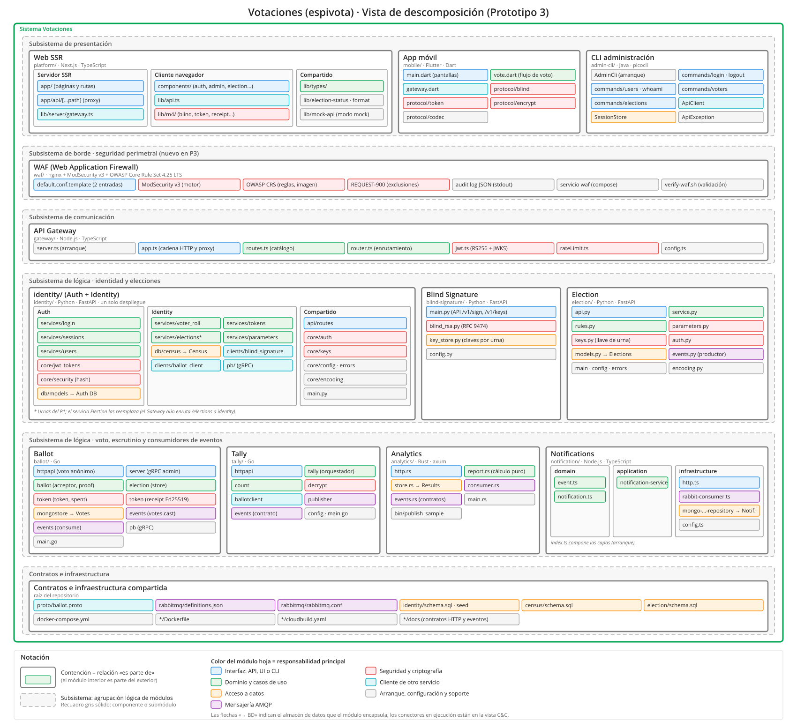

# Prototipo 3 — espivota

## Equipo

| Dato | Información |
|---|---|
| Equipo | Fabian Espitia y asociados |
| Nombre | 2c |

### Integrantes

| Nombre completo | Correo |
|---|---|
| Fabián Espitia Sotelo | [fespitia@unal.edu.co](mailto:fespitia@unal.edu.co) |
| Juan Sebastian Moya Alvarez | [umoyaa@unal.edu.co](mailto:umoyaa@unal.edu.co) |
| Sergio Nicolas Rey Mora | [sreym@unal.edu.co](mailto:sreym@unal.edu.co) |
| Kevin David Rodriguez Riveros | [kerodriguezr@unal.edu.co](mailto:kerodriguezr@unal.edu.co) |
| José Julián Pira Naranjo | [Jpira@unal.edu.co](mailto:Jpira@unal.edu.co) |
| Juan Camilo Camargo Prieto | [jucamargop@unal.edu.co](mailto:jucamargop@unal.edu.co) |
| Andrés Felipe Rosada Mosquera | [arosada@unal.edu.co](mailto:arosada@unal.edu.co) |
| Cristhian Yamith Cely Oliveros | [ccelyo@unal.edu.co](mailto:ccelyo@unal.edu.co) |

## Sistema de software

### espivota


**Repositorio:** [github.com/ccelyo/Votaciones](https://github.com/ccelyo/Votaciones)<br>
**Prototipo desplegado:** [espivota.vercel.app](https://espivota.vercel.app/)

espivota es un sistema web distribuido para administrar elecciones y recibir
votos electrónicos. Los administradores gestionan urnas, opciones y el padrón;
los votantes se autentican, consultan las elecciones disponibles y envían una
papeleta cifrada desde el navegador. El sistema separa la autenticación de la
recepción del voto: Identity conoce al votante, mientras que Ballot recibe el
token anónimo y la papeleta cifrada, y devuelve un recibo verificable. El
prototipo contempla autenticación con MFA, emisión de tokens mediante firma
ciega RSA (RFC 9474) y recibos firmados con Ed25519. En el prototipo 3 se
redisenó la arquitectura para responder a cinco escenarios de seguridad.

<!-- Secciones a cargo de otros integrantes: C&C, despliegue, capas,
     escenarios de seguridad 1, 2, 3 y 5, y desempeño general. -->

## Estructuras arquitectónicas

### Estructura de componentes y conectores (C&C)

_Pendiente._

### Estructura de despliegue

_Pendiente._

### Estructura por capas

_Pendiente._

### Estructura de descomposición



La vista de descomposición muestra cómo se divide el sistema en **módulos**
(unidades de implementación) y qué responsabilidad tiene cada uno. Es una vista
estática: no muestra procesos ni conectores en ejecución (eso es la vista C&C),
sino cómo está organizado el código del repositorio. Los nombres de los
componentes coinciden con los de la vista C&C para poder cruzar las dos vistas.

La jerarquía tiene cuatro niveles:

| Nivel | Elemento | En el repositorio |
|---|---|---|
| 0 | Sistema Votaciones (espivota) | El repositorio completo |
| 1 | Subsistema | Agrupación lógica de componentes (presentación, borde, comunicación, lógica, contratos) |
| 2 | Componente | Una carpeta de primer nivel con su propio `Dockerfile` o imagen (`ballot/`, `gateway/`, `waf/`, …) |
| 3 | Módulo y submódulo | Paquete o archivo de código (`internal/token`, `app/services/login.py`, …) |

#### Descripción de las relaciones

- **Es parte de (contención).** Es la única relación de la vista: cada módulo
  pertenece exactamente a un módulo padre, así que la descomposición forma un
  árbol. En el diagrama se representa anidando un recuadro dentro de otro.
- **Responsabilidad del módulo hoja (color).** No es una relación entre
  módulos. Indica la responsabilidad principal del módulo: interfaz, dominio,
  acceso a datos, mensajería, seguridad y criptografía, cliente de otro servicio
  o arranque y soporte. Así se ve en cada componente la división API → lógica →
  persistencia → eventos que pide el plan del prototipo.
- **Encapsula un almacén (`→ BD`).** Señala el único módulo de cada componente
  que accede a su base de datos. Ningún otro módulo, ni de otro componente,
  conoce esa base.
- **Usa.** En las tablas de abajo, la columna *Usa* indica de qué módulos del
  mismo componente depende cada uno (según sus `import`). Las dependencias entre
  componentes no pasan por código compartido: ocurren en ejecución por HTTP o
  AMQP y se documentan en la vista C&C.

#### Descripción de los elementos

##### Nivel 1: subsistemas

| Subsistema | Componentes | Responsabilidad |
|---|---|---|
| Presentación | Web SSR, App móvil, CLI administración | Interfaces de votante y administrador. Ciegan el token y cifran el voto en el cliente |
| Borde · seguridad perimetral | WAF | **Nuevo en P3.** Única puerta de entrada desde fuera: inspecciona cada petición HTTP con ModSecurity + OWASP CRS y bloquea las maliciosas antes de que lleguen a la Web SSR o al Gateway |
| Comunicación | API Gateway | Punto de entrada de la API, detrás del WAF: enrutamiento, validación de JWT, CORS y límites de tasa |
| Lógica: identidad y elecciones | identity (Auth + Identity), Blind Signature, Election | Usuarios y sesiones, padrón y elegibilidad, firma ciega de credenciales, ciclo de vida de las urnas |
| Lógica: voto, escrutinio y consumidores | Ballot, Tally, Analytics, Notifications | Recepción anónima del voto, escrutinio, analíticas y notificaciones a partir de eventos |
| Contratos e infraestructura | `proto/`, `rabbitmq/`, esquemas SQL, `docker-compose.yml` | Contratos compartidos entre componentes y su configuración de ejecución |

##### Nivel 2 y 3: componentes y módulos

**Web SSR** (`platform/`, Next.js · TypeScript). Se divide igual que en la vista C&C.

| Submódulo | Módulo | Responsabilidad | Usa |
|---|---|---|---|
| Servidor SSR | `app/` | Páginas y rutas: login, registro, panel de administración, votación y recibo | `components/`, `lib/server` |
| Servidor SSR | `app/api/[...path]/route.ts` | Proxy del navegador hacia el Gateway. Guarda la sesión en una cookie `httpOnly` y no reenvía la sesión en `/ballots` | `lib/server` |
| Servidor SSR | `lib/server/gateway.ts` | Cliente del API Gateway que solo se ejecuta en el servidor | — |
| Cliente navegador | `components/` | Componentes de UI por funcionalidad: `auth`, `admin`, `election`, `layout`, `m4`, `ui` | `lib/api.ts`, `lib/m4` |
| Cliente navegador | `lib/api.ts` | Cliente HTTP del navegador. Solo habla con el Servidor SSR | `lib/types` |
| Cliente navegador | `lib/m4/` | Protocolo de voto: `token` (sobre del token), `blind` (RSABSSA), `encryptor` (cifrado del voto), `receipt` (verificación del recibo), `tokenStore` (token en memoria), `api` (envío a Ballot) | — |
| Compartido | `lib/types/`, `lib/format.ts`, `lib/election-status.ts`, `lib/mock-api.ts` | Tipos de dominio, formato y estado de las urnas, y un modo *mock* para trabajar sin backend | — |

**App móvil** (`mobile/`, Flutter · Dart)

| Módulo | Responsabilidad | Usa |
|---|---|---|
| `lib/main.dart` | Pantallas: login, urnas abiertas, voto y recibo | `vote`, `gateway` |
| `lib/src/vote.dart` | Flujo del voto: pide el token con la sesión y envía la papeleta sin ella | `gateway`, `protocol` |
| `lib/src/gateway.dart` | Cliente del API Gateway, con un modo anónimo para la papeleta | — |
| `lib/src/protocol/` | `token` (mensaje canónico), `blind` (cegado RSA), `encrypt` (cifrado del voto), `codec` (base64url) | — |

**CLI administración** (`admin-cli/`, Java · picocli)

| Módulo | Responsabilidad | Usa |
|---|---|---|
| `AdminCli` | Punto de entrada y registro de subcomandos | `commands` |
| `commands/` | `login`, `logout`, `whoami`, `users`, `voters`, `elections`. Comparten la base `AdminCommand` | `ApiClient`, `SessionStore` |
| `ApiClient` | Cliente HTTP/JSON del Gateway (o de identity y Ballot) | `ApiException` |
| `SessionStore` | Persiste el JWT del administrador en `<home>/session.json` | — |
| `ApiException`, `NotLoggedInException` | Traducción de los errores de la API a mensajes de consola | — |

**WAF** (`waf/`, nginx · ModSecurity v3 · OWASP Core Rule Set 4.25 LTS). **Nuevo en P3.**
Se construye con la imagen oficial `owasp/modsecurity-crs` (versión fijada en
`docker-compose.yml`); el repositorio solo contiene la configuración propia del proyecto.

| Módulo | Responsabilidad | Usa |
|---|---|---|
| `waf/nginx/templates/conf.d/default.conf.template` | Dos entradas: `:3000 → platform:3000` (web) y `:8088 → gateway:8088` (API). Sobrescribe `X-Forwarded-For` con la IP real, limita el cuerpo a 1 MB y fija los *timeouts* | ModSecurity |
| ModSecurity v3 (de la imagen) | Motor del WAF dentro de nginx: analiza cabeceras, URI, argumentos y cuerpo JSON y aplica las reglas en las fases 1 y 2 | OWASP CRS |
| OWASP CRS (de la imagen) | Reglas genéricas de detección (SQLi 942xxx, XSS 941xxx, LFI 930xxx, RCE 932xxx, escáneres 913xxx…) con puntuación de anomalía | — |
| `waf/rules/REQUEST-900-EXCLUSION-RULES-BEFORE-CRS.conf` | Exclusiones propias del proyecto, cada una justificada por un falso positivo comprobado. Hoy está vacía: el flujo completo pasa sin exclusiones | OWASP CRS |
| Servicio `waf` en `docker-compose.yml` | Nivel de paranoia, umbrales de anomalía, métodos permitidos, modo `On`/`DetectionOnly` y registro de auditoría JSON | — |
| `docs/p3-waf/verify-waf.sh` | Validación: 16 ataques que deben dar 403 y 9 peticiones legítimas que deben pasar | — |

**API Gateway** (`gateway/`, Node.js · TypeScript)

| Módulo | Responsabilidad | Usa |
|---|---|---|
| `server.ts` | Arranque del servidor HTTP | `app`, `config` |
| `app.ts` | Cadena de cada petición: CORS → resolución de la ruta → límite de tasa → validación JWT según el acceso de la ruta → reenvío al servicio | `jwt`, `rateLimit`, `router`, `routes`, `config` |
| `routes.ts` | Catálogo de rutas hacia Auth, Election, Identity, Ballot, Tally, Analytics y Notifications, con su nivel de acceso (`public`, `user`, `admin` o `anonymous`) y su cuota | — |
| `router.ts` | Resuelve método y ruta contra el catálogo y sustituye los parámetros en la ruta del servicio | `routes` |
| `jwt.ts` | Valida el JWT RS256 de identity con su JWKS (`iss`, `aud`, expiración) | — |
| `rateLimit.ts` | Límite de tasa en memoria con ventana fija por cliente y cuota | `routes` |
| `config.ts` | Lee las URL de los servicios y las políticas de las variables de entorno | `routes`, `rateLimit` |

**identity** (`identity/`, Python · FastAPI). Un solo despliegue implementa los
componentes **Auth** e **Identity** de la vista C&C. Cada uno tiene su propia
base (Auth DB y Census) y su propio módulo de acceso a datos.

| Submódulo | Módulo | Responsabilidad | Usa |
|---|---|---|---|
| Auth | `services/login.py` | Login con contraseña y segundo factor (MFA) | `core/security`, `core/auth`, `db/models` |
| Auth | `services/sessions.py` | Sesiones y emisión del JWT de acceso | `core/auth`, `core/keys`, `db/models` |
| Auth | `services/users.py` | Alta, activación y listado de usuarios por el administrador | `core/security`, `db/models` |
| Auth | `core/jwt_tokens.py` | Firma RS256 del JWT y publicación del JWKS | `core/keys`, `core/encoding` |
| Auth | `core/security.py` | Hash y verificación de contraseñas | — |
| Auth | `db/models.py` | Modelo relacional de Auth DB (usuarios, sesiones, roles) | — |
| Identity | `services/voter_roll.py` | Padrón electoral: inscripción y consulta de votantes | `db/census`, `services/elections` |
| Identity | `services/tokens.py` | Emisión de la credencial anónima: comprueba la elegibilidad, reserva la emisión y pide la firma ciega | `clients/blind_signature`, `db/census`, `services/elections` |
| Identity | `services/elections.py` | Urnas del prototipo 1 (alta, apertura, cierre, estado)* | `clients/*`, `db/models` |
| Identity | `services/parameters.py` | Parámetros públicos de la elección y su firma Ed25519 | `clients/ballot_client` |
| Identity | `db/census.py` | Modelo de la base Census, separada de Auth DB | — |
| Identity | `clients/blind_signature.py` | Cliente REST de Blind Signature, con el secreto `X-Internal-Token` | `core/encoding` |
| Identity | `clients/ballot_client.py`, `pb/` | Cliente gRPC de la administración de Ballot (código generado desde `proto/`) | — |
| Compartido | `api/routes.py` | API REST/JSON: `/login`, `/tokens/blind`, `/users`, `/elections/*/voters`, `/.well-known/jwks.json`, … | `services/*`, `core/*` |
| Compartido | `core/auth.py`, `core/keys.py` | Autenticación de cada petición, y claves privadas (JWT y parámetros) | `core/errors` |
| Compartido | `core/config.py`, `core/errors.py`, `core/encoding.py`, `main.py` | Configuración, errores uniformes, base64url y arranque | — |

\* El servicio Election reemplaza a `services/elections.py`. Mientras el
Gateway siga enrutando `/elections` a identity, conviven los dos.

**Blind Signature** (`blind-signature/`, Python · FastAPI)

| Módulo | Responsabilidad | Usa |
|---|---|---|
| `main.py` | API interna: `POST /v1/sign`, `GET /v1/keys/{election_id}` (con `X-Internal-Token`) y `GET /health` | `key_store`, `blind_rsa`, `config` |
| `blind_rsa.py` | Lado servidor de la firma ciega RSA (RFC 9474, RSABSSA) | — |
| `key_store.py` | Una clave RSA por elección, creada la primera vez y guardada en el volumen de claves. La privada nunca sale del servicio | `blind_rsa` |
| `config.py` | Variables `BLINDSIG_*`. El secreto es obligatorio | — |

**Election** (`election/`, Python · FastAPI)

| Módulo | Responsabilidad | Usa |
|---|---|---|
| `api.py` | API REST/JSON: CRUD de urnas, `open`, `close`, parámetros y entrega de la llave privada de la urna a Tally | `service`, `auth`, `models`, `keys` |
| `service.py` | Casos de uso de la elección | `rules`, `models`, `keys`, `parameters` |
| `rules.py` | Reglas de negocio y ciclo de vida `draft → open → closed` con fases derivadas de la ventana de tiempo | `models`, `errors` |
| `parameters.py` | Parámetros públicos en JSON canónico firmados con Ed25519 | `encoding` |
| `keys.py` | Llave de la urna (RSA-OAEP-256 + A256GCM), cuya privada se cifra bajo una llave maestra, y llave de firma de los parámetros | — |
| `auth.py` | Permisos por rol (JWT, o cabeceras `X-Dev-*` en desarrollo) | `config`, `errors` |
| `models.py` | Modelo relacional de la base Elections | — |
| `events.py` | Productor de `election.created`, `election.opened` y `election.closed` | `models`, `encoding` |
| `main.py`, `config.py`, `errors.py`, `encoding.py` | Arranque, configuración, errores uniformes y codificación | — |

**Ballot** (`ballot/`, Go)

| Módulo | Responsabilidad | Usa |
|---|---|---|
| `internal/httpapi` | API pública y anónima: `POST /v1/ballots`, parámetros, resultados y papeletas selladas para Tally | `ballot`, `election`, `token` |
| `internal/server` | API gRPC privada de administración: registrar, cerrar y consultar urnas | `election`, `token` |
| `internal/ballot` | Lógica del voto: `acceptor` (valida y acepta la papeleta), `proof` (prueba de validez), `hash` (cadena de *hashes*), `tally` (conteo de resultados) | `token` |
| `internal/token` | `token` (verifica el token RFC 9474 de la urna), `spent` (gasto atómico, un voto por token), `receipt` (recibo Ed25519) | — |
| `internal/election` | Configuración y ciclo de vida de cada urna en Ballot | `token` |
| `internal/mongostore` | Adaptador MongoDB de la base Votes: papeletas anonimizadas y urnas | `ballot`, `election`, `token` |
| `internal/events` | Publica `votes.cast` y consume `election.created` y `election.closed` | `election` |
| `internal/pb`, `main.go` | Código gRPC generado. Arranque y cableado de los adaptadores (Mongo o memoria) | todos |

**Tally** (`tally/`, Go)

| Módulo | Responsabilidad | Usa |
|---|---|---|
| `internal/httpapi` | API interna: `POST` y `GET /v1/tally/elections/{id}` | `tally` |
| `internal/tally` | Orquesta un escrutinio: lee la urna cerrada → descifra → cuenta → publica, una sola vez por contenido | `ballotclient`, `decrypt`, `count`, `publisher`, `events` |
| `internal/ballotclient` | Cliente REST de Ballot: parámetros y papeletas cifradas | — |
| `internal/decrypt` | Descifra las papeletas con la llave privada de la urna | — |
| `internal/count` | Aplica las reglas de conteo y separa los votos nulos | `decrypt` |
| `internal/events`, `internal/publisher` | Contrato de `tally.completed` y publicación con confirmación del *broker* | `events` |
| `internal/config`, `main.go` | Configuración y arranque | todos |

**Analytics** (`analytics/`, Rust · axum)

| Módulo | Responsabilidad | Usa |
|---|---|---|
| `http.rs` | API REST/JSON: `/v1/analytics/summary`, `/v1/analytics/elections`, … | `report`, `store` |
| `consumer.rs` | Consumidor RabbitMQ: declara la cola `analytics.events` con su DLQ y aplica cada evento | `events`, `store` |
| `events.rs` | Contratos de los eventos consumidos (`election.*`, `census.updated`, `votes.cast`, `tally.completed`) | — |
| `report.rs` | Cálculo puro de las analíticas de una elección cerrada, sin E/S | `events` |
| `store.rs` | Persistencia en la base MongoDB Results | `events`, `report` |
| `main.rs`, `bin/publish_sample.rs` | Arranque, y una herramienta que publica eventos de ejemplo | — |

**Notifications** (`notification/`, Node.js · TypeScript)

| Submódulo | Módulo | Responsabilidad | Usa |
|---|---|---|---|
| `domain` | `event.ts`, `notification.ts` | Eventos de entrada, la entidad notificación y el puerto `NotificationRepository` | — |
| `application` | `notification-service.ts` | Convierte cada evento en una notificación mediante *handlers* por tipo de evento | `domain` |
| `infrastructure` | `rabbit-consumer.ts` | Consumidores por *exchange* (`election`, `identity`, `votes`, `tally`) con DLQ | — |
| `infrastructure` | `mongo-notification-repository.ts` | Adaptador MongoDB de la base Notif. record | `domain` |
| `infrastructure` | `http.ts`, `config.ts` | API REST de consulta y configuración | `domain` |
| — | `index.ts` | Raíz de composición: conecta la infraestructura con la aplicación | todos |

**Contratos e infraestructura compartida**

| Módulo | Responsabilidad |
|---|---|
| `proto/ballot.proto` | Contrato gRPC `BallotAdminService` entre identity y Ballot |
| `rabbitmq/definitions.json`, `rabbitmq.conf` | Topología del *broker*: *exchanges* duraderos, colas, DLQ y *bindings* |
| `identity/schema.sql`, `census/schema.sql`, `election/schema.sql` | Esquemas de Auth DB, Census y Elections. Los carga PostgreSQL al iniciar |
| `docker-compose.yml`, `*/Dockerfile`, `*/cloudbuild.yaml` | Construcción y ejecución de cada componente. Desde P3 solo el WAF publica los puertos de la web y de la API |
| `*/docs/`, `analytics/CONTRACTS.md` | Contratos HTTP y de eventos de cada componente |

#### Descripción de los patrones arquitectónicos

- **Descomposición por capacidad de negocio (microservicios).** Cada componente
  de nivel 2 corresponde a una capacidad (autenticar, emitir credenciales,
  firmar a ciegas, administrar urnas, recibir votos, escrutar, analizar,
  notificar). Es una carpeta independiente, con su lenguaje, sus pruebas y su
  imagen de contenedor, así que se construye y despliega sin tocar las demás.
- **Base de datos por servicio y ocultamiento de información.** Solo un módulo
  por componente accede a su almacén (`db/models`, `db/census`, `models.py`,
  `mongostore`, `store.rs`, `mongo-notification-repository`). El esquema queda
  oculto detrás de ese módulo y ningún otro componente lo importa.
- **Capas dentro de cada servicio.** Los servicios Python separan API
  (`api/routes.py`, `api.py`) → casos de uso (`services/`, `service.py`,
  `rules.py`) → acceso a datos (`db/`, `models.py`). Las dependencias van
  siempre hacia abajo.
- **Puertos y adaptadores (hexagonal).** El dominio define interfaces y la
  infraestructura las implementa. En Notifications, `domain`, `application` e
  `infrastructure` están separados y `index.ts` hace de raíz de composición. En
  Ballot, `ballot.CommitStore`, `ballot.VoteReader` y `ballot.SealedBallotReader`
  son puertos que implementan `mongostore` o un adaptador en memoria para las
  pruebas.
- **Web Application Firewall (filtro interceptor en el borde).** Nuevo en P3.
  La inspección de contenido malicioso es un componente aparte, `waf/`, que se
  configura y no se programa. Ningún servicio tiene que validar ataques genéricos
  (SQLi, XSS, *path traversal*): se resuelven una sola vez, delante de todos. Las
  reglas del proveedor (CRS) y las exclusiones del proyecto están separadas, así
  que se puede actualizar el CRS sin tocar la configuración propia.
- **API Gateway y Backend for Frontend.** Detrás del WAF, el Gateway es el único
  módulo con política transversal de la API (`jwt.ts`, `rateLimit.ts`). El *route handler*
  `app/api/[...path]` del Servidor SSR es el BFF de la web: el navegador nunca
  conoce la URL del Gateway ni ve el token de sesión.
- **Publicar-suscribir.** La mensajería vive en módulos propios
  (`events.py`, `internal/events`, `internal/publisher`, `consumer.rs`,
  `rabbit-consumer.ts`), separados de la lógica, y los contratos de eventos se
  versionan junto al código (`docs/`, `CONTRACTS.md`, `events.rs`).
- **Orquestador y tubería en Tally.** `internal/tally` coordina pasos que no se
  conocen entre sí: `ballotclient` → `decrypt` → `count` → `publisher`.
- **Separación entre identidad y voto.** Los módulos que conocen al votante
  (`db/census`, `services/tokens`) y los que reciben el voto (`internal/token`,
  `internal/ballot`) están en componentes distintos. La criptografía de la
  credencial se reparte entre el cliente (`lib/m4`, `protocol/`), Blind
  Signature (`blind_rsa`, `key_store`) y Ballot (`token`, `receipt`), de modo
  que ningún módulo puede unir un voto con un votante.

#### Coherencia con el código actual

- Auth e Identity son componentes separados en la vista C&C, pero hoy se
  despliegan juntos en `identity/`. La descomposición en submódulos (`Auth`,
  `Identity`) y sus bases separadas permite extraer Auth a otro servicio sin
  reorganizar el código.
- El WAF no tiene código propio, solo configuración. Su lógica (ModSecurity y
  CRS) viene de una imagen de terceros con versión fijada.
- La vista C&C del prototipo 2 solo usa REST y AMQP, pero `proto/` y los
  módulos `pb/`, `clients/ballot_client.py` e `internal/server` mantienen
  todavía el canal gRPC de administración entre identity y Ballot.

## Atributos de calidad

### Seguridad

#### Escenario 1: Secure Channel

_Pendiente._

#### Escenario 2: Reverse Proxy

_Pendiente._

#### Escenario 3: Network Segmentation

_Pendiente._

#### Escenario 4: Web Application Firewall

**Problema de diseño.** Hasta el prototipo 2, la Web SSR (`:3000`) y el API
Gateway (`:8088`) se publicaban directamente al exterior. El Gateway valida el
JWT y limita la tasa de peticiones, pero no inspecciona el contenido. Una
petición con una inyección SQL en un parámetro, un *script* en un campo JSON o un
`../../etc/passwd` en la ruta llegaba tal cual a Identity, Election, Ballot o
Analytics, y la defensa dependía de que cada servicio, escrito en un lenguaje
distinto (Python, Go, Rust, TypeScript), validara bien sus entradas.

**Escenario de calidad**

| Parte | Descripción |
|---|---|
| Fuente | Atacante externo, anónimo o con una cuenta de votante, o una herramienta automática de escaneo (sqlmap, Nikto) |
| Estímulo | Petición HTTP con contenido malicioso: inyección SQL, XSS, *path traversal* o inclusión de archivos, inyección de comandos, JNDI (Log4Shell) o firma de un escáner |
| Artefacto | Puntos de entrada públicos: la Web SSR y el API Gateway, y los servicios de lógica detrás de ellos |
| Entorno | Operación normal, con elecciones abiertas y votantes usando la web, la app móvil y la CLI |
| Respuesta | El WAF de borde detecta la petición, la bloquea con `403 Forbidden` antes de que llegue a la Web SSR o al Gateway y la registra en el log de auditoría con el ID de las reglas que se activaron |
| Medida | 16 de 16 ataques de prueba bloqueados (100 %), 0 de 9 peticiones legítimas bloqueadas, el flujo de voto completo (`docs/demo/e2e_vote.py`) sin falsos positivos, ninguna petición maliciosa en el log del Gateway y unos 5 ms de latencia adicional por petición |

**Táctica aplicada (resistir ataques / detectar ataques)**

- **Detectar intrusiones.** Cada petición se compara con firmas y patrones de
  ataques conocidos (OWASP Core Rule Set) y recibe una puntuación de anomalía.
- **Validar la entrada.** Se aplica una validación genérica y común a todos los
  servicios, adicional a la validación propia de cada uno (defensa en profundidad).
- **Limitar la exposición.** Platform y Gateway dejan de publicar puertos. El WAF
  es el único componente alcanzable desde fuera para la web y la API.
- **Mantener un registro de auditoría.** Cada bloqueo queda en un registro JSON
  con la petición y los IDs de las reglas (`docker compose logs waf`).

**Patrón aplicado: Web Application Firewall**

Un componente intermediario, en el borde de la red, intercepta todo el tráfico
HTTP hacia la aplicación y lo filtra antes de que llegue a ella (filtro
interceptor). Se implementó con la imagen oficial `owasp/modsecurity-crs`
(nginx + ModSecurity v3 + OWASP CRS 4.25 LTS):

```
Navegador / app móvil / CLI
        │  :3000           │  :8088
        ▼                  ▼
┌─────────────── WAF (waf) ───────────────┐
│ ModSecurity + OWASP CRS, paranoia 1     │──► 403 + audit log
│ umbral de anomalía de entrada = 5       │
└──────┬──────────────────────┬───────────┘
       ▼                      ▼
 Web SSR (platform:3000)  API Gateway (gateway:8088) ──► servicios
       └── SSR/BFF (red interna) ──┘
```

- **Modo de bloqueo por puntuación de anomalía.** Cada regla del CRS que coincide
  suma puntos (crítica = 5). Si la petición alcanza el umbral de entrada (5), la
  regla 949110 la bloquea. Con el nivel de paranoia 1 se reducen los falsos
  positivos; está pensado para producción.
- **Sin falsos positivos y sin exclusiones.** Las papeletas cifradas, los tokens
  cegados (base64url), los JWT y las cookies de sesión pasaron sin ajustes.
  `waf/rules/REQUEST-900-EXCLUSION-RULES-BEFORE-CRS.conf` queda listo para
  exclusiones futuras, cada una justificada por un falso positivo comprobado.
- **IP real del cliente.** El WAF sobrescribe `X-Forwarded-For` con la IP de la
  conexión, así que un cliente no puede falsificarla para evadir el límite de tasa
  del Gateway, que confía en esa cabecera.
- **Modo de afinación.** `WAF_RULE_ENGINE=DetectionOnly docker compose up` solo
  registra, sin bloquear.

**Validación** (`bash docs/p3-waf/verify-waf.sh`, detalle en
[`docs/p3-waf/README.md`](../../p3-waf/README.md))

| Ataque | Ejemplo | Resultado | Reglas CRS que se activan |
|---|---|---|---|
| SQLi | `?id=1' OR '1'='1`, `UNION SELECT`, `admin' OR 1=1--` en JSON | 403 | 942100, 942190, 942270, 942350, 942360 |
| XSS | `<script>alert(1)</script>`, `` en JSON, `<svg/onload=…>` en la web | 403 | 941100, 941110, 941120, 941160, 941180, 941390 |
| *Path traversal* / LFI | `/api/elections/open/../../../etc/passwd`, `..%2f..%2f`, `/.env` | 403 | 930100, 930110, 930120, 930130 |
| Inyección de comandos | `;cat /etc/passwd`, `$(curl …\|sh)` en JSON | 403 | 932130, 932160, 932235, 932250 |
| Log4Shell | `${jndi:ldap://…}` en una cabecera | 403 | 944150 |
| Escáneres | `User-Agent: sqlmap`, `Nikto` | 403 | 913100 |
| SSRF / RFI | `?page=http://169.254.169.254/…` | 403 | 931100, 934110 |
| Legítimo | catálogo, salud, elecciones abiertas, login (también con contraseña con símbolos), páginas web, BFF | 200 / 401 | — |

#### Escenario 5: Role-Based Access Control (RBAC)

**Problema de diseño.** En el prototipo 2, la autorización de Identity se
reducía a una dependencia, `require_admin`, que solo comprobaba si el rol era
`admin`. Gestionar usuarios, modificar el padrón y cerrar una urna exigían la
misma condición, y no había un lugar único donde leer qué puede hacer cada rol. La
lista de roles asignables estaba duplicada en `services/users.py`. Las rutas del
votante (`/tokens/blind`, `/vote-confirmation`, `/eligibility`, `/parameters`)
aceptaban cualquier sesión, incluso la de un rol que no existe en el modelo, en
vez de denegar por defecto. Además, ninguna prueba comprobaba que cada ruta
estuviera clasificada, así que un endpoint nuevo podía quedar sin protección.

**Escenario de calidad**

| Parte | Descripción |
|---|---|
| Fuente | Usuario interno con rol `voter` que ya inició sesión con contraseña y MFA y tiene un JWT RS256 vigente |
| Estímulo | Intenta una operación administrativa sobre el padrón: consultarlo (`GET /elections/{id}/voters`), inscribirse (`POST …/voters`) o cambiar la elegibilidad de otro votante (`PATCH …/voters/{user_id}`). Variantes: alterar el claim `role` del token, enviar `X-User-Roles: admin` o `X-Dev-Roles: admin`, o usar un rol que no existe en el catálogo |
| Artefacto | Capa de autorización de Identity (`core/auth.py`, `core/permissions.py`) que protege las rutas de `api/routes.py`, y los datos de Census y de Auth DB |
| Entorno | Operación normal, con la autenticación de desarrollo desactivada (`IDENTITY_DEV_AUTH=false`). La petición llega por WAF → Gateway → Identity o directamente a Identity desde la red interna |
| Respuesta | Identity valida el JWT y la sesión, toma el rol de la base de datos y comprueba que tenga el permiso de la ruta. Sin el permiso responde `403 forbidden` sin ejecutar la operación; con un token inválido o una sesión revocada responde `401 unauthenticated` |
| Medida | 11 de 11 operaciones administrativas intentadas por un votante rechazadas con 403 (100 %), las 15 rutas protegidas responden 401 sin token y, tras los intentos denegados, padrón, usuarios, urnas y credenciales emitidas quedan idénticos y Ballot no recibe ninguna orden. Lo verifican 47 pruebas automatizadas; la suite de Identity queda en 140/140 |

**Táctica aplicada (resistir ataques / autorizar actores)**

- **Autorizar actores.** Cada operación protegida exige un permiso explícito y se
  evalúa en Identity, aunque el Gateway ya haya aplicado su propio control por rol
  (defensa en profundidad).
- **Mínimo privilegio y denegación por defecto.** El rol `voter` solo puede
  participar en la votación sobre sí mismo. Un rol que no está en el catálogo no
  tiene permisos.
- **No confiar en el cliente.** El rol se lee de la base de datos al validar la
  sesión, no del claim del JWT ni de cabeceras. Un token manipulado pierde la
  firma y `X-User-Roles` o `X-Dev-Roles` no tienen efecto.

**Patrón aplicado: Role-Based Access Control**

Se pasó de comprobar un rol a comprobar un permiso, con un mapa central rol →
permisos en el servidor. No hubo migración de base de datos ni cambios en el
formato del JWT.

```
Petición ──► get_principal ──► require_permission(p) ──► ruta
             JWT RS256 +        rol de la BD → permisos    (solo si se
             sesión en BD       p ∉ permisos → 403          autoriza)
             inválido → 401
```

- `Permission` ([`core/permissions.py`](../../../identity/app/core/permissions.py)):
  catálogo de permisos. Cada uno corresponde a operaciones que existen en
  `api/routes.py`.
- `ROLE_PERMISSIONS`: mapa de solo lectura rol → permisos, única fuente de verdad.
  Los roles asignables (`ROLES`) se derivan de él.
- `permissions_for(roles)`: une los permisos de los roles del actor. Un rol
  desconocido no aporta ninguno.
- `require_permission(p)` ([`core/auth.py`](../../../identity/app/core/auth.py)):
  dependencia de FastAPI que reutiliza la autenticación existente (`get_principal`)
  y exige `p`. Se resuelve antes de validar el cuerpo y de ejecutar la ruta: una
  petición denegada nunca llega a la operación protegida. `require_admin` se
  conserva por compatibilidad, aunque las rutas ya no lo usan.

| Permiso | Operaciones | `admin` | `voter` |
|---|---|:-:|:-:|
| `users:read` | `GET /users` | ✔ | — |
| `users:write` | `POST /users`, `PATCH /users/{id}` | ✔ | — |
| `census:read` | `GET /elections/{id}/voters` | ✔ | — |
| `census:write` | `POST /elections/{id}/voters`, `PATCH /elections/{id}/voters/{user_id}` | ✔ | — |
| `elections:read` | `GET /elections`, `GET /elections/{id}/status` | ✔ | — |
| `elections:manage` | `POST /elections`, `POST /elections/{id}/open`, `POST /elections/{id}/close` | ✔ | — |
| `voting:participate` | `GET /elections/{id}/parameters`, `GET /elections/{id}/eligibility`, `POST /tokens/blind`, `POST /vote-confirmation` | ✔ (\*) | ✔ |

Rutas sin permiso adicional:
- **Públicas:** login, MFA, `GET /elections/open`, JWKS, `GET /keys` y salud.
- **Solo sesión:** `GET /auth/me` y `POST /logout`, que operan sobre la propia sesión.

(\*) Decisión de compatibilidad: en el prototipo 2, un administrador inscrito en
el padrón podía votar, y se mantuvo así. Aplicar separación de funciones entre
administrar y votar es quitar una línea de `ROLE_PERMISSIONS`, pendiente de
decisión del grupo. El padrón y la regla de una credencial por votante y elección
aplican igual a ambos roles.

**Implementación en Identity**

| Archivo | Responsabilidad |
|---|---|
| `identity/app/core/permissions.py` (nuevo) | Catálogo `Permission`, `ROLE_PERMISSIONS`, `ROLES`, `permissions_for` y `has_permission` |
| `identity/app/core/auth.py` | `require_permission`, sobre `get_principal`; conserva `require_admin` |
| `identity/app/api/routes.py` | Las 11 rutas de administración y las 4 del votante declaran su permiso; su lógica no cambia |
| `identity/app/services/users.py` | Valida el rol de un usuario nuevo con `ROLES` del catálogo |
| `identity/tests/test_rbac.py` (nuevo) | 47 pruebas del escenario con JWT reales (login + MFA) y `dev_auth=False` |
| `identity/README.md` | Permiso de cada endpoint y sección de RBAC |

**Validación** (`cd identity && uv run pytest -q`; detalle en
[`escenario-5-rbac-kevin.md`](escenario-5-rbac-kevin.md))

Las 93 pruebas que ya existían pasan sin cambios; con las 47 nuevas la suite de
Identity queda en **140/140**. Las pruebas nuevas no usan cabeceras de desarrollo:
cada actor obtiene su JWT con login y MFA, así que se ejercitan la firma, la sesión,
el rol de la base de datos y el permiso.

| Caso | Prueba | Resultado |
|---|---|---|
| Ruta sin clasificar | `test_every_route_declares_the_expected_permission` compara cada ruta del router con el permiso esperado | Falla si una ruta nueva no declara permiso |
| Sin sesión | 15 rutas protegidas sin token | 401 |
| JWT inválido o rol manipulado | Texto arbitrario, segmentos falsos, `alg: none`, token de votante con `role` cambiado a `admin` | 401 |
| Sesión revocada | Token de admin después de `POST /logout` | 401 |
| Cabeceras falsificadas | `X-Dev-*` con `dev_auth` desactivado; `X-User-Roles: admin` y `X-Dev-Roles: admin` junto a un Bearer de votante | 401 / 403 |
| Votante en operaciones de administración | 11 operaciones (usuarios, urnas, padrón) | 403 |
| Rol desconocido | Rol `auditor` creado por SQL, y roles mal escritos (`ADMIN`, `admin `, vacío) | 403 (solo consulta su propia sesión) |
| Integridad ante denegación | 6 intentos de modificación del votante | 403; padrón, usuarios, urnas y credenciales idénticos; Ballot sin órdenes |
| Operación permitida | Admin en todas sus operaciones; votante completa el flujo de voto | 200 / 201 |

Como prueba de mutación, se cambió a mano el permiso de
`GET /elections/{id}/voters` de `census:read` a `voting:participate`, lo que
expondría el padrón a cualquier votante. Fallaron tres pruebas, y al restaurarlo la
suite volvió a pasar. También se verificó que un votante que envía un cuerpo
inválido a una ruta administrativa recibe 403 y no 422: la autorización va antes
que la validación del cuerpo.

**Integridad y anonimato del voto.** El cambio solo actúa en la zona de identidad:

- No se modificaron la emisión de la credencial (`services/tokens.py`), el cliente
  y el servicio Blind Signature, `core/jwt_tokens.py`, `services/sessions.py` ni el
  contrato de parámetros firmados.
- Las rutas del votante solo añaden la comprobación de `voting:participate`.
  Blind Signature sigue recibiendo únicamente `election_id` y el mensaje cegado.
  Identity no guarda el mensaje cegado, la firma ni el token, y Census conserva solo
  el día de emisión. Las pruebas que ya cubrían esas propiedades siguen pasando.
- No se agregó ningún registro con marcas de tiempo de emisión o confirmación que
  permita cruzarlas con la llegada de papeletas a Ballot.
- `test_voter_completes_the_anonymous_flow_with_a_real_session` recorre el flujo
  completo con un JWT real: elegibilidad, parámetros, cegado, firma ciega,
  verificación de la credencial y confirmación.

**Limitaciones y pendientes de coordinación.** Estos puntos están identificados
pero **no resueltos**. Los dos primeros corresponden al Gateway y quedan por
coordinar con Sergio (escenario 2):

1. **Revocación en el Gateway.** El Gateway valida el JWT sin estado y acepta un
   token revocado, o de un usuario desactivado, hasta su `exp` (1 h). Identity lo
   rechaza en sus rutas. En cambio, las operaciones administrativas que el Gateway
   envía a servicios sin autorización propia (escrutinio en Tally, `recompute` en
   Analytics) lo siguen aceptando durante esa ventana.
2. **Rutas administrativas fuera del Gateway.** `POST /users`, `PATCH /users/{id}`
   y `POST /elections/{id}/open` existen en Identity, protegidas por permiso, pero
   no están en el catálogo del Gateway. La CLI de administración las invoca
   directamente sobre Identity, sin pasar por el WAF ni por el Gateway.
3. Fuera del alcance de este escenario:
   - Tally y Analytics delegan toda la autorización en el Gateway.
   - El servicio Election mantiene `ELECTION_DEV_AUTH=true` (solo en loopback).
   - El canal gRPC de administración hacia Ballot no tiene autenticación.
   - Los permisos se aplican dentro de Identity; el Gateway sigue autorizando por rol.

### Desempeño y escalabilidad

_Pendiente: análisis general del equipo._

#### Costo del WAF

Se midió con k6 la ruta *Ver elecciones abiertas* (`GET /api/elections/open`),
el mismo script del laboratorio 6. Se comparó la llamada directa al Gateway
(dentro de la red de Docker) con la llamada a través del WAF. Cada corrida duró
30 s con el límite de tasa desactivado (`docs/lab6-performance/docker-compose.perf.yml`).

| VUs | Ruta | avg (ms) | mediana (ms) | p95 (ms) | req/s | errores |
|---:|---|---:|---:|---:|---:|---:|
| 1 | Gateway directo | 8,0 | 7,1 | 14,8 | 1,0 | 0 % |
| 1 | WAF → Gateway | 13,1 | 13,9 | 18,0 | 1,0 | 0 % |
| 50 | Gateway directo | 15,3 | 10,5 | 48,2 | 48,9 | 0 % |
| 50 | WAF → Gateway | 19,8 | 15,0 | 49,6 | 48,5 | 0 % |

El WAF agrega unos **5 ms** por petición (salto de red adicional e inspección
de reglas), mantiene el mismo *throughput* y no produce errores con 50 VUs, que
es la rodilla medida en el laboratorio 6. El cuello de botella sigue siendo
Identity y su *pool* de conexiones, no el borde.

