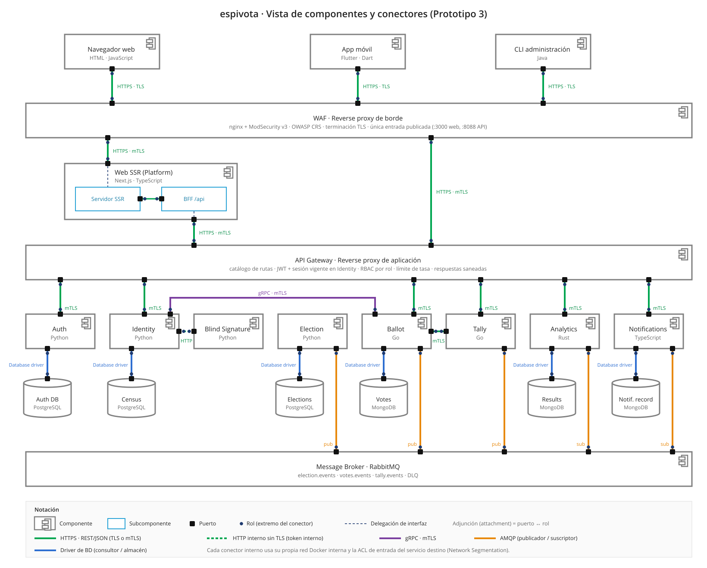
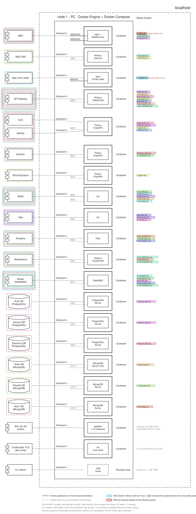

# Prototipo 3 — espivota

## Equipo

| Dato | Información |
|---|---|
| Equipo | Fabian Espitia y asociados |
| Nombre | 2c |

### Integrantes

| Nombre completo | Correo |
|---|---|
| Fabián Espitia Sotelo | [fespitia@unal.edu.co](mailto:fespitia@unal.edu.co) |
| Juan Sebastian Moya Alvarez | [umoyaa@unal.edu.co](mailto:umoyaa@unal.edu.co) |
| Sergio Nicolas Rey Mora | [sreym@unal.edu.co](mailto:sreym@unal.edu.co) |
| Kevin David Rodriguez Riveros | [kerodriguezr@unal.edu.co](mailto:kerodriguezr@unal.edu.co) |
| José Julián Pira Naranjo | [Jpira@unal.edu.co](mailto:Jpira@unal.edu.co) |
| Juan Camilo Camargo Prieto | [jucamargop@unal.edu.co](mailto:jucamargop@unal.edu.co) |
| Andrés Felipe Rosada Mosquera | [arosada@unal.edu.co](mailto:arosada@unal.edu.co) |
| Cristhian Yamith Cely Oliveros | [ccelyo@unal.edu.co](mailto:ccelyo@unal.edu.co) |

## Sistema de software

### espivota


**Repositorio:** [github.com/ccelyo/Votaciones](https://github.com/ccelyo/Votaciones)<br>
**Prototipo desplegado:** [espivota.vercel.app](https://espivota.vercel.app/)

espivota es un sistema web distribuido para administrar elecciones y recibir
votos electrónicos. Los administradores gestionan urnas, opciones y el padrón;
los votantes se autentican, consultan las elecciones disponibles y envían una
papeleta cifrada desde el navegador. El sistema separa la autenticación de la
recepción del voto: Identity conoce al votante, mientras que Ballot recibe el
token anónimo y la papeleta cifrada, y devuelve un recibo verificable. El
prototipo contempla autenticación con MFA, emisión de tokens mediante firma
ciega RSA (RFC 9474) y recibos firmados con Ed25519. En el prototipo 3 se
redisenó la arquitectura para responder a cinco escenarios de seguridad.

## Estructuras arquitectónicas

### Estructura de componentes y conectores (C&C)



La vista C&C describe el sistema **en ejecución**: qué componentes intercambian mensajes, por qué canal y con qué controles de seguridad. El Prototipo 3 conserva los componentes funcionales del Prototipo 2 y añade un **borde de seguridad** (WAF y *reverse proxy*) delante de la Web SSR y del Gateway. Los otros cuatro escenarios no crean servicios nuevos: modifican los conectores y la posición de los componentes existentes.

La figura se lee de arriba hacia abajo:

1. **Clientes** de presentación: navegador/Web SSR, app móvil y CLI de administración.
2. **Borde**: WAF con TLS, inspección HTTP y bloqueo; es la única entrada publicada para la web y la API.
3. **Aplicación**: Platform (SSR/BFF) y API Gateway, sin puertos en el host.
4. **Servicios de dominio**: Auth, Identity, Blind Signature, Ballot, Election, Tally, Analytics y Notifications.
5. **Datos y mensajería**: una base por servicio y RabbitMQ para eventos de dominio.

Los nombres de los componentes coinciden con los de la vista de descomposición. La correspondencia con contenedores concretos está en [la vista de despliegue](#estructura-de-despliegue).

#### Descripción de los elementos

| Elemento | Tipo | Tecnología | Responsabilidad | Papel en la seguridad |
|---|---|---|---|---|
| **Cliente navegador / Web SSR** | Componente de presentación | Next.js · TypeScript | Interfaz web, renderizado en servidor y BFF; el cliente cifra el voto antes de enviarlo | Usa HTTPS contra el WAF y acepta la CA de desarrollo; el servidor SSR reenvía al Gateway por mTLS |
| **App móvil** | Componente de presentación | Flutter · Dart | Cliente de votación para Android/web; consume la API del Gateway | HTTPS con validación del servidor; la API se obtiene por el WAF; el estático se sirve desde `mobile` |
| **CLI de administración** | Componente de presentación | Java | Operaciones administrativas y consulta de resultados | JWT de administrador y HTTPS con `VOTACIONES_TLS_CA_FILE`; solo usa rutas `/api/...` por WAF → Gateway (`ApiClient` rechaza las demás); no debe recibir datos del votante |
| **WAF de borde** | Componente de borde | nginx + ModSecurity v3 + OWASP CRS 4.25 LTS | *Reverse proxy* de la web y de la API; inspecciona, bloquea y audita cada petición HTTP | Termina TLS, aplica CRS, devuelve `403` y registra el ID de regla; sobrescribe `X-Forwarded-For` |
| **Platform** | Componente de aplicación | Next.js · TypeScript | Web SSR y BFF; compone la interfaz y delega la API en el Gateway | mTLS hacia Gateway; no publica puertos; recibe TLS del WAF |
| **API Gateway** | Componente de comunicación | Node.js · TypeScript | Punto único de entrada a la API y *reverse proxy* de aplicación; enruta, valida JWT RS256/JWKS, comprueba la sesión vigente en Identity, aplica roles y límite de tasa y sanea las respuestas | RBAC de borde (`public`, `user`, `admin`, `anonymous`) con el rol vigente de Identity, y mTLS hacia los servicios |
| **Auth** | Componente de identidad | Python · FastAPI | Login, MFA, sesiones, emisión y revocación de JWT, directorio de usuarios | Rutas públicas de login y rutas `admin`/`user`; forma parte del contenedor `identity` |
| **Identity** | Componente de identidad | Python · FastAPI | Padrón, elegibilidad, tokens ciegos, confirmación de voto y autorización granular | `require_permission` con rol leído de la base; **deny by default**; forma parte del contenedor `identity` |
| **Blind Signature** | Componente criptográfico | Python | Firma ciega del token (RFC 9474); no conoce al votante | Solo accesible desde Identity; canal interno HTTP con `X-Internal-Token` (sin TLS en P3; ver limitaciones) |
| **Ballot** | Componente de dominio | Go | Registro anónimo de papeletas, parámetros y resultados agregados; API HTTP y gRPC | mTLS en HTTP y en gRPC; la ruta del Gateway es `anonymous` y no reenvía credenciales |
| **Election** | Componente de dominio | Python | Ciclo de vida de las urnas, llaves y publicación de `election.events` | HTTPS/mTLS; en la configuración actual el Gateway aún envía `/elections` a Identity |
| **Tally** | Componente de dominio | Go | Escrutinio asíncrono, verificación y publicación de `tally.completed` en `tally.events` | HTTPS/mTLS; el disparo es `admin` en el Gateway; descarga papeletas de Ballot con token |
| **Analytics** | Componente de dominio | Rust | Proyecciones, participación y recálculo de resultados | HTTPS/mTLS; `recompute` es `admin`; consume eventos de RabbitMQ |
| **Notifications** | Componente de dominio | TypeScript | Avisos a votantes y administradores | HTTPS/mTLS; consume eventos; su ruta en el Gateway es provisional |
| **Auth DB / Census** | Almacén | PostgreSQL | Usuarios, sesiones y padrón electoral | Solo `identity` en `identity-data-net`; sin puerto en el host |
| **Elections DB** | Almacén | PostgreSQL | Urnas y estado electoral | Solo `election` en `election-data-net` |
| **Votes DB** | Almacén | MongoDB | Papeletas cifradas y recibos | Solo `ballot` en `ballot-data-net` |
| **Results DB** | Almacén | MongoDB | Proyecciones e informes | Solo `analytics` en `results-data-net` |
| **Notifications DB** | Almacén | MongoDB | Historial de avisos | Solo `notification` en `notif-data-net` |
| **RabbitMQ** | Infraestructura de mensajería | RabbitMQ 4 | Exchanges, colas y *dead-letter queues* de eventos de dominio | AMQP interno; UI de gestión solo en `127.0.0.1:15672`; sin puerto AMQP en el host |

#### Descripción de las relaciones

La tabla distingue **conectores síncronos** (HTTP/HTTPS, gRPC) de **conectores asíncronos** (AMQP) y anota la red de Docker que los habilita. `internal: true` significa que la red no tiene salida a Internet ni al host.

| Desde → Hasta | Conector | Red | Seguridad / patrón | Observación |
|---|---|---|---|---|
| Navegador → WAF | HTTPS/TLS 1.2–1.3, puerto de host `:3000` | `edge-net` | Secure Channel + Reverse Proxy | El WAF presenta su certificado; el navegador valida la CA |
| App móvil → WAF | HTTPS/TLS, puerto de host `:8088` | `edge-net` | Secure Channel + Reverse Proxy | La API móvil pasa por el WAF |
| CLI → WAF | HTTPS/TLS + JWT, puerto de host `:8088` | `edge-net` | Secure Channel + RBAC | La CLI confía en la CA local; el token no se envía a Ballot |
| WAF → Platform | HTTPS :3000, mTLS | `waf-web-net` | Reverse Proxy + mTLS | WAF reenvía la web; Platform no publica puertos |
| WAF → Gateway | HTTPS :8088, mTLS | `waf-api-net` | Reverse Proxy + mTLS | WAF reenvía la API; el Gateway no publica puertos |
| Platform → Gateway | HTTPS :8088, mTLS | `frontend-net` | BFF/SSR + Secure Channel | El servidor SSR usa el Gateway en nombre del navegador |
| Gateway → Identity/Auth | HTTPS :8000, mTLS; JWKS | `gw-identity-net` | API Gateway + Reverse Proxy + Secure Channel | Login, MFA, sesión, padrón y permisos; `/api/auth/*`; además, `GET /auth/me` para comprobar la sesión antes de reenviar rutas `user`/`admin` (caché ≤ 5 s) |
| Gateway → Election | HTTPS :8000, mTLS | `gw-election-net` (prevista) | API Gateway + Secure Channel | **Ruta no activa:** `GATEWAY_ELECTION_URL` apunta hoy a `identity:8000`; ver hallazgo |
| Gateway → Ballot | HTTPS :8080, mTLS | `gw-ballot-net` | API Gateway + Secure Channel | Ruta `anonymous`: no reenvía `Authorization`, cookies ni IP del votante |
| Gateway → Tally | HTTPS :8092, mTLS | `gw-tally-net` | API Gateway + RBAC | `POST /api/tally/...` es `admin`; la consulta es `user` |
| Gateway → Analytics | HTTPS :8090, mTLS | `gw-analytics-net` | API Gateway + RBAC | `recompute` es `admin`; las consultas son `user` |
| Gateway → Notifications | HTTPS :3000, mTLS | `gw-notification-net` | API Gateway + Secure Channel | Ruta `user`; el contrato todavía es provisional |
| Identity → Blind Signature | HTTP :8100 + `X-Internal-Token` | `signer-net` | Canal interno autenticado por secreto | **Sin TLS en P3**; no debe confundirse con el patrón Secure Channel |
| Identity → Ballot | gRPC :9091, mTLS | `vote-link-net` | Secure Channel | Identity solicita parámetros/registro sin revelar la identidad del votante |
| Tally → Ballot | HTTPS :8080, mTLS + `BALLOT_TALLY_TOKEN` | `tally-ballot-net` | Secure Channel + autorización interna | Descarga de papeletas para el escrutinio |
| Identity/Auth → Auth DB y Census | SQL :5432 | `identity-data-net` | Database per service + Network Segmentation | Las dos bases solo son visibles para `identity` |
| Election → Elections DB | SQL :5432 | `election-data-net` | Database per service | Solo `election` |
| Ballot → Votes DB | MongoDB :27017 | `ballot-data-net` | Database per service | Solo `ballot` |
| Analytics → Results DB | MongoDB :27017 | `results-data-net` | Database per service | Solo `analytics` |
| Notifications → Notifications DB | MongoDB :27017 | `notif-data-net` | Database per service | Solo `notification` |
| Identity → RabbitMQ | AMQP :5672, `identity.events` | — (previsto) | Publish/Subscribe | `census.updated` está definido, pero Identity no publica todavía y no tiene red hacia el broker |
| Election → RabbitMQ | AMQP :5672, `election.events` | `mq-election-net` | Publish/Subscribe | `election.created`, `election.opened`, `election.closed` |
| Ballot → RabbitMQ | AMQP :5672, `votes.events` | `mq-ballot-net` | Publish/Subscribe | `votes.cast`; red separada de la de los consumidores |
| Tally → RabbitMQ | AMQP :5672, `tally.events` | `mq-tally-net` | Publish/Subscribe | `tally.completed`, con `event_id` determinista |
| RabbitMQ → Analytics/Notifications | AMQP :5672 | `mq-analytics-net`, `mq-notification-net` | Publish/Subscribe + DLQ | Tally no consume eventos; Analytics y Notifications sí |

> **Regla de lectura:** una flecha del dibujo no implica que todos los servicios compartan una red. Al contrario: cada relación tiene su propia red, y el Gateway está conectado a una red distinta por cada *upstream*.

#### Autorización y trazabilidad de los escenarios

La C&C no incorpora un «servicio de autorización» separado. El control se distribuye en dos puntos de aplicación y en el borde:

| Punto | Qué comprueba | Respuesta denegada | Escenario |
|---|---|---|---|
| WAF | contenido HTTP contra OWASP CRS, tamaño, *path traversal*, XSS, SQLi, escáneres | `403` + registro de auditoría; la petición no llega al servicio | 4 · WAF |
| Gateway | firma RS256 contra JWKS, vigencia del token, sesión vigente en Identity (caché ≤ 5 s) y rol de la base de datos para la ruta | `401` sin token o con la sesión revocada; `403` sin rol suficiente; `503` si Identity no responde | 2 · Reverse Proxy y 5 · RBAC |
| Identity | `require_permission` sobre el permiso de cada ruta; rol leído de la base de datos | `401` sin sesión válida; `403` sin permiso | 5 · RBAC |
| Servicios internos | mTLS (o token interno en Blind Signature); Ballot recibe la ruta anónima sin credenciales | conexión rechazada si falta el certificado o el token | 1 · Secure Channel |
| Redes Docker | membresía de red y `internal: true`; puertos no publicados | paquete sin ruta entre contenedores | 3 · Network Segmentation |

La traza completa queda así: **WAF** decide si la petición es aceptable; **Gateway** decide si el actor puede usar la ruta y a qué servicio va; **Identity** vuelve a decidir, con permisos granulares, si la operación concreta está autorizada. Tally y Analytics confían en el Gateway para la autorización de sus rutas administrativas; esa duplicación es deliberada (defensa en profundidad). Desde el escenario 2, el Gateway revalida la sesión en Identity antes de reenviarles una petición, así que la ventana de revocación pasa de 1 h a como mucho 5 s (la caché de cada réplica).

#### Patrones arquitectónicos

| Patrón | Dónde se ve | Táctica | Efecto | Coste o límite |
|---|---|---|---|---|
| **WAF / filtro interceptor** | `waf` delante de Platform y Gateway | Detectar intrusiones y validar la entrada de forma común | Bloquea ataques antes de la lógica de negocio; unifica la defensa de servicios escritos en lenguajes distintos | Añade ~5 ms por petición y un punto único de configuración |
| **Reverse Proxy** | WAF como *reverse proxy* de borde (única entrada HTTP; Platform y Gateway sin puertos); Gateway como *reverse proxy* de aplicación (catálogo, sesión vigente, respuestas saneadas) | Limitar la exposición, limitar el acceso y autorizar actores | Reduce la superficie de ataque, permite TLS/auditoría en un solo lugar y oculta servicios, hosts y frameworks | El WAF es un componente crítico; la comprobación de sesión hace depender las rutas `user`/`admin` de Identity (falla cerrado) |
| **Secure Channel** | TLS de clientes al WAF; mTLS WAF→Platform/Gateway, Platform→Gateway, Gateway→servicios, Identity→Ballot, Tally→Ballot | Cifrar el canal y autenticar a los pares | Confidencialidad e integridad; rechazo de clientes sin certificado | Gestión de certificados y CA; en desarrollo se usa una CA local |
| **API Gateway** | `gateway` | Centralizar enrutamiento, JWT, roles, límite de tasa y cabeceras | Un único contrato de acceso y una política de borde | Puede convertirse en cuello de botella; no sustituye la autorización de Identity |
| **RBAC** | Gateway (rol) + Identity (permiso) | Autorizar actores y aplicar mínimo privilegio | Un votante no ejecuta operaciones administrativas; un rol desconocido no obtiene permisos | El Gateway no conoce el catálogo de permisos; la revocación de sesión tarda como mucho 5 s en otras réplicas del Gateway |
| **Network Segmentation** | 23 redes (21 `internal: true`), una por relación, y ACL de entrada por servicio (sidecars `*-fw`) | Aislar y restringir comunicaciones | Un servicio comprometido no alcanza bases o servicios que no necesita | Más redes y configuración; un sidecar con `NET_ADMIN` por servicio |
| **Publish/Subscribe** | RabbitMQ con exchanges `identity.events`, `election.events`, `votes.events`, `tally.events` y DLQ | Desacoplar a los consumidores y tolerar fallos | Tally, Analytics y Notifications evolucionan sin acoplarse en tiempo real | Consistencia eventual y necesidad de idempotencia |
| **Database per service** | Auth/Census/Elections, Votes, Results, Notifications | Mantener los datos encapsulados y separar la zona de voto de la de identidad | Cada servicio controla su esquema; se limita el alcance de una brecha | Duplicación de datos derivados y necesidad de eventos |
| **BFF / SSR** | Platform | Componer la interfaz y delegar la API en el Gateway | El navegador no necesita conocer todos los servicios; se centraliza el token | Añade un salto y un componente que escalar |
| **Separación identidad–voto** | Identity frente a Ballot; Blind Signature | No almacenar el vínculo entre votante y papeleta | Anonimato del voto y separación de confianza | El flujo criptográfico es más complejo y no admite reconciliación directa |

#### Coherencia con las otras vistas y hallazgos

- **Descomposición:** los componentes de esta vista son los mismos módulos de [`decomposition-view-p3.svg`](./decomposition-view-p3.svg): `waf`, `platform`, `gateway`, `identity` (Auth + Identity), `blind-signature`, `ballot`, `election`, `tally`, `analytics` y `notification`. No se añadió un módulo de seguridad separado; el WAF es un componente de borde y RBAC es una política dentro de Gateway/Identity.
- **Despliegue:** cada componente lógico se materializa en un contenedor (o dos componentes en el caso de Auth + Identity) y las relaciones se traducen en redes Docker. La tabla de despliegue documenta esa correspondencia.
- **Capas:** la vista por capas (a cargo del Integrante 2) debe conservar estos nombres y esta dirección de dependencias: presentación → borde → comunicación → lógica → datos. La C&C no introduce llamadas de datos hacia arriba ni un acceso directo de los clientes a los servicios internos.
- **Hallazgo de enrutamiento:** `GATEWAY_ELECTION_URL` apunta a `identity:8000`; el servicio Election existe y publica eventos, pero la ruta `/api/elections` la atiende Identity. Election no tiene red hacia el Gateway (su ACL de entrada está vacía).
- **Hallazgo de autorización (resuelto en el escenario 2):** `POST /users`, `PATCH /users/{id}` y `POST /elections/{id}/open` ya están en el catálogo del Gateway con acceso `admin`, y la CLI de administración solo usa rutas `/api/...` por WAF → Gateway. Véase el [escenario 2](#escenario-2-reverse-proxy).
- **Hallazgo de canal interno:** Identity→Blind Signature usa HTTP y `X-Internal-Token`; no forma parte del canal mTLS del escenario 1. Se muestra con línea discontinua naranja para no dar una garantía que no existe.
- **Alcance de la validación:** el despliegue completo se levantó con Docker Compose y se verificó en vivo; véase [Resultados de las pruebas](./resultados-pruebas-p3.md).

### Estructura de despliegue



La vista de despliegue muestra el **ambiente físico/lógico** del prototipo: un único host `localhost` con Docker Engine y Docker Compose. No es una topología de alta disponibilidad ni de producción; es el ambiente reproducible de la entrega. Los clientes quedan fuera del host y entran por los puertos publicados. Dentro del host se distinguen cinco zonas: borde (WAF), aplicación (Platform y Gateway), servicios de dominio, datos y mensajería, y material TLS/volúmenes.

#### Nodo, contenedores y artefactos

| Contenedor / artefacto | Imagen o build | Puerto interno | Publicación en el host | Redes | Volúmenes / material | Notas de seguridad |
|---|---|---|---|---|---|---|
| `dev-certificates` | `security/dev-certs` (one-shot) | — | — | — | `./.dev-certs:/certs` | Genera CA local y certificados con SAN por servicio; la clave de la CA no se monta en los servicios |
| `waf` | `owasp/modsecurity-crs` fijado | 8443 web · 8444 API | `3000:8443`, `8088:8444` | `edge-net`, `waf-web-net`, `waf-api-net` | `.dev-certs/waf`, `.dev-certs/ca-public`, plantilla nginx, reglas de exclusión | TLS 1.2/1.3, ModSecurity + CRS, `403`, audit log, healthcheck mTLS |
| `mobile` | `mobile/` (estático) | 80 | `8092:80` | `mobile-net` | — | Excepción: sirve archivos estáticos y no pasa por el WAF; no recibe datos sensibles |
| `platform` | `platform/` (Next.js) | 3000 | — | `waf-web-net`, `frontend-net` | `.dev-certs/platform`, `ca-public` | HTTPS interno; mTLS a Gateway; `PLATFORM_GATEWAY_TLS_REQUIRED` |
| `gateway` | `gateway/` (Node.js) | 8088 | — | `waf-api-net`, `frontend-net`, `gw-identity-net`, `gw-ballot-net`, `gw-tally-net`, `gw-analytics-net`, `gw-notification-net` | `.dev-certs/gateway`, `ca-public` | HTTPS/mTLS, JWT RS256/JWKS, sesión vigente en Identity (`GATEWAY_SESSION_CHECK=identity`, `GATEWAY_SESSION_CACHE_TTL_MS=5000`), roles, límite de tasa; healthcheck TLS |
| `identity` | `identity/` (FastAPI) | 8000 | — | `gw-identity-net`, `identity-data-net`, `signer-net`, `vote-link-net` | `.dev-certs/identity`, `ca-public`, `identity-keys` | Auth + Identity en un contenedor; RBAC granular; mTLS de entrada y gRPC a Ballot |
| `election` | `election/` (Python) | 8000 | — | `election-data-net`, `mq-election-net` | `.dev-certs/election`, `ca-public`, `election-keys` | HTTPS; `ELECTION_DEV_AUTH=true` es una limitación de desarrollo; debe publicar eventos |
| `blind-signature` | `blind-signature/` (Python) | 8100 | — | `signer-net` | `blind-signature-keys` | Solo Identity; HTTP interno + `X-Internal-Token`; no tiene TLS |
| `ballot` | `ballot/` (Go) | 8080 HTTP · 9091 gRPC | — | `gw-ballot-net`, `vote-link-net`, `tally-ballot-net`, `ballot-data-net`, `mq-ballot-net` | `.dev-certs/ballot`, `ca-public`, `mongo-data` | mTLS HTTP/gRPC; `BALLOT_TLS_REQUIRED`; gRPC restringido a la identidad `identity` |
| `tally` | `tally/` (Go) | 8092 | — | `gw-tally-net`, `tally-ballot-net`, `mq-tally-net` | `.dev-certs/tally`, `ca-public` | HTTPS/mTLS; `BALLOT_TALLY_TOKEN`; disparo `admin` en Gateway |
| `analytics` | `analytics/` (Rust) | 8090 | — | `gw-analytics-net`, `results-data-net`, `mq-analytics-net` | `.dev-certs/analytics`, `ca-public`, `results-data` | HTTPS/mTLS; consume eventos; `recompute` es `admin` |
| `notification` | `notification/` (TypeScript) | 3000 | — | `gw-notification-net`, `notif-data-net`, `mq-notification-net` | `.dev-certs/notification`, `ca-public`, `notifications-data` | HTTPS/mTLS; consume eventos; contrato provisional |
| `postgres` | `postgres` | 5432 | — | `identity-data-net` | `postgres-data` | Auth DB; sin puerto en el host |
| `postgres-census` | `postgres` | 5432 | — | `identity-data-net` | `census-data` | Census; sin puerto en el host |
| `postgres-elections` | `postgres` | 5432 | — | `election-data-net` | `elections-data` | Elections; sin puerto en el host |
| `mongo` | `mongo:8.0` | 27017 | — | `ballot-data-net` | `mongo-data` | Votes; sin puerto en el host |
| `mongo-results` | `mongo:8.0` | 27017 | — | `results-data-net` | `results-data` | Results; sin puerto en el host |
| `notifications-mongo` | `mongo:8.0` | 27017 | — | `notif-data-net` | `notifications-data` | Notifications DB; sin puerto en el host |
| `rabbitmq` | `rabbitmq:4-management-alpine` | 5672 AMQP · 15672 UI | — | `mq-ballot-net`, `mq-election-net`, `mq-tally-net`, `mq-analytics-net`, `mq-notification-net` | `rabbitmq/definitions.json`, `rabbitmq/rabbitmq.conf` | Sin puertos en el host (la UI solo con `docker-compose.rabbitmq-ui.yml`); credenciales de desarrollo |
| `<servicio>-fw` (10) | `security/netfw` | — | — | Espacio de red del servicio (`network_mode: service:<servicio>`) | — | ACL de entrada con `iptables` y denegación por defecto para `waf`, `platform`, `gateway`, `identity`, `election`, `ballot`, `tally`, `analytics`, `notification` y `rabbitmq` |

#### Puertos publicados y puertos internos

| Puerto | Servicio | Protocolo | ¿Publicado? | Observación |
|---:|---|---|---|---|
| 3000 | WAF → web | HTTPS | Sí, `3000:8443` | Entrada web; TLS termina en el WAF |
| 8088 | WAF → API | HTTPS | Sí, `8088:8444` | Entrada de la API; TLS termina en el WAF |
| 8092 | `mobile` | HTTP | Sí, `8092:80` | Solo archivos estáticos; excepción acotada |
| 3000 | `platform` | HTTPS | No | Recibe mTLS del WAF |
| 8088 | `gateway` | HTTPS | No | Recibe mTLS del WAF y de Platform |
| 8000 | `identity`, `election` | HTTPS | No | Solo redes internas |
| 8100 | `blind-signature` | HTTP | No | Solo `signer-net` |
| 8080 / 9091 | `ballot` | HTTPS / gRPC | No | HTTP y gRPC con mTLS |
| 8092 | `tally` | HTTPS | No | Solo `gw-tally-net` |
| 8090 | `analytics` | HTTPS | No | Solo `gw-analytics-net` |
| 3000 | `notification` | HTTPS | No | Solo `gw-notification-net` |
| 5672 | `rabbitmq` | AMQP | No | Una red `mq-*-net` por cliente |
| 5432 / 27017 | PostgreSQL / MongoDB | SQL / MongoDB | No | Solo la red de datos de su dueño |

Los puertos del host son configurables con `WEB_PORT`, `GATEWAY_PORT` y `MOBILE_PORT`. El WAF escucha internamente en 8443/8444; los backends escuchan en 3000/8088 con HTTPS/mTLS. No hay `ports:` para los servicios de dominio ni para las bases.

#### Redes de Docker

`docker-compose.yml` declara **23 redes** con subredes fijas `10.89.N.0/24`: 2 no internas (`edge-net` y `mobile-net`, las únicas con puerto en el host) y 21 `internal: true`. La regla es **una red por relación** del C&C. Dos contenedores solo se ven si comparten una red.

| Red | `internal` | Miembros | Relación que habilita |
|---|:---:|---|---|
| `edge-net` | No | `waf` | Entrada TLS desde el host |
| `mobile-net` | No | `mobile` | Estático de la app móvil (`8092`) |
| `waf-web-net` | Sí | `waf`, `platform` | WAF → Platform |
| `waf-api-net` | Sí | `waf`, `gateway` | WAF → Gateway |
| `frontend-net` | Sí | `platform`, `gateway` | Platform (SSR/BFF) → Gateway |
| `gw-identity-net` | Sí | `gateway`, `identity` | Gateway → Identity/Auth |
| `gw-ballot-net` | Sí | `gateway`, `ballot` | Gateway → Ballot |
| `gw-tally-net` | Sí | `gateway`, `tally` | Gateway → Tally |
| `gw-analytics-net` | Sí | `gateway`, `analytics` | Gateway → Analytics |
| `gw-notification-net` | Sí | `gateway`, `notification` | Gateway → Notifications |
| `vote-link-net` | Sí | `identity`, `ballot` | Identity → Ballot (gRPC) |
| `tally-ballot-net` | Sí | `tally`, `ballot` | Tally → Ballot |
| `signer-net` | Sí | `identity`, `blind-signature` | Identity → Blind Signature |
| `identity-data-net` | Sí | `identity`, `postgres`, `postgres-census` | Identity → Auth DB/Census |
| `ballot-data-net` | Sí | `ballot`, `mongo` | Ballot → Votes DB |
| `election-data-net` | Sí | `election`, `postgres-elections` | Election → Elections DB |
| `results-data-net` | Sí | `analytics`, `mongo-results` | Analytics → Results DB |
| `notif-data-net` | Sí | `notification`, `notifications-mongo` | Notification → Notifications DB |
| `mq-ballot-net` | Sí | `ballot`, `rabbitmq` | Ballot → RabbitMQ (`votes.events`) |
| `mq-election-net` | Sí | `election`, `rabbitmq` | Election → RabbitMQ (`election.events`) |
| `mq-tally-net` | Sí | `tally`, `rabbitmq` | Tally ↔ RabbitMQ (`tally.events`) |
| `mq-analytics-net` | Sí | `analytics`, `rabbitmq` | RabbitMQ → Analytics |
| `mq-notification-net` | Sí | `notification`, `rabbitmq` | RabbitMQ → Notifications |

#### Volúmenes y material TLS

| Volumen / ruta | Contenido | Consumidor | Persistencia |
|---|---|---|---|
| `postgres-data` | Auth DB | `postgres` | Sí |
| `census-data` | Census | `postgres-census` | Sí |
| `elections-data` | Elections | `postgres-elections` | Sí |
| `mongo-data` | Votes | `mongo` | Sí |
| `results-data` | Results | `mongo-results` | Sí |
| `notifications-data` | Notifications | `notifications-mongo` | Sí |
| `identity-keys` | Claves de firma de Identity | `identity` | Sí |
| `election-keys` | Claves de Election | `election` | Sí |
| `blind-signature-keys` | Clave de firma ciega | `blind-signature` | Sí |
| `./.dev-certs/` | CA pública y certificados por servicio | Todos los servicios TLS | No (bind mount de desarrollo) |

`security/dev-certs` se ejecuta una vez (`service_completed_successfully`) y escribe los certificados en `.dev-certs/`. Cada servicio monta **solo** su certificado y la CA pública; la clave privada de la CA no se monta. En producción debe reemplazarse por certificados gestionados por el despliegue.

#### Patrones de despliegue

| Patrón | Implementación | Beneficio | Compromiso |
|---|---|---|---|
| **Single-host Docker Compose** | Un `docker-compose.yml`, un proyecto y una red de contenedores | Reproducibilidad y bajo coste para la demo | No hay alta disponibilidad ni aislamiento físico; el host es un punto único |
| **Reverse proxy / WAF de borde** | `waf` con dos *server* TLS y dos backends | Una sola entrada y una política común | El WAF es crítico y añade latencia |
| **Service per container** | Cada componente en su imagen; Auth e Identity comparten contenedor | Escalado y despliegue independiente de los servicios | Más contenedores y configuración; Auth+Identity no se separan físicamente |
| **Network per connection** | 23 redes, una por relación; `internal: true` salvo bordes | Mínimo alcance de red | Más configuración y riesgo de olvidar una membresía |
| **Database per service** | Seis almacenes con volumen propio | Aislamiento de datos y de fallos | Copias de seguridad y migraciones por servicio |
| **One-shot certificate bootstrap** | `dev-certificates` + CA local | TLS/mTLS reproducible en local | No apto para producción; hay que inyectar certificados reales |
| **Healthchecks y orden de arranque** | `depends_on` con `service_healthy`/`completed_successfully` | Evita arrancar contra una base o CA no lista | Arranque más lento y acoplamiento de orden |
| **Configuración por entorno** | Variables `*_TLS_*`, URLs y puertos | Misma imagen en local y otros entornos | Muchas variables y riesgo de deriva |

#### Condiciones de validación y evidencias

Todos los escenarios se verificaron en vivo sobre el despliegue completo (`docker compose up -d --build`, Docker 28.3.3). El resumen está en [Resultados de las pruebas](./resultados-pruebas-p3.md) y las salidas completas en [`evidencias/`](./evidencias/).

### Estructura por capas

_Pendiente._

### Estructura de descomposición


La vista de descomposición muestra cómo se divide el sistema en **módulos**
(unidades de implementación) y qué responsabilidad tiene cada uno. Es una vista
estática: no muestra procesos ni conectores en ejecución (eso es la vista C&C),
sino cómo está organizado el código del repositorio. Los nombres de los
componentes coinciden con los de la vista C&C para poder cruzar las dos vistas.

La jerarquía tiene cuatro niveles:

| Nivel | Elemento | En el repositorio |
|---|---|---|
| 0 | Sistema Votaciones (espivota) | El repositorio completo |
| 1 | Subsistema | Agrupación lógica de componentes (presentación, borde, comunicación, lógica, contratos) |
| 2 | Componente | Una carpeta de primer nivel con su propio `Dockerfile` o imagen (`ballot/`, `gateway/`, `waf/`, …) |
| 3 | Módulo y submódulo | Paquete o archivo de código (`internal/token`, `app/services/login.py`, …) |

#### Descripción de las relaciones

- **Es parte de (contención).** Es la única relación de la vista: cada módulo
  pertenece exactamente a un módulo padre, así que la descomposición forma un
  árbol. En el diagrama se representa anidando un recuadro dentro de otro.
- **Responsabilidad del módulo hoja (color).** No es una relación entre
  módulos. Indica la responsabilidad principal del módulo: interfaz, dominio,
  acceso a datos, mensajería, seguridad y criptografía, cliente de otro servicio
  o arranque y soporte. Así se ve en cada componente la división API → lógica →
  persistencia → eventos que pide el plan del prototipo.
- **Encapsula un almacén (`→ BD`).** Señala el único módulo de cada componente
  que accede a su base de datos. Ningún otro módulo, ni de otro componente,
  conoce esa base.
- **Usa.** En las tablas de abajo, la columna *Usa* indica de qué módulos del
  mismo componente depende cada uno (según sus `import`). Las dependencias entre
  componentes no pasan por código compartido: ocurren en ejecución por HTTP o
  AMQP y se documentan en la vista C&C.

#### Descripción de los elementos

##### Nivel 1: subsistemas

| Subsistema | Componentes | Responsabilidad |
|---|---|---|
| Presentación | Web SSR, App móvil, CLI administración | Interfaces de votante y administrador. Ciegan el token y cifran el voto en el cliente |
| Borde · seguridad perimetral | WAF | **Nuevo en P3.** Única puerta de entrada desde fuera: inspecciona cada petición HTTP con ModSecurity + OWASP CRS y bloquea las maliciosas antes de que lleguen a la Web SSR o al Gateway |
| Comunicación | API Gateway | Punto de entrada de la API, detrás del WAF: enrutamiento, validación de JWT, CORS y límites de tasa |
| Lógica: identidad y elecciones | identity (Auth + Identity), Blind Signature, Election | Usuarios y sesiones, padrón y elegibilidad, firma ciega de credenciales, ciclo de vida de las urnas |
| Lógica: voto, escrutinio y consumidores | Ballot, Tally, Analytics, Notifications | Recepción anónima del voto, escrutinio, analíticas y notificaciones a partir de eventos |
| Contratos e infraestructura | `proto/`, `rabbitmq/`, esquemas SQL, `docker-compose.yml` | Contratos compartidos entre componentes y su configuración de ejecución |

##### Nivel 2 y 3: componentes y módulos

**Web SSR** (`platform/`, Next.js · TypeScript). Se divide igual que en la vista C&C.

| Submódulo | Módulo | Responsabilidad | Usa |
|---|---|---|---|
| Servidor SSR | `app/` | Páginas y rutas: login, registro, panel de administración, votación y recibo | `components/`, `lib/server` |
| Servidor SSR | `app/api/[...path]/route.ts` | Proxy del navegador hacia el Gateway. Guarda la sesión en una cookie `httpOnly` y no reenvía la sesión en `/ballots` | `lib/server` |
| Servidor SSR | `lib/server/gateway.ts` | Cliente del API Gateway que solo se ejecuta en el servidor | — |
| Cliente navegador | `components/` | Componentes de UI por funcionalidad: `auth`, `admin`, `election`, `layout`, `m4`, `ui` | `lib/api.ts`, `lib/m4` |
| Cliente navegador | `lib/api.ts` | Cliente HTTP del navegador. Solo habla con el Servidor SSR | `lib/types` |
| Cliente navegador | `lib/m4/` | Protocolo de voto: `token` (sobre del token), `blind` (RSABSSA), `encryptor` (cifrado del voto), `receipt` (verificación del recibo), `tokenStore` (token en memoria), `api` (envío a Ballot) | — |
| Compartido | `lib/types/`, `lib/format.ts`, `lib/election-status.ts`, `lib/mock-api.ts` | Tipos de dominio, formato y estado de las urnas, y un modo *mock* para trabajar sin backend | — |

**App móvil** (`mobile/`, Flutter · Dart)

| Módulo | Responsabilidad | Usa |
|---|---|---|
| `lib/main.dart` | Pantallas: login, urnas abiertas, voto y recibo | `vote`, `gateway` |
| `lib/src/vote.dart` | Flujo del voto: pide el token con la sesión y envía la papeleta sin ella | `gateway`, `protocol` |
| `lib/src/gateway.dart` | Cliente del API Gateway, con un modo anónimo para la papeleta | — |
| `lib/src/protocol/` | `token` (mensaje canónico), `blind` (cegado RSA), `encrypt` (cifrado del voto), `codec` (base64url) | — |

**CLI administración** (`admin-cli/`, Java · picocli)

| Módulo | Responsabilidad | Usa |
|---|---|---|
| `AdminCli` | Punto de entrada y registro de subcomandos | `commands` |
| `commands/` | `login`, `logout`, `whoami`, `users`, `voters`, `elections`. Comparten la base `AdminCommand` | `ApiClient`, `SessionStore` |
| `ApiClient` | Cliente HTTP/JSON del Gateway (o de identity y Ballot) | `ApiException` |
| `SessionStore` | Persiste el JWT del administrador en `<home>/session.json` | — |
| `ApiException`, `NotLoggedInException` | Traducción de los errores de la API a mensajes de consola | — |

**WAF** (`waf/`, nginx · ModSecurity v3 · OWASP Core Rule Set 4.25 LTS). **Nuevo en P3.**
Se construye con la imagen oficial `owasp/modsecurity-crs` (versión fijada en
`docker-compose.yml`); el repositorio solo contiene la configuración propia del proyecto.

| Módulo | Responsabilidad | Usa |
|---|---|---|
| `waf/nginx/templates/conf.d/default.conf.template` | Dos entradas: `:3000 → platform:3000` (web) y `:8088 → gateway:8088` (API). Sobrescribe `X-Forwarded-For` con la IP real, limita el cuerpo a 1 MB y fija los *timeouts* | ModSecurity |
| ModSecurity v3 (de la imagen) | Motor del WAF dentro de nginx: analiza cabeceras, URI, argumentos y cuerpo JSON y aplica las reglas en las fases 1 y 2 | OWASP CRS |
| OWASP CRS (de la imagen) | Reglas genéricas de detección (SQLi 942xxx, XSS 941xxx, LFI 930xxx, RCE 932xxx, escáneres 913xxx…) con puntuación de anomalía | — |
| `waf/rules/REQUEST-900-EXCLUSION-RULES-BEFORE-CRS.conf` | Exclusiones propias del proyecto, cada una justificada por un falso positivo comprobado. Hoy está vacía: el flujo completo pasa sin exclusiones | OWASP CRS |
| Servicio `waf` en `docker-compose.yml` | Nivel de paranoia, umbrales de anomalía, métodos permitidos, modo `On`/`DetectionOnly` y registro de auditoría JSON | — |
| `docs/p3-waf/verify-waf.sh` | Validación: 16 ataques que deben dar 403 y 9 peticiones legítimas que deben pasar | — |

**API Gateway** (`gateway/`, Node.js · TypeScript)

| Módulo | Responsabilidad | Usa |
|---|---|---|
| `server.ts` | Arranque del servidor HTTP | `app`, `config` |
| `app.ts` | Cadena de cada petición: CORS → resolución de la ruta → límite de tasa → validación JWT según el acceso de la ruta → reenvío al servicio | `jwt`, `rateLimit`, `router`, `routes`, `config` |
| `routes.ts` | Catálogo de rutas hacia Auth, Election, Identity, Ballot, Tally, Analytics y Notifications, con su nivel de acceso (`public`, `user`, `admin` o `anonymous`) y su cuota | — |
| `router.ts` | Resuelve método y ruta contra el catálogo y sustituye los parámetros en la ruta del servicio | `routes` |
| `jwt.ts` | Valida el JWT RS256 de identity con su JWKS (`iss`, `aud`, expiración) | — |
| `rateLimit.ts` | Límite de tasa en memoria con ventana fija por cliente y cuota | `routes` |
| `config.ts` | Lee las URL de los servicios y las políticas de las variables de entorno | `routes`, `rateLimit` |

**identity** (`identity/`, Python · FastAPI). Un solo despliegue implementa los
componentes **Auth** e **Identity** de la vista C&C. Cada uno tiene su propia
base (Auth DB y Census) y su propio módulo de acceso a datos.

| Submódulo | Módulo | Responsabilidad | Usa |
|---|---|---|---|
| Auth | `services/login.py` | Login con contraseña y segundo factor (MFA) | `core/security`, `core/auth`, `db/models` |
| Auth | `services/sessions.py` | Sesiones y emisión del JWT de acceso | `core/auth`, `core/keys`, `db/models` |
| Auth | `services/users.py` | Alta, activación y listado de usuarios por el administrador | `core/security`, `db/models` |
| Auth | `core/jwt_tokens.py` | Firma RS256 del JWT y publicación del JWKS | `core/keys`, `core/encoding` |
| Auth | `core/security.py` | Hash y verificación de contraseñas | — |
| Auth | `db/models.py` | Modelo relacional de Auth DB (usuarios, sesiones, roles) | — |
| Identity | `services/voter_roll.py` | Padrón electoral: inscripción y consulta de votantes | `db/census`, `services/elections` |
| Identity | `services/tokens.py` | Emisión de la credencial anónima: comprueba la elegibilidad, reserva la emisión y pide la firma ciega | `clients/blind_signature`, `db/census`, `services/elections` |
| Identity | `services/elections.py` | Urnas del prototipo 1 (alta, apertura, cierre, estado)* | `clients/*`, `db/models` |
| Identity | `services/parameters.py` | Parámetros públicos de la elección y su firma Ed25519 | `clients/ballot_client` |
| Identity | `db/census.py` | Modelo de la base Census, separada de Auth DB | — |
| Identity | `clients/blind_signature.py` | Cliente REST de Blind Signature, con el secreto `X-Internal-Token` | `core/encoding` |
| Identity | `clients/ballot_client.py`, `pb/` | Cliente gRPC de la administración de Ballot (código generado desde `proto/`) | — |
| Compartido | `api/routes.py` | API REST/JSON: `/login`, `/tokens/blind`, `/users`, `/elections/*/voters`, `/.well-known/jwks.json`, … | `services/*`, `core/*` |
| Compartido | `core/auth.py`, `core/keys.py` | Autenticación de cada petición, y claves privadas (JWT y parámetros) | `core/errors` |
| Compartido | `core/config.py`, `core/errors.py`, `core/encoding.py`, `main.py` | Configuración, errores uniformes, base64url y arranque | — |

\* El servicio Election reemplaza a `services/elections.py`. Mientras el
Gateway siga enrutando `/elections` a identity, conviven los dos.

**Blind Signature** (`blind-signature/`, Python · FastAPI)

| Módulo | Responsabilidad | Usa |
|---|---|---|
| `main.py` | API interna: `POST /v1/sign`, `GET /v1/keys/{election_id}` (con `X-Internal-Token`) y `GET /health` | `key_store`, `blind_rsa`, `config` |
| `blind_rsa.py` | Lado servidor de la firma ciega RSA (RFC 9474, RSABSSA) | — |
| `key_store.py` | Una clave RSA por elección, creada la primera vez y guardada en el volumen de claves. La privada nunca sale del servicio | `blind_rsa` |
| `config.py` | Variables `BLINDSIG_*`. El secreto es obligatorio | — |

**Election** (`election/`, Python · FastAPI)

| Módulo | Responsabilidad | Usa |
|---|---|---|
| `api.py` | API REST/JSON: CRUD de urnas, `open`, `close`, parámetros y entrega de la llave privada de la urna a Tally | `service`, `auth`, `models`, `keys` |
| `service.py` | Casos de uso de la elección | `rules`, `models`, `keys`, `parameters` |
| `rules.py` | Reglas de negocio y ciclo de vida `draft → open → closed` con fases derivadas de la ventana de tiempo | `models`, `errors` |
| `parameters.py` | Parámetros públicos en JSON canónico firmados con Ed25519 | `encoding` |
| `keys.py` | Llave de la urna (RSA-OAEP-256 + A256GCM), cuya privada se cifra bajo una llave maestra, y llave de firma de los parámetros | — |
| `auth.py` | Permisos por rol (JWT, o cabeceras `X-Dev-*` en desarrollo) | `config`, `errors` |
| `models.py` | Modelo relacional de la base Elections | — |
| `events.py` | Productor de `election.created`, `election.opened` y `election.closed` | `models`, `encoding` |
| `main.py`, `config.py`, `errors.py`, `encoding.py` | Arranque, configuración, errores uniformes y codificación | — |

**Ballot** (`ballot/`, Go)

| Módulo | Responsabilidad | Usa |
|---|---|---|
| `internal/httpapi` | API pública y anónima: `POST /v1/ballots`, parámetros, resultados y papeletas selladas para Tally | `ballot`, `election`, `token` |
| `internal/server` | API gRPC privada de administración: registrar, cerrar y consultar urnas | `election`, `token` |
| `internal/ballot` | Lógica del voto: `acceptor` (valida y acepta la papeleta), `proof` (prueba de validez), `hash` (cadena de *hashes*), `tally` (conteo de resultados) | `token` |
| `internal/token` | `token` (verifica el token RFC 9474 de la urna), `spent` (gasto atómico, un voto por token), `receipt` (recibo Ed25519) | — |
| `internal/election` | Configuración y ciclo de vida de cada urna en Ballot | `token` |
| `internal/mongostore` | Adaptador MongoDB de la base Votes: papeletas anonimizadas y urnas | `ballot`, `election`, `token` |
| `internal/events` | Publica `votes.cast` y consume `election.created` y `election.closed` | `election` |
| `internal/pb`, `main.go` | Código gRPC generado. Arranque y cableado de los adaptadores (Mongo o memoria) | todos |

**Tally** (`tally/`, Go)

| Módulo | Responsabilidad | Usa |
|---|---|---|
| `internal/httpapi` | API interna: `POST` y `GET /v1/tally/elections/{id}` | `tally` |
| `internal/tally` | Orquesta un escrutinio: lee la urna cerrada → descifra → cuenta → publica, una sola vez por contenido | `ballotclient`, `decrypt`, `count`, `publisher`, `events` |
| `internal/ballotclient` | Cliente REST de Ballot: parámetros y papeletas cifradas | — |
| `internal/decrypt` | Descifra las papeletas con la llave privada de la urna | — |
| `internal/count` | Aplica las reglas de conteo y separa los votos nulos | `decrypt` |
| `internal/events`, `internal/publisher` | Contrato de `tally.completed` y publicación con confirmación del *broker* | `events` |
| `internal/config`, `main.go` | Configuración y arranque | todos |

**Analytics** (`analytics/`, Rust · axum)

| Módulo | Responsabilidad | Usa |
|---|---|---|
| `http.rs` | API REST/JSON: `/v1/analytics/summary`, `/v1/analytics/elections`, … | `report`, `store` |
| `consumer.rs` | Consumidor RabbitMQ: declara la cola `analytics.events` con su DLQ y aplica cada evento | `events`, `store` |
| `events.rs` | Contratos de los eventos consumidos (`election.*`, `census.updated`, `votes.cast`, `tally.completed`) | — |
| `report.rs` | Cálculo puro de las analíticas de una elección cerrada, sin E/S | `events` |
| `store.rs` | Persistencia en la base MongoDB Results | `events`, `report` |
| `main.rs`, `bin/publish_sample.rs` | Arranque, y una herramienta que publica eventos de ejemplo | — |

**Notifications** (`notification/`, Node.js · TypeScript)

| Submódulo | Módulo | Responsabilidad | Usa |
|---|---|---|---|
| `domain` | `event.ts`, `notification.ts` | Eventos de entrada, la entidad notificación y el puerto `NotificationRepository` | — |
| `application` | `notification-service.ts` | Convierte cada evento en una notificación mediante *handlers* por tipo de evento | `domain` |
| `infrastructure` | `rabbit-consumer.ts` | Consumidores por *exchange* (`election`, `identity`, `votes`, `tally`) con DLQ | — |
| `infrastructure` | `mongo-notification-repository.ts` | Adaptador MongoDB de la base Notif. record | `domain` |
| `infrastructure` | `http.ts`, `config.ts` | API REST de consulta y configuración | `domain` |
| — | `index.ts` | Raíz de composición: conecta la infraestructura con la aplicación | todos |

**Contratos e infraestructura compartida**

| Módulo | Responsabilidad |
|---|---|
| `proto/ballot.proto` | Contrato gRPC `BallotAdminService` entre identity y Ballot |
| `rabbitmq/definitions.json`, `rabbitmq.conf` | Topología del *broker*: *exchanges* duraderos, colas, DLQ y *bindings* |
| `identity/schema.sql`, `census/schema.sql`, `election/schema.sql` | Esquemas de Auth DB, Census y Elections. Los carga PostgreSQL al iniciar |
| `docker-compose.yml`, `*/Dockerfile`, `*/cloudbuild.yaml` | Construcción y ejecución de cada componente. Desde P3 solo el WAF publica los puertos de la web y de la API |
| `*/docs/`, `analytics/CONTRACTS.md` | Contratos HTTP y de eventos de cada componente |

#### Descripción de los patrones arquitectónicos

- **Descomposición por capacidad de negocio (microservicios).** Cada componente
  de nivel 2 corresponde a una capacidad (autenticar, emitir credenciales,
  firmar a ciegas, administrar urnas, recibir votos, escrutar, analizar,
  notificar). Es una carpeta independiente, con su lenguaje, sus pruebas y su
  imagen de contenedor, así que se construye y despliega sin tocar las demás.
- **Base de datos por servicio y ocultamiento de información.** Solo un módulo
  por componente accede a su almacén (`db/models`, `db/census`, `models.py`,
  `mongostore`, `store.rs`, `mongo-notification-repository`). El esquema queda
  oculto detrás de ese módulo y ningún otro componente lo importa.
- **Capas dentro de cada servicio.** Los servicios Python separan API
  (`api/routes.py`, `api.py`) → casos de uso (`services/`, `service.py`,
  `rules.py`) → acceso a datos (`db/`, `models.py`). Las dependencias van
  siempre hacia abajo.
- **Puertos y adaptadores (hexagonal).** El dominio define interfaces y la
  infraestructura las implementa. En Notifications, `domain`, `application` e
  `infrastructure` están separados y `index.ts` hace de raíz de composición. En
  Ballot, `ballot.CommitStore`, `ballot.VoteReader` y `ballot.SealedBallotReader`
  son puertos que implementan `mongostore` o un adaptador en memoria para las
  pruebas.
- **Web Application Firewall (filtro interceptor en el borde).** Nuevo en P3.
  La inspección de contenido malicioso es un componente aparte, `waf/`, que se
  configura y no se programa. Ningún servicio tiene que validar ataques genéricos
  (SQLi, XSS, *path traversal*): se resuelven una sola vez, delante de todos. Las
  reglas del proveedor (CRS) y las exclusiones del proyecto están separadas, así
  que se puede actualizar el CRS sin tocar la configuración propia.
- **API Gateway y Backend for Frontend.** Detrás del WAF, el Gateway es el único
  módulo con política transversal de la API (`jwt.ts`, `rateLimit.ts`). El *route handler*
  `app/api/[...path]` del Servidor SSR es el BFF de la web: el navegador nunca
  conoce la URL del Gateway ni ve el token de sesión.
- **Publicar-suscribir.** La mensajería vive en módulos propios
  (`events.py`, `internal/events`, `internal/publisher`, `consumer.rs`,
  `rabbit-consumer.ts`), separados de la lógica, y los contratos de eventos se
  versionan junto al código (`docs/`, `CONTRACTS.md`, `events.rs`).
- **Orquestador y tubería en Tally.** `internal/tally` coordina pasos que no se
  conocen entre sí: `ballotclient` → `decrypt` → `count` → `publisher`.
- **Separación entre identidad y voto.** Los módulos que conocen al votante
  (`db/census`, `services/tokens`) y los que reciben el voto (`internal/token`,
  `internal/ballot`) están en componentes distintos. La criptografía de la
  credencial se reparte entre el cliente (`lib/m4`, `protocol/`), Blind
  Signature (`blind_rsa`, `key_store`) y Ballot (`token`, `receipt`), de modo
  que ningún módulo puede unir un voto con un votante.

#### Coherencia con el código actual

- Auth e Identity son componentes separados en la vista C&C, pero hoy se
  despliegan juntos en `identity/`. La descomposición en submódulos (`Auth`,
  `Identity`) y sus bases separadas permite extraer Auth a otro servicio sin
  reorganizar el código.
- El WAF no tiene código propio, solo configuración. Su lógica (ModSecurity y
  CRS) viene de una imagen de terceros con versión fijada.
- La vista C&C del prototipo 2 solo usa REST y AMQP, pero `proto/` y los
  módulos `pb/`, `clients/ballot_client.py` e `internal/server` mantienen
  todavía el canal gRPC de administración entre identity y Ballot.

## Atributos de calidad

### Seguridad

#### Escenario 1: Secure Channel

**Problema de diseño.** Los clientes de presentación y los servicios se
comunicaban por HTTP sin cifrar; la llamada gRPC de Identity a Ballot tampoco
autenticaba el canal. Un intermediario con acceso a la red podía observar o
modificar credenciales, tokens, datos de las elecciones y respuestas internas.

**Escenario de calidad**

| Elemento | Descripción |
|---|---|
| Fuente del estímulo | Navegador, app móvil o CLI; un servicio interno que inicia una conexión con otro servicio; o un atacante con acceso a la red |
| Estímulo | Solicitud de conexión a la plataforma o entre servicios, incluida una conexión interceptada o que presenta un certificado ausente, no confiable o inválido |
| Entorno (ambiente) | Operación normal del sistema, con elecciones abiertas y votantes usando la web, la app móvil y la CLI |
| Artefacto | Canales TLS de entrada al WAF y conexiones internas entre WAF, Platform, Gateway y los servicios Identity, Ballot, Tally, Analytics y Notifications |
| Respuesta | Se cifra el tráfico y se valida el certificado del servidor. Para las conexiones internas se exige mTLS y se rechazan conexiones sin certificado cliente confiable |
| Medida de respuesta | En vivo: el borde negocia TLS 1.3 con certificado verificado; WAF→Gateway y WAF→Platform aceptan la conexión con certificado de cliente (200) y rechazan 4 de 4 intentos sin certificado de cliente, por HTTP plano o sin confiar en la CA; el flujo de voto completo funciona sobre mTLS (incluido gRPC Identity→Ballot). Pruebas: Gateway 96/96, Identity 144/144 y CLI 29/29 |

**Táctica aplicada (resistir ataques / limitar exposición)**

- **Cifrar el canal.** HTTPS protege las conexiones desde web, móvil y CLI al
  punto de entrada TLS del WAF. El WAF establece, a su vez, canales mTLS con
  Platform y Gateway.
- **Autenticar los pares internos.** El Gateway usa mTLS con cada upstream
  (Identity, Ballot, Tally, Analytics y Notifications); Platform usa
  mTLS hacia Gateway. Identity usa mTLS para su conexión gRPC con Ballot, que
  restringe ese listener a la identidad `identity`. También se configura mTLS
  en Tally→Ballot.
- **Confiar en certificados explícitos.** En desarrollo, `security/dev-certs`
  crea una CA local y certificados con SAN por servicio. La clave de la CA no
  se monta en los servicios; estos reciben únicamente su certificado de
  servicio y la CA pública. El CLI acepta la CA local mediante
  `VOTACIONES_TLS_CA_FILE`. Navegador y app requieren que la CA sea confiable en
  el almacén del sistema/plataforma. En producción se deben inyectar
  certificados y CA gestionados por el despliegue, no usar la CA de desarrollo.
- **No degradar silenciosamente.** Las variables `*_TLS_REQUIRED` hacen fallar
  el arranque si falta el material TLS configurado; los clientes validan la CA
  y el nombre del servidor. El Gateway no publica su puerto directamente:
  Compose expone HTTPS por el WAF.

**Patrón aplicado: Secure Channel**

El patrón establece un canal de comunicación cifrado entre dos extremos y
autentica al servidor con certificados X.509. En las conexiones internas se usa
autenticación mutua (mTLS), de modo que el servicio remoto también valida el
certificado del cliente.

```text
Navegador / móvil / CLI
        │ HTTPS (servidor autenticado)
        ▼
       WAF ── mTLS ──► Platform ── mTLS ──┐
        │                                 │
        └──────── mTLS ──► Gateway ◄──────┘
                               │ mTLS
              ┌────────────────┼─────────────────┐
              ▼                ▼                 ▼
          Identity                            Ballot
              │ gRPC mTLS                         ▲
              └───────────────────────────────────┘
                               │ mTLS
                    Tally / Analytics / Notifications
```

La configuración local se activa con `docker compose up`; el generador crea los
certificados ignorados por Git en `.dev-certs/`. Las pruebas ejecutadas cubren
la validación de configuración segura del Gateway y que las consultas de la CLI
usen la ruta anónima del Gateway sin enviar el JWT a Ballot. La verificación en
vivo está en [`evidencias/escenario1-secure-channel.txt`](./evidencias/escenario1-secure-channel.txt).

Fuera del canal mTLS quedan Identity→Blind Signature (HTTP con `X-Internal-Token`),
AMQP hacia RabbitMQ y las conexiones a las bases de datos, todas en redes internas
del escenario 3.

#### Escenario 2: Reverse Proxy

**Problema de diseño.** El WAF (escenario 4) dejó una sola entrada HTTP, pero el
API Gateway que está detrás no actuaba como un intermediario completo. Validaba
el JWT sin estado, así que un token revocado con `POST /logout` o de un usuario
desactivado seguía sirviendo hasta su `exp` (1 h) contra Tally y Analytics, que
no revalidan la sesión. Tres operaciones administrativas (`POST /users`,
`PATCH /users/{id}` y `POST /elections/{id}/open`) no estaban en su catálogo, y
la CLI de administración llamaba a las rutas nativas de Identity (sin `/api`):
contra el Gateway recibía 404, y solo funcionaba apuntando a Identity, saltándose
el WAF y el Gateway. Además, el proxy filtraba topología y tecnología: `GET /api`
publicaba el servicio de cada ruta y su disponibilidad, `/readyz` el estado de
cada servicio, los 5xx y el 422 de pydantic pasaban tal cual, los mensajes
nombraban servicios internos y `Location` se reenviaba sin filtrar.

**Escenario de calidad**

| Parte | Descripción |
|---|---|
| Fuente | Cliente externo (navegador, app móvil o CLI) o administrador con la sesión revocada o la cuenta desactivada; atacante sin credenciales que hace reconocimiento |
| Estímulo | (1) Usa un JWT ya revocado, o de un usuario desactivado, en una ruta protegida de un servicio que no revalida (`GET /api/analytics/summary`, `POST /api/tally/elections/:id`). (2) Ejecuta las operaciones administrativas de la CLI. (3) Sondea el catálogo, la salud y errores provocados para descubrir servicios, hosts y frameworks |
| Artefacto | API Gateway (`gateway/`), detrás del WAF, como *reverse proxy* de aplicación; CLI de administración (`admin-cli/`) |
| Entorno | Operación normal del despliegue P3 (`docker compose up`), con urnas abiertas y el flujo anónimo de voto en uso |
| Respuesta | El Gateway es el único intermediario hacia los servicios. Antes de reenviar una ruta `user` o `admin` consulta la sesión vigente en Identity; si está revocada o el usuario está desactivado responde `401 invalid_token` sin contactar al servicio, y decide `admin` con el rol de la base de datos. La CLI ejecuta todas sus operaciones por rutas `/api/...` del catálogo. Las respuestas no revelan nombres de servicio, hosts, puertos ni frameworks. Ballot sigue sin recibir el JWT ni provocar consultas de sesión |
| Medida | En vivo, `verify-reverse-proxy.sh`: **56 de 56 comprobaciones correctas**. 10 de 10 operaciones de la CLI vía WAF → Gateway; token revocado y usuario desactivado rechazados con 401 de inmediato y tras 6 s, con 0 reenvíos al servicio (comprobado en el log del Gateway); 0 apariciones de `identity:`, `:8000`, `uvicorn`, `pydantic`, `starlette`, `page not found` o `nginx` en las respuestas sondeadas (catálogo, salud, 404, 405, 422, 413 y 403); ningún servicio interno alcanzable desde el host. Pruebas: Gateway 96/96 y CLI 29/29 |

**Táctica aplicada (resistir ataques / detectar ataques)**

- **Autorizar actores (mediación completa).** Cada petición autenticada se
  revalida contra la sesión vigente en Identity: revocación, `is_active` y rol
  actual. El rol que decide una ruta `admin` es el de la base de datos, no el
  claim del JWT.
- **Limitar el acceso.** El catálogo (allowlist) del Gateway es el único camino
  hacia los servicios. Las tres operaciones administrativas que faltaban entran
  con acceso `admin`, y la CLI deja de usar rutas internas.
- **Limitar la exposición (en la capa de aplicación).** Se ocultan la topología
  (catálogo y `/readyz` depurados, mensajes sin nombre de servicio) y la
  tecnología (errores normalizados, `Location` filtrado). La entrada única y el
  TLS de borde son del escenario 4, no de este.
- **No confiar en el cliente ni en el *upstream*.** El Gateway sanea en los dos
  sentidos: cabeceras de la allowlist hacia el servicio y cuerpos reconstruidos
  hacia el cliente.
- **Mantener un registro de auditoría.** Cada respuesta lleva `X-Request-Id`; el
  log del Gateway guarda con el mismo identificador el servicio, el estado del
  *upstream*, el detalle ocultado y si la petición llegó a reenviarse
  (`forwarded`).

**Patrón aplicado: Reverse Proxy**

Un intermediario recibe todas las peticiones de los clientes, decide si pueden
pasar, las reenvía a servidores internos que el cliente no conoce y devuelve una
respuesta que no revela a esos servidores. En espivota hay dos niveles: el WAF es
el *reverse proxy* de borde (TLS e inspección de contenido, escenario 4) y el
API Gateway es el *reverse proxy* de aplicación, que controla qué operaciones
existen hacia fuera, quién las ejecuta en este instante y qué se revela de los
servidores internos.

```text
 Navegador / app móvil / CLI
        │ HTTPS :3000 / :8088
        ▼
 WAF (borde, escenario 4) ── mTLS ──►
 ┌──────────────── API Gateway: reverse proxy de aplicación ────────────────┐
 │ 1. catálogo (allowlist)               → 404 / 405                        │
 │ 2. JWT RS256 (firma, iss, aud, exp)   → 401                              │
 │ 3. sesión vigente ──── GET /auth/me (mTLS) ───────────────► Identity     │
 │    caché ≤ 5 s; invalidada en logout y PATCH de usuario → 401 / 503      │
 │ 4. rol de la base de datos            → 403                              │
 │ 5. reenvío mTLS con cabeceras de la allowlist                            │
 │ 6. saneo de la respuesta: 5xx, 4xx, Location, X-Request-Id               │
 └───────┬──────────────────┬──────────────────┬──────────────────┬─────────┘
         ▼                  ▼                  ▼                  ▼
      Ballot         Tally / Analytics    Notification    Identity (Auth,
  (ruta anónima:                                          urnas y padrón)
   sin JWT ni consulta de sesión)
```

| Situación | Respuesta del Gateway | ¿Llega al servicio? |
|---|---|---|
| Token revocado o usuario desactivado (Identity responde 401/403 en `/auth/me`) | `401 invalid_token` | No |
| Claim `role=admin`, pero Identity dice `voter`, en una ruta `admin` | `403 forbidden` | No |
| Identity no responde a la consulta de sesión | `503 auth_unavailable` (falla cerrado) | No |
| Ruta `public` o `anonymous` (Ballot) | Sin consulta de sesión | Sí, sin JWT hacia Ballot |
| El servicio responde 5xx | `502` (se conservan `503`/`504`) `upstream_error`; el cuerpo se descarta y el código original va al log | — |
| El servicio responde 4xx con el formato acordado (`{"error":"<código>"}` de Ballot, Tally y Analytics, o `{"error":{"code",...}}` de Identity) | Se reconstruye con el código, el mensaje si es texto y `requestId`; se descarta lo demás | — |
| El servicio responde 4xx con otro formato (422 de pydantic, `404 page not found`, HTML) | Mismo estado, `{"error":{"code","message","requestId"}}` | — |
| `Location` absoluta o fuera de `/api/` | Se descarta y se registra | — |

**Implementación**

| Archivo | Responsabilidad |
|---|---|
| `gateway/src/session.ts` (nuevo) | `createSessionVerifier`: consulta `GET /auth/me` con el transporte mTLS del Gateway (timeout de 2 s); caché por `sha256(token)` que expira en `min(TTL, exp)`, con límite de entradas, invalidación por token y por usuario, y sin guardar un resultado si hubo una invalidación durante la consulta |
| `gateway/src/app.ts` | Comprobación de sesión en `authenticate()` (excepto rutas `public`/`anonymous` y `/auth/me`); invalidación tras `logout` y `PATCH` de usuario; normalización de respuestas, filtro de `Location`, `X-Request-Id` (expuesto por CORS); catálogo público con solo `method`, `path`, `access` y `description`; `/readyz` solo con `{status}` y caché de 2 s; `forwarded` en el log de acceso |
| `gateway/src/routes.ts` | `POST /api/auth/users`, `PATCH /api/auth/users/:userId` y `POST /api/elections/:electionId/open`, con acceso `admin` |
| `gateway/src/config.ts`, `gateway/src/jwt.ts` | `GATEWAY_SESSION_CHECK` (`identity`\|`off`, por defecto `off`), `GATEWAY_SESSION_CACHE_TTL_MS` (5000) y `GATEWAY_SESSION_CACHE_MAX` (10000); `Principal.expiresAt` desde `exp` |
| `docker-compose.yml` (servicio `gateway`) | `GATEWAY_SESSION_CHECK: identity` y `GATEWAY_SESSION_CACHE_TTL_MS`; no cambian puertos ni redes (la consulta usa `gw-identity-net`) |
| `admin-cli/src/main/...` | Todas las rutas pasan a `/api/...` (el padrón usa `/api/identity/elections/{id}/voters`); `ApiClient` rechaza toda ruta que no empiece por `/api/` o que contenga `..`, `.`, `//`, `\` o sus formas codificadas |
| `waf/nginx/...default.conf.template`, `platform/next.config.ts`, `identity/app/clients/blind_signature.py` (opcional) | Oculta `X-Powered-By`; errores propios del WAF como JSON en lugar de la página de nginx; Identity deja de reenviar el `detail` de Blind Signature |
| `docs/p3-reverse-proxy/verify-reverse-proxy.sh` (nuevo) | Verificación en modos `--static`, `--selftest` y en vivo |

**Validación** (`bash docs/p3-reverse-proxy/verify-reverse-proxy.sh --static`;
detalle en [`docs/p3-reverse-proxy/README.md`](../../p3-reverse-proxy/README.md))

| Comprobación | Resultado |
|---|---|
| Pruebas del Gateway (`node --test`): sesión, rutas nuevas, normalización, catálogo y CLI frente al catálogo | 96/96 (antes 47) |
| Pruebas de la CLI (`./mvnw test`): todos los comandos solo piden `/api/...`; `ApiClient` rechaza rutas internas | 29/29 (antes 27) |
| `verify-reverse-proxy.sh --static`: puertos publicados, configuración de sesión del Gateway y literales de ruta de la CLI | 17 correctos, 0 fallidos |
| `verify-reverse-proxy.sh --selftest`: lectura de `forwarded` en el log del Gateway | 5 correctos, 0 fallidos |
| `docker compose config --quiet` | Válido |
| `verify-reverse-proxy.sh` en vivo: CLI real vía WAF → Gateway, revocación, desactivación, ocultamiento y voto anónimo | 56 correctos, 0 fallidos ([evidencia](./evidencias/escenario2-reverse-proxy.txt)) |

Las pruebas unitarias del Gateway usan un Identity falso por HTTP y comprueban
que un token revocado o de un usuario desactivado recibe 401 con 0 peticiones al
servicio, que un claim `admin` con rol `voter` en Identity recibe 403, que la
caída de Identity da 503, que dos peticiones seguidas hacen una sola consulta,
que `logout` y `PATCH` invalidan la caché (también con un id no canónico como
`/users/0042`) y que `POST /api/ballots` no consulta la sesión ni reenvía
`authorization`. También fijan que el código de error de Ballot
(`token_already_spent`) se conserva, porque Platform decide con él. El 17 del
modo estático incluye las dos pruebas de rutas de la CLI, que solo se ejecutan si
hay `java` y la caché de Maven.

En la ejecución en vivo apareció un fallo: el 413 del WAF (cuerpo mayor de 1 MB)
devolvía la página HTML de nginx. Al redirigir a la página de error, nginx volvía a
comparar el cuerpo con el límite por defecto y generaba un segundo 413. Se corrigió
con `client_max_body_size 0` en la ubicación interna de error.

**Limitaciones.**

- **Disponibilidad:** la comprobación falla cerrada. Si Identity cae, las rutas
  `user` y `admin` responden 503; votar no se ve afectado.
- **Ventana residual:** la caché es en memoria por réplica. En la réplica que
  atiende el `logout` o la desactivación el efecto es inmediato; en las demás
  tarda como mucho 5 s.
- **Rendimiento:** cada token añade como mucho una consulta mTLS a Identity cada
  5 s. No está medido: el escenario k6 actual usa `GET /api/auth/me`, que no pasa
  por la comprobación.
- **Compatibilidad:** el 422 de Identity llega con un `error.message` genérico, y
  los 5xx con código propio de Identity (`ballot_unavailable`,
  `blind_signature_unavailable`) llegan como `502 upstream_error`. El código
  original queda en el log con el mismo `requestId`.
- `/readyz` sigue siendo público, aunque ya solo devuelve `{status}`.
  `GATEWAY_ELECTION_URL` sigue apuntando a Identity.

#### Escenario 3: Network Segmentation

**Problema de diseño.** En el prototipo 2 todos los contenedores compartían una
sola red: cualquier servicio, o un atacante que lograra entrar a uno, podía
conectarse directamente a las bases de datos, a RabbitMQ (guest/guest) o al gRPC
de administración de Ballot, sin pasar por el WAF ni por el Gateway. El
Laboratorio 5 separó la red en una red Docker por conexión, pero Docker aísla por
red y no por puerto: quedaron 8 conexiones abiertas que nadie necesitaba (por
ejemplo Gateway → `ballot:9091` o Notification → API de gestión de RabbitMQ).
Además, al integrar Secure Channel se perdieron las redes de seis servicios y el
`docker-compose.yml` dejó de ser válido.

**Escenario de calidad**

| Parte | Descripción |
|---|---|
| Fuente | Atacante externo que escanea el sistema, o un atacante que ya comprometió un componente (el WAF, el Gateway o cualquier microservicio) |
| Estímulo | Intenta conectarse directamente a las bases de datos, a RabbitMQ, al gRPC de Ballot o a servicios que el componente comprometido no necesita, para leer o alterar votos y resultados |
| Artefacto | Segmento privado: microservicios, bases de datos y broker |
| Entorno | Operación normal, con el sistema completo levantado |
| Respuesta | Las redes internas y las ACL de entrada descartan toda conexión que no esté en la tabla de dependencias y registran cada intento. Desde fuera solo es alcanzable el WAF |
| Medida | 100 % de los intentos no autorizados bloqueados (65/65 pares laterales; 479/481 puertos `filtered` en un escaneo `nmap` de las 37 IP internas, y los 2 abiertos son la entrada del WAF); 0 flujos legítimos bloqueados (flujo de voto completo correcto); cada intento denegado aparece en el log en el mismo segundo; ACL reaplicada en 1–3 s si el servicio se reinicia |

**Táctica aplicada (resistir ataques / detectar ataques)**

- **Limitar la exposición.** Solo el WAF publica puertos (3000 y 8088). La UI de
  RabbitMQ dejó de publicarse.
- **Limitar el acceso.** Una red por conexión de la vista C&C (23 redes, 21
  internas) y una ACL de entrada por servicio con denegación por defecto: cada
  servicio acepta conexiones nuevas solo en su puerto y solo desde la red de quien
  lo llama.
- **Separar entidades.** Cada base de datos comparte red solo con su dueño; cada
  cliente de RabbitMQ tiene su propia red hacia el broker.
- **Detectar intrusiones.** Cada intento denegado se registra
  (`docker compose logs <servicio>-fw`).

**Patrón aplicado: Network Segmentation**

El sistema se divide en zonas con distinto nivel de confianza y solo se permiten
los flujos explícitos entre ellas. Se implementa con dos controles:

1. **Zonas (redes Docker).** `edge-net` es la única red de entrada del web/API (no
   interna, publica los puertos del WAF). El resto son redes `internal: true`, sin
   salida a Internet ni acceso desde el host, una por conexión
   (`gw-ballot-net`, `vote-link-net`, `ballot-data-net`, `mq-tally-net`, …) con
   subredes fijas `10.89.N.0/24`.
2. **ACL de entrada por servicio (filtro por puerto).** Un sidecar `<servicio>-fw`
   (`security/netfw`) comparte el espacio de red del servicio
   (`network_mode: service:<servicio>`) y aplica con `iptables` la misma ACL del
   núcleo del Laboratorio 5: política `DROP`, una regla `ACCEPT` por flujo de la
   tabla de dependencias y `NFLOG` para registrar el resto. Solo el sidecar tiene
   `NET_ADMIN`, así que un servicio comprometido no puede cambiar sus reglas. Si
   el servicio se reinicia o alguien modifica la política, el sidecar lo detecta,
   Docker lo reinicia y la ACL se reaplica.

```text
Internet ──► :3000 / :8088 ──► WAF  (edge-net: única red de entrada)
                                │ waf-web-net / waf-api-net   (internas)
                                ▼
                     Platform ──► Gateway       ACL: 8088 solo desde WAF y Platform
                                │ gw-<servicio>-net, una por upstream
          ┌─────────────┬───────┼──────────┬──────────────┐
          ▼             ▼       ▼          ▼              ▼
      Identity ──gRPC──► Ballot ◄── Tally  Analytics   Notification
      │ :8000     9091   │ 8080: solo Gateway y Tally;  9091: solo Identity
      │                  │
  postgres(+census)   mongo        cada base solo con su dueño
                         │
                     RabbitMQ  ◄── mq-<cliente>-net, una por cliente; 5672 solo AMQP
```

| Servicio | Acepta conexiones nuevas solo en | Desde |
|---|---|---|
| WAF | 8443, 8444 | cualquier cliente, por su IP de `edge-net` |
| Platform | 3000 | WAF |
| Gateway | 8088 | WAF, Platform |
| Identity | 8000 | Gateway |
| Ballot | 8080 / 9091 | Gateway y Tally / Identity |
| Tally, Analytics, Notification | 8092, 8090, 3000 | Gateway |
| RabbitMQ | 5672 | sus 5 clientes (15672 cerrado) |
| Election | — | nadie (el Gateway enruta `/api/elections` a Identity) |

**Validación** (`bash docs/p3-network-segmentation/verify-segmentation.sh`, solo
lectura; detalle en
[`docs/p3-network-segmentation/README.md`](../../p3-network-segmentation/README.md)
y salida completa en `resultados.txt`): **174 comprobaciones correctas, 0
fallidas** (repetido con `RESTART_TEST=1` sobre el despliegue final;
[evidencia](./evidencias/escenario3-segmentacion.txt)). Los sondeos corren en contenedores efímeros que comparten el espacio
de red del origen, así que también se prueba desde imágenes distroless y con el
certificado mTLS del origen.

| Comprobación | Resultado |
|---|---|
| Flujos permitidos (9 con mTLS, 13 TCP) | 22/22 conectan |
| Movimiento lateral desde un servicio comprometido | 65/65 bloqueados (27 por la ACL, 38 por no compartir red) |
| Riesgos que dejó el Laboratorio 5 | 8/8 mitigados |
| Atacante en `edge-net`: `nmap` a 37 IP internas × 13 puertos | 479 `filtered`; solo el WAF en 8443/8444 |
| Puertos del host | solo el WAF; 11 puertos internos cerrados |
| Registro de intentos denegados | 8/8 sidecars con intentos los registran |
| Reinicio de Ballot / manipulación de la ACL | reaplicada en 1–3 s / en menos de 6 s |
| Flujo de voto completo (`docs/demo/e2e_vote.py`) | correcto, 0 paquetes legítimos descartados |

Durante la validación aparecieron tres problemas que se corrigieron: una ACL se
perdía al reiniciar su servicio; las redes no internas se enrutan entre sí a
través del host (el WAF alcanzaba la UI de RabbitMQ, por eso dejó de publicarse);
y en Docker Desktop el tráfico de los puertos publicados llega con origen
`192.168.65.1`, así que la entrada del WAF se filtra por destino. La segmentación
no reemplaza la autenticación: Election sigue con `ELECTION_DEV_AUTH=true` y
RabbitMQ con `guest/guest`, pero ya solo los alcanzan sus clientes legítimos.

#### Escenario 4: Web Application Firewall

**Problema de diseño.** Hasta el prototipo 2, la Web SSR (`:3000`) y el API
Gateway (`:8088`) se publicaban directamente al exterior. El Gateway valida el
JWT y limita la tasa de peticiones, pero no inspecciona el contenido. Una
petición con una inyección SQL en un parámetro, un *script* en un campo JSON o un
`../../etc/passwd` en la ruta llegaba tal cual a Identity, Election, Ballot o
Analytics, y la defensa dependía de que cada servicio, escrito en un lenguaje
distinto (Python, Go, Rust, TypeScript), validara bien sus entradas.

**Escenario de calidad**

| Parte | Descripción |
|---|---|
| Fuente | Atacante externo, anónimo o con una cuenta de votante, o una herramienta automática de escaneo (sqlmap, Nikto) |
| Estímulo | Petición HTTP con contenido malicioso: inyección SQL, XSS, *path traversal* o inclusión de archivos, inyección de comandos, JNDI (Log4Shell) o firma de un escáner |
| Artefacto | Puntos de entrada públicos: la Web SSR y el API Gateway, y los servicios de lógica detrás de ellos |
| Entorno | Operación normal, con elecciones abiertas y votantes usando la web, la app móvil y la CLI |
| Respuesta | El WAF de borde detecta la petición, la bloquea con `403 Forbidden` antes de que llegue a la Web SSR o al Gateway y la registra en el log de auditoría con el ID de las reglas que se activaron |
| Medida | 16 de 16 ataques de prueba bloqueados (100 %), 0 de 9 peticiones legítimas bloqueadas y el flujo de voto completo (`docs/demo/e2e_vote.py`) sin falsos positivos, sobre el despliegue con TLS/mTLS; cada bloqueo queda en el audit log con los IDs de las reglas. La latencia adicional (~5 ms) se midió antes de activar TLS |

**Táctica aplicada (resistir ataques / detectar ataques)**

- **Detectar intrusiones.** Cada petición se compara con firmas y patrones de
  ataques conocidos (OWASP Core Rule Set) y recibe una puntuación de anomalía.
- **Validar la entrada.** Se aplica una validación genérica y común a todos los
  servicios, adicional a la validación propia de cada uno (defensa en profundidad).
- **Limitar la exposición.** Platform y Gateway dejan de publicar puertos. El WAF
  es el único componente alcanzable desde fuera para la web y la API.
- **Mantener un registro de auditoría.** Cada bloqueo queda en un registro JSON
  con la petición y los IDs de las reglas (`docker compose logs waf`).

**Patrón aplicado: Web Application Firewall**

Un componente intermediario, en el borde de la red, intercepta todo el tráfico
HTTP hacia la aplicación y lo filtra antes de que llegue a ella (filtro
interceptor). Se implementó con la imagen oficial `owasp/modsecurity-crs`
(nginx + ModSecurity v3 + OWASP CRS 4.25 LTS):

```
Navegador / app móvil / CLI
        │  :3000           │  :8088
        ▼                  ▼
┌─────────────── WAF (waf) ───────────────┐
│ ModSecurity + OWASP CRS, paranoia 1     │──► 403 + audit log
│ umbral de anomalía de entrada = 5       │
└──────┬──────────────────────┬───────────┘
       ▼                      ▼
 Web SSR (platform:3000)  API Gateway (gateway:8088) ──► servicios
       └── SSR/BFF (red interna) ──┘
```

- **Modo de bloqueo por puntuación de anomalía.** Cada regla del CRS que coincide
  suma puntos (crítica = 5). Si la petición alcanza el umbral de entrada (5), la
  regla 949110 la bloquea. Con el nivel de paranoia 1 se reducen los falsos
  positivos; está pensado para producción.
- **Sin falsos positivos y sin exclusiones.** Las papeletas cifradas, los tokens
  cegados (base64url), los JWT y las cookies de sesión pasaron sin ajustes.
  `waf/rules/REQUEST-900-EXCLUSION-RULES-BEFORE-CRS.conf` queda listo para
  exclusiones futuras, cada una justificada por un falso positivo comprobado.
- **IP real del cliente.** El WAF sobrescribe `X-Forwarded-For` con la IP de la
  conexión, así que un cliente no puede falsificarla para evadir el límite de tasa
  del Gateway, que confía en esa cabecera.
- **Modo de afinación.** `WAF_RULE_ENGINE=DetectionOnly docker compose up` solo
  registra, sin bloquear.

**Validación** (`bash docs/p3-waf/verify-waf.sh`: 25 correctos, 0 fallidos;
[evidencia](./evidencias/escenario4-waf.txt); detalle en
[`docs/p3-waf/README.md`](../../p3-waf/README.md))

| Ataque | Ejemplo | Resultado | Reglas CRS que se activan |
|---|---|---|---|
| SQLi | `?id=1' OR '1'='1`, `UNION SELECT`, `admin' OR 1=1--` en JSON | 403 | 942100, 942190, 942270, 942350, 942360 |
| XSS | `<script>alert(1)</script>`, `` en JSON, `<svg/onload=…>` en la web | 403 | 941100, 941110, 941120, 941160, 941180, 941390 |
| *Path traversal* / LFI | `/api/elections/open/../../../etc/passwd`, `..%2f..%2f`, `/.env` | 403 | 930100, 930110, 930120, 930130 |
| Inyección de comandos | `;cat /etc/passwd`, `$(curl …\|sh)` en JSON | 403 | 932130, 932160, 932235, 932250 |
| Log4Shell | `${jndi:ldap://…}` en una cabecera | 403 | 944150 |
| Escáneres | `User-Agent: sqlmap`, `Nikto` | 403 | 913100 |
| SSRF / RFI | `?page=http://169.254.169.254/…` | 403 | 931100, 934110 |
| Legítimo | catálogo, salud, elecciones abiertas, login (también con contraseña con símbolos), páginas web, BFF | 200 / 401 | — |

#### Escenario 5: Role-Based Access Control (RBAC)

**Problema de diseño.** En el prototipo 2, la autorización de Identity se
reducía a una dependencia, `require_admin`, que solo comprobaba si el rol era
`admin`. Gestionar usuarios, modificar el padrón y cerrar una urna exigían la
misma condición, y no había un lugar único donde leer qué puede hacer cada rol. La
lista de roles asignables estaba duplicada en `services/users.py`. Las rutas del
votante (`/tokens/blind`, `/vote-confirmation`, `/eligibility`, `/parameters`)
aceptaban cualquier sesión, incluso la de un rol que no existe en el modelo, en
vez de denegar por defecto. Además, ninguna prueba comprobaba que cada ruta
estuviera clasificada, así que un endpoint nuevo podía quedar sin protección.

**Escenario de calidad**

| Parte | Descripción |
|---|---|
| Fuente | Usuario interno con rol `voter` que ya inició sesión con contraseña y MFA y tiene un JWT RS256 vigente |
| Estímulo | Intenta una operación administrativa sobre el padrón: consultarlo (`GET /elections/{id}/voters`), inscribirse (`POST …/voters`) o cambiar la elegibilidad de otro votante (`PATCH …/voters/{user_id}`). Variantes: alterar el claim `role` del token, enviar `X-User-Roles: admin` o `X-Dev-Roles: admin`, o usar un rol que no existe en el catálogo |
| Artefacto | Capa de autorización de Identity (`core/auth.py`, `core/permissions.py`) que protege las rutas de `api/routes.py`, y los datos de Census y de Auth DB |
| Entorno | Operación normal, con la autenticación de desarrollo desactivada (`IDENTITY_DEV_AUTH=false`). La petición llega por WAF → Gateway → Identity o directamente a Identity desde la red interna |
| Respuesta | Identity valida el JWT y la sesión, toma el rol de la base de datos y comprueba que tenga el permiso de la ruta. Sin el permiso responde `403 forbidden` sin ejecutar la operación; con un token inválido o una sesión revocada responde `401 unauthenticated` |
| Medida | 11 de 11 operaciones administrativas intentadas por un votante rechazadas con 403 (100 %), las 15 rutas protegidas responden 401 sin token y, tras los intentos denegados, padrón, usuarios, urnas y credenciales emitidas quedan idénticos y Ballot no recibe ninguna orden. Lo verifican 47 pruebas automatizadas; la suite de Identity queda en 140/140 |

**Táctica aplicada (resistir ataques / autorizar actores)**

- **Autorizar actores.** Cada operación protegida exige un permiso explícito y se
  evalúa en Identity, aunque el Gateway ya haya aplicado su propio control por rol
  (defensa en profundidad).
- **Mínimo privilegio y denegación por defecto.** El rol `voter` solo puede
  participar en la votación sobre sí mismo. Un rol que no está en el catálogo no
  tiene permisos.
- **No confiar en el cliente.** El rol se lee de la base de datos al validar la
  sesión, no del claim del JWT ni de cabeceras. Un token manipulado pierde la
  firma y `X-User-Roles` o `X-Dev-Roles` no tienen efecto.

**Patrón aplicado: Role-Based Access Control**

Se pasó de comprobar un rol a comprobar un permiso, con un mapa central rol →
permisos en el servidor. No hubo migración de base de datos ni cambios en el
formato del JWT.

```
Petición ──► get_principal ──► require_permission(p) ──► ruta
             JWT RS256 +        rol de la BD → permisos    (solo si se
             sesión en BD       p ∉ permisos → 403          autoriza)
             inválido → 401
```

- `Permission` ([`core/permissions.py`](../../../identity/app/core/permissions.py)):
  catálogo de permisos. Cada uno corresponde a operaciones que existen en
  `api/routes.py`.
- `ROLE_PERMISSIONS`: mapa de solo lectura rol → permisos, única fuente de verdad.
  Los roles asignables (`ROLES`) se derivan de él.
- `permissions_for(roles)`: une los permisos de los roles del actor. Un rol
  desconocido no aporta ninguno.
- `require_permission(p)` ([`core/auth.py`](../../../identity/app/core/auth.py)):
  dependencia de FastAPI que reutiliza la autenticación existente (`get_principal`)
  y exige `p`. Se resuelve antes de validar el cuerpo y de ejecutar la ruta: una
  petición denegada nunca llega a la operación protegida. `require_admin` se
  conserva por compatibilidad, aunque las rutas ya no lo usan.

| Permiso | Operaciones | `admin` | `voter` |
|---|---|:-:|:-:|
| `users:read` | `GET /users` | ✔ | — |
| `users:write` | `POST /users`, `PATCH /users/{id}` | ✔ | — |
| `census:read` | `GET /elections/{id}/voters` | ✔ | — |
| `census:write` | `POST /elections/{id}/voters`, `PATCH /elections/{id}/voters/{user_id}` | ✔ | — |
| `elections:read` | `GET /elections`, `GET /elections/{id}/status` | ✔ | — |
| `elections:manage` | `POST /elections`, `POST /elections/{id}/open`, `POST /elections/{id}/close` | ✔ | — |
| `voting:participate` | `GET /elections/{id}/parameters`, `GET /elections/{id}/eligibility`, `POST /tokens/blind`, `POST /vote-confirmation` | ✔ (\*) | ✔ |

Rutas sin permiso adicional:
- **Públicas:** login, MFA, `GET /elections/open`, JWKS, `GET /keys` y salud.
- **Solo sesión:** `GET /auth/me` y `POST /logout`, que operan sobre la propia sesión.

(\*) Decisión de compatibilidad: en el prototipo 2, un administrador inscrito en
el padrón podía votar, y se mantuvo así. Aplicar separación de funciones entre
administrar y votar es quitar una línea de `ROLE_PERMISSIONS`, pendiente de
decisión del grupo. El padrón y la regla de una credencial por votante y elección
aplican igual a ambos roles.

**Implementación en Identity**

| Archivo | Responsabilidad |
|---|---|
| `identity/app/core/permissions.py` (nuevo) | Catálogo `Permission`, `ROLE_PERMISSIONS`, `ROLES`, `permissions_for` y `has_permission` |
| `identity/app/core/auth.py` | `require_permission`, sobre `get_principal`; conserva `require_admin` |
| `identity/app/api/routes.py` | Las 11 rutas de administración y las 4 del votante declaran su permiso; su lógica no cambia |
| `identity/app/services/users.py` | Valida el rol de un usuario nuevo con `ROLES` del catálogo |
| `identity/tests/test_rbac.py` (nuevo) | 47 pruebas del escenario con JWT reales (login + MFA) y `dev_auth=False` |
| `identity/README.md` | Permiso de cada endpoint y sección de RBAC |

**Validación** (`cd identity && uv run pytest -q`; detalle en
[`escenario-5-rbac-kevin.md`](escenario-5-rbac-kevin.md))

Las 93 pruebas que ya existían pasan sin cambios; con las 47 nuevas la suite de
Identity queda en **140/140** (hoy 144/144 con el resto de la suite). Las pruebas nuevas no usan cabeceras de desarrollo:
cada actor obtiene su JWT con login y MFA, así que se ejercitan la firma, la sesión,
el rol de la base de datos y el permiso.

| Caso | Prueba | Resultado |
|---|---|---|
| Ruta sin clasificar | `test_every_route_declares_the_expected_permission` compara cada ruta del router con el permiso esperado | Falla si una ruta nueva no declara permiso |
| Sin sesión | 15 rutas protegidas sin token | 401 |
| JWT inválido o rol manipulado | Texto arbitrario, segmentos falsos, `alg: none`, token de votante con `role` cambiado a `admin` | 401 |
| Sesión revocada | Token de admin después de `POST /logout` | 401 |
| Cabeceras falsificadas | `X-Dev-*` con `dev_auth` desactivado; `X-User-Roles: admin` y `X-Dev-Roles: admin` junto a un Bearer de votante | 401 / 403 |
| Votante en operaciones de administración | 11 operaciones (usuarios, urnas, padrón) | 403 |
| Rol desconocido | Rol `auditor` creado por SQL, y roles mal escritos (`ADMIN`, `admin `, vacío) | 403 (solo consulta su propia sesión) |
| Integridad ante denegación | 6 intentos de modificación del votante | 403; padrón, usuarios, urnas y credenciales idénticos; Ballot sin órdenes |
| Operación permitida | Admin en todas sus operaciones; votante completa el flujo de voto | 200 / 201 |

Como prueba de mutación, se cambió a mano el permiso de
`GET /elections/{id}/voters` de `census:read` a `voting:participate`, lo que
expondría el padrón a cualquier votante. Fallaron tres pruebas, y al restaurarlo la
suite volvió a pasar. También se verificó que un votante que envía un cuerpo
inválido a una ruta administrativa recibe 403 y no 422: la autorización va antes
que la validación del cuerpo.

**Integridad y anonimato del voto.** El cambio solo actúa en la zona de identidad:

- No se modificaron la emisión de la credencial (`services/tokens.py`), el cliente
  y el servicio Blind Signature, `core/jwt_tokens.py`, `services/sessions.py` ni el
  contrato de parámetros firmados.
- Las rutas del votante solo añaden la comprobación de `voting:participate`.
  Blind Signature sigue recibiendo únicamente `election_id` y el mensaje cegado.
  Identity no guarda el mensaje cegado, la firma ni el token, y Census conserva solo
  el día de emisión. Las pruebas que ya cubrían esas propiedades siguen pasando.
- No se agregó ningún registro con marcas de tiempo de emisión o confirmación que
  permita cruzarlas con la llegada de papeletas a Ballot.
- `test_voter_completes_the_anonymous_flow_with_a_real_session` recorre el flujo
  completo con un JWT real: elegibilidad, parámetros, cegado, firma ciega,
  verificación de la credencial y confirmación.

**Limitaciones y pendientes de coordinación.** Los dos primeros puntos
correspondían al Gateway y los resolvió el
[escenario 2](#escenario-2-reverse-proxy) en el código y en las pruebas
unitarias, y se verificaron en vivo (escenario 2: 56/56). En vivo, un votante
recibe 403 en 4 de 4 operaciones administrativas probadas, sin token se responde
401 y el administrador accede ([evidencia](./evidencias/escenario5-rbac.txt)).
El tercero sigue **sin resolver**:

1. **Revocación en el Gateway (resuelto por el escenario 2).** Antes, el Gateway
   validaba el JWT sin estado y aceptaba un token revocado, o de un usuario
   desactivado, hasta su `exp` (1 h), y Tally y Analytics lo aceptaban durante esa
   ventana. Ahora el Gateway consulta la sesión en Identity antes de reenviar
   cualquier ruta `user` o `admin` y responde `401` sin contactar al servicio. En
   la réplica que atiende el `logout` o la desactivación el efecto es inmediato;
   en otras réplicas la ventana es como mucho de 5 s. Si Identity no responde, el
   Gateway falla cerrado con `503`.
2. **Rutas administrativas fuera del Gateway (resuelto por el escenario 2).**
   `POST /users`, `PATCH /users/{id}` y `POST /elections/{id}/open` están ahora en
   el catálogo del Gateway con acceso `admin`, y la CLI de administración solo usa
   rutas `/api/...` por WAF → Gateway.
3. Fuera del alcance de este escenario:
   - Tally y Analytics delegan toda la autorización en el Gateway.
   - El servicio Election mantiene `ELECTION_DEV_AUTH=true`, pero no publica puertos y su ACL de entrada no admite conexiones.
   - Los permisos se aplican dentro de Identity; el Gateway sigue autorizando por rol.

### Desempeño y escalabilidad

_Pendiente: análisis general del equipo._

#### Costo del WAF

Se midió con k6 la ruta *Ver elecciones abiertas* (`GET /api/elections/open`),
el mismo script del laboratorio 6. Se comparó la llamada directa al Gateway
(dentro de la red de Docker) con la llamada a través del WAF. Cada corrida duró
30 s con el límite de tasa desactivado (`docs/lab6-performance/docker-compose.perf.yml`).

| VUs | Ruta | avg (ms) | mediana (ms) | p95 (ms) | req/s | errores |
|---:|---|---:|---:|---:|---:|---:|
| 1 | Gateway directo | 8,0 | 7,1 | 14,8 | 1,0 | 0 % |
| 1 | WAF → Gateway | 13,1 | 13,9 | 18,0 | 1,0 | 0 % |
| 50 | Gateway directo | 15,3 | 10,5 | 48,2 | 48,9 | 0 % |
| 50 | WAF → Gateway | 19,8 | 15,0 | 49,6 | 48,5 | 0 % |

El WAF agrega unos **5 ms** por petición (salto de red adicional e inspección
de reglas), mantiene el mismo *throughput* y no produce errores con 50 VUs, que
es la rodilla medida en el laboratorio 6. El cuello de botella sigue siendo
Identity y su *pool* de conexiones, no el borde.

