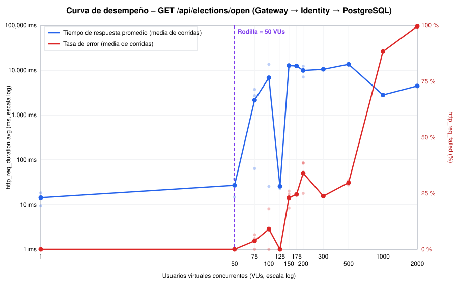
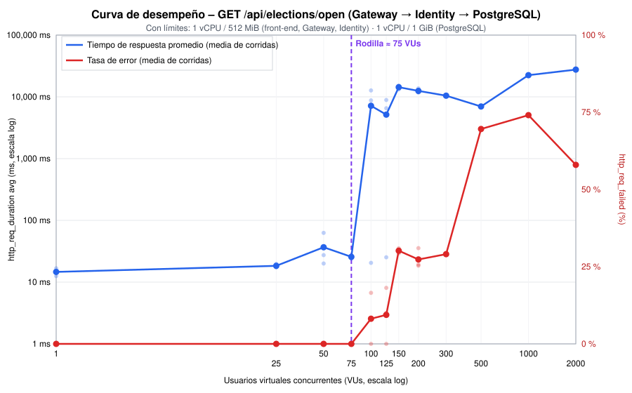

# Laboratorio 6 – Desempeño (Opción 2: k6)

**Funcionalidad probada:** *Ver elecciones abiertas*, la pantalla inicial del votante.

```
Front-end web (platform, Next.js :3100)
  → API Gateway (:8088)  GET /api/elections/open   (ruta pública)
    → microservicio Identity (FastAPI)  GET /elections/open
      → base de datos PostgreSQL (votaciones.elections)
```

Los cuatro componentes que pide el laboratorio son la base de datos, un microservicio, el API Gateway y el front-end web.



## Resultado

| | |
|---|---|
| **Rodilla de la curva** | **≈ 50 VUs**. Es el último nivel con 0 % de `http_req_failed` en todas las corridas: 3 de 3 en caliente y 1 de 1 en frío. |
| Primer nivel con errores | 75 VUs: 2 de 3 corridas con errores, y el promedio sube de 27 ms a 2,2 s. |
| Zona inestable | 75–125 VUs: según la corrida, el sistema colapsa o responde bien. |
| Saturación | 150–500 VUs: falla en el 100 % de las corridas, con un promedio de 10–14 s, entre el 23 y el 34 % de errores y un throughput de unas 3 req/s. |
| Colapso | 1000–2000 VUs: entre el 88 y el 99,6 % de errores. |

**Pasos e.1 y e.3** (3 corridas en caliente cada uno):
- 1 VU: promedio de 9–18 ms y 0 % de errores.
- 50 VUs: promedio de 15–37 ms y 0 % de errores, con un throughput de unas 48 req/s.

Hasta 50 VUs el throughput crece de forma lineal (1 → 48 req/s) y la latencia se mantiene plana. A partir de 75 VUs la latencia salta dos órdenes de magnitud y aparecen errores. Por lo tanto, la rodilla está entre 50 y 75 VUs.

### Resumen por nivel

| VUs | Corridas | avg (ms, media) | Throughput (req/s, media) | Error % (media) | Corridas sin errores |
|---:|---:|---:|---:|---:|---:|
| 1 | 3 | 14 | 1.0 | 0.0 % | 3/3 |
| 50 | 3 | 27 | 48.4 | 0.0 % | 3/3 |
| 75 | 3 | 2164 | 35.4 | 3.8 % | 1/3 |
| 100 | 3 | 6824 | 38.5 | 9.1 % | 1/3 |
| 125 | 3 | 25 | 121.1 | 0.0 % | 3/3 |
| 150 | 3 | 12726 | 2.5 | 23.1 % | 0/3 |
| 175 | 1\* | 12501 | 2.6 | 24.5 % | 0/1 |
| 200 | 3 | 9900 | 3.1 | 34.0 % | 0/3 |
| 300 | 1\* | 10522 | 2.3 | 23.7 % | 0/1 |
| 500 | 2\* | 13610 | 2.4 | 29.8 % | 0/2 |
| 1000 | 1\* | 2805 | 10.1 | 88.3 % | 0/1 |
| 2000 | 1\* | 4461 | 4.6 | 99.6 % | 0/1 |

Los niveles de 1 a 200 VUs, salvo 175, salen de 3 corridas **con calentamiento** (`results/warm1`–`warm3`). Los niveles marcados con \* solo se corrieron **en frío**, es decir, con Identity recién reiniciado y sin calentamiento (`results/main`, `rep*`). En ningún nivel se mezclan ambos tipos de corrida. Todas las corridas, con mediana y p95, están en [`results/results.md`](results/results.md).

**Inestabilidad entre 75 y 125 VUs.** En esta zona el resultado no es determinista. Si la ráfaga inicial agota el pool de conexiones de Identity, el servicio colapsa durante el resto de la corrida. Si no lo agota, la corrida termina limpia. Por ejemplo, 125 VUs quedó limpio en 3 de 3 corridas en caliente, pero falló en 3 de 4 en frío. Por eso no se toma 125 como capacidad: el único umbral estable es 50 VUs.

**¿Influye el arranque en frío?** Se verificó y no mueve la rodilla. Las corridas en frío y en caliente coinciden en que 50 VUs no tiene errores y 75 VUs ya los tiene.

**Tipo de error.** Las corridas en caliente registran el código HTTP con contadores de k6 (`status_200`, `status_5xx`, `status_0_network`):
- De 75 a 150 VUs todos los fallos son **5xx del sistema**, ninguno es un error de red del generador.
- A 200 VUs aparecen además algunos errores de red: 60 y 18 en dos de las corridas.
- El log del Gateway muestra mayoritariamente **504 Gateway Timeout**, junto con algunos 500 y 502.

## Prueba con recursos limitados por contenedor

La prueba se repitió limitando los recursos de los cuatro componentes con [`docker-compose.limits.yml`](docker-compose.limits.yml). Los valores imitan una instancia por defecto de Cloud Run, donde el proyecto despliega sus servicios:

| Componente | CPU | Memoria |
|---|---:|---:|
| Front-end (platform) | 1 vCPU | 512 MiB |
| API Gateway | 1 vCPU | 512 MiB |
| Identity | 1 vCPU | 512 MiB |
| PostgreSQL | 1 vCPU | 1 GiB |

```bash
WEB_PORT=3100 docker compose -f docker-compose.yml \
  -f docs/lab6-performance/docker-compose.perf.yml \
  -f docs/lab6-performance/docker-compose.limits.yml up -d platform
cd docs/lab6-performance
for r in 1 2 3; do OUT=results-limited/warm$r ./run_levels.sh 1 25 50 75 100 125 150 200; done
OUT=results-limited/high ./run_levels.sh 300 500 1000 2000
python3 build_report.py results-limited curva_desempeno_limitada.svg "Con límites: ..."
```



| VUs | Corridas | avg (ms, media) | Throughput (req/s, media) | Error % (media) | Corridas sin errores |
|---:|---:|---:|---:|---:|---:|
| 1 | 3 | 15 | 1.0 | 0.0 % | 3/3 |
| 25 | 3 | 18 | 24.5 | 0.0 % | 3/3 |
| 50 | 3 | 37 | 47.9 | 0.0 % | 3/3 |
| 75 | 3 | 26 | 72.6 | 0.0 % | 3/3 |
| 100 | 3 | 7164 | 38.2 | 8.1 % | 1/3 |
| 125 | 3 | 5154 | 42.7 | 9.4 % | 1/3 |
| 150 | 3 | 14328 | 2.2 | 30.2 % | 0/3 |
| 200 | 3 | 12481 | 2.2 | 27.3 % | 0/3 |
| 300 | 1\* | 10444 | 1.9 | 29.1 % | 0/1 |
| 500 | 1\* | 6981 | 4.0 | 69.6 % | 0/1 |
| 1000 | 1\* | 22437 | 0.9 | 74.1 % | 0/1 |
| 2000 | 1\* | 27622 | 1.1 | 58.0 % | 0/1 |

Todas las corridas fueron con calentamiento. Los niveles marcados con \* tienen una sola corrida (`results-limited/high`). El detalle de cada corrida está en [`results-limited/results.md`](results-limited/results.md).

**Rodilla con límites: ≈ 75 VUs**, que es el último nivel con 0 % de errores en 3 de 3 corridas. A partir de 100 VUs ya aparecen errores.

Hasta 75 VUs el throughput crece de forma lineal (1 → 72,6 req/s) y el promedio se mantiene por debajo de 40 ms. Todos los fallos entre 100 y 2000 VUs son 5xx del sistema. La única excepción es la corrida de 500 VUs, que tuvo además 127 errores de red.

### Comparación: sin límites vs. con límites

| | Sin límites | Con límites (1 vCPU por servicio) |
|---|---|---|
| Rodilla | ≈ 50 VUs | ≈ 75 VUs |
| 75 VUs, corridas limpias | 1/3 | 3/3 |
| 100 VUs, corridas limpias | 1/3 | 1/3 |
| 150+ VUs | Falla siempre | Falla siempre |

**Interpretación.** Limitar los recursos **no empeoró** el desempeño. Esto respalda la causa raíz: el cuello de botella no es la CPU ni la memoria, sino el pool de 15 conexiones de Identity con un solo worker. Ese límite es idéntico en ambas configuraciones, y por eso la saturación aparece en la misma zona, entre 75 y 150 VUs. La diferencia a 75 VUs (1/3 frente a 3/3 corridas limpias) cae dentro de la zona inestable descrita arriba. Puede deberse a la variación entre corridas o a que, sin límites, todos los contenedores competían por los mismos núcleos que k6. Con estos datos no se puede separar una explicación de la otra. La conclusión práctica es que la rodilla está entre **50 y 75 VUs** en ambos casos, y que dar más CPU o memoria a Identity no la desplazaría: habría que ampliar el pool, agregar workers o hacer el endpoint asíncrono.

### ¿Por qué falla? (causa raíz)

El cuello de botella es **Identity**, no el Gateway ni PostgreSQL.

- Corre con un solo proceso `uvicorn`. El endpoint es síncrono, de modo que FastAPI lo ejecuta en un threadpool de AnyIO de 40 hilos. Además, la sesión de BD se obtiene con una dependencia `yield` síncrona (`get_session`).
- El engine de SQLAlchemy usa el pool por defecto, de `pool_size=5 + max_overflow=10`, es decir, 15 conexiones.
- Bajo una ráfaga de más de unas 50 peticiones simultáneas, el pool se agota. El log muestra `QueuePool limit of size 5 overflow 10 reached, connection timed out, timeout 30.00`. Las peticiones esperan 30 s, que es justo el máximo de unos 30 s que se ve en los resultados, y el cliente recibe un 5xx, sobre todo 504.
- En la primera corrida, sin reinicio (`results/run1_sin_reinicio/`), Identity quedó *unhealthy* y **no se recuperó solo**. Esto concuerda con el *deadlock* conocido de FastAPI entre el threadpool y una dependencia síncrona con `yield` cuando el pool de BD está agotado. Por eso `run_levels.sh` reinicia Identity antes de cada nivel (`RESET=1`) y luego lo calienta 10 s a 5 VUs (`WARMUP=1`). Así cada punto de la curva mide un sistema sano y no uno ya caído ni uno recién arrancado.

Posibles mejoras, como trabajo futuro: aumentar `pool_size` y `max_overflow`, levantar varios workers de uvicorn, hacer el endpoint `async` con un driver asíncrono, o cachear `/elections/open`, que cambia poco.

## Paso a paso realizado

### b. Despliegue de componentes

El stack se levanta con `docker compose`. Para desactivar el rate limit del Gateway se usa un override (explicado más abajo).

```bash
cd Votaciones
WEB_PORT=3100 docker compose -f docker-compose.yml \
  -f docs/lab6-performance/docker-compose.perf.yml up -d --build platform
```

`platform` (el front-end) arrastra por dependencias al Gateway, Identity y PostgreSQL. Se usó `WEB_PORT=3100` porque el puerto 3000 estaba ocupado en la máquina.

Se verifica el despliegue:

```bash
curl -i localhost:8088/api/elections/open   # 200 OK
curl -o /dev/null -w '%{http_code}' localhost:3100   # 200
```

Se sembraron 5 elecciones abiertas para que la consulta no devolviera una lista vacía:

```bash
docker exec votaciones-postgres-1 psql -U votaciones -d votaciones -c "
INSERT INTO elections (name,status,starts_at,ends_at)
SELECT 'Lab6 - Elección de prueba '||g,'open',
       now() at time zone 'utc' - interval '1 hour',
       now() at time zone 'utc' + interval '7 days'
FROM generate_series(1,5) g;"
```

**Override `docker-compose.perf.yml`.** El Gateway limita cada IP a 300 peticiones por minuto. Todas las VUs de k6 salen de la misma IP, así que desde unas 5 VUs todo serían respuestas 429 rápidas. Eso falsearía tanto la tasa de error como el promedio. `GATEWAY_RATE_LIMIT_DEFAULT=0` desactiva el limitador, porque `rateLimit.ts` trata un `limit <= 0` como ilimitado. Una prueba de humo con 20 VUs confirmó 0 respuestas 429.

### c. Instalación de k6

```bash
brew install k6        # k6 v2.4.0
```

### d. Script de prueba

[`performance_test.js`](performance_test.js) es el script base del enunciado, con la URI y el endpoint reales. `BASE_URL`, `VUS` y `DURATION` se pueden pasar por `-e`. Se le añadieron contadores de códigos de estado para distinguir los 5xx del sistema de los errores de red del generador.

### e. Ejecución

```bash
cd docs/lab6-performance
k6 run performance_test.js                 # e.1: 1 VU, 30 s  → avg 9–18 ms, 0 % errores
k6 run -e VUS=50 performance_test.js       # e.3: 50 VUs      → avg 15–37 ms, 0 % errores
k6 run performance_test_stages.js          # e.4: stages 1→50→200→500→2000→0

# Barridos que se ejecutaron realmente:
WARMUP=0 ./run_levels.sh 1 50 100 125 150 175 200 300 500 1000 2000   # en frío → main/
WARMUP=0 ./run_levels.sh 75 100 125 150     # ×3, en frío → rep1/–rep3/
WARMUP=0 ./run_levels.sh 200 300 500        # en frío → rep4/
./run_levels.sh 1 50 75 100 125 150 200     # ×3, con calentamiento → warm1/–warm3/
python3 build_report.py                     # tabla + curva_desempeno.svg
```

- **Con stages (e.4):** el resultado agregado fue `avg=9.82s`, `http_req_failed=16.66%` (1193 de 7158) y 2000 VUs como máximo, en [`results/stages.txt`](results/stages.txt). Un run con stages produce un único promedio para toda la ejecución. Por eso **la curva se construyó con un run de carga constante por nivel**, como en los pasos e.1 y e.3, y no con el agregado de stages.
- **Con `run_levels.sh`:** el script reinicia Identity, espera a que responda 200, lo calienta 10 s a 5 VUs, corre k6 durante 30 s, guarda `results/vus_<N>.json` (`--summary-export`) y la salida de consola, y espera 10 s antes del siguiente nivel. También sube `ulimit -n` para que el generador no se quede sin descriptores de archivo.

## Estructura de `results/`

| Carpeta | Contenido |
|---|---|
| `warm1/`–`warm3/` | 3 barridos de 1 a 200 VUs **con calentamiento**. Son la base de la curva hasta 200 VUs. |
| `main/` | Barrido en frío: 1, 50, 100, 125, 150, 175, 200, 500, 1000 y 2000 VUs. |
| `rep1/`–`rep3/` | Repeticiones de 75, 100, 125 y 150 VUs, para caracterizar la rodilla. |
| `rep4/` | Segunda muestra de 200, 300 y 500 VUs. |
| `run1_sin_reinicio/` | Primer barrido, en el que Identity quedó bloqueado. Se conserva como evidencia y no se usa en la curva. |
| `discarded/` | Corrida de 300 VUs descartada. k6 midió peticiones de 6 min cuando la iteración más larga fue de 43 s, por una pausa de la VM de Docker o del equipo. |
| `stages.*` | Ejecución con stages (paso e.4). |

## Entorno de pruebas

| Recurso | Valor |
|---|---|
| Máquina | Apple M4: 10 núcleos (4 de rendimiento y 6 de eficiencia), 16 GB de RAM, macOS 27.2 |
| Docker | Docker Desktop 28.3.3. Su VM tenía 10 CPUs y unos 7,7 GB de RAM asignados |
| Contenedores | Prueba principal: sin límites por contenedor. Segunda prueba: con los límites de la tabla anterior. Los demás servicios del stack corrían sin límites, pero estaban inactivos |
| Generador | k6 v2.4.0 nativo (darwin/arm64), en la misma máquina, con `ulimit -n 65536` |
| Red | Loopback (`localhost:8088`), a través del reenvío de puertos de Docker Desktop |

## Limitaciones

- **Nodo independiente.** El enunciado pide ejecutar k6 en un nodo distinto del que aloja el sistema. Estas mediciones se tomaron con k6 y Docker Desktop **en el mismo Mac**, así que el generador compite por CPU con el sistema bajo prueba. Para cumplir el requisito al pie de la letra, se puede repetir desde otra máquina de la misma red: `BASE_URL=http://<IP_del_host>:8088 ./run_levels.sh`. Ojo: `RESET=1` usa `docker restart` en local, así que desde otro nodo hay que usar `RESET=0` y reiniciar Identity a mano entre niveles.
- **Errores a 1000 y 2000 VUs.** En esos niveles la mayoría de los errores son `connection reset by peer` al abrir la conexión. Pueden deberse al Gateway, que rechaza conexiones, o al reenvío de puertos de Docker Desktop. Este punto no cambia la ubicación de la rodilla: de 75 a 150 VUs todos los errores son 5xx del sistema (verificado con los contadores de estado), no fallos del generador.
- **Rate limit desactivado.** Con el rate limit activo (la configuración por defecto), el sistema protege a Identity rechazando con 429 a cualquier cliente que supere las 300 peticiones por minuto.
