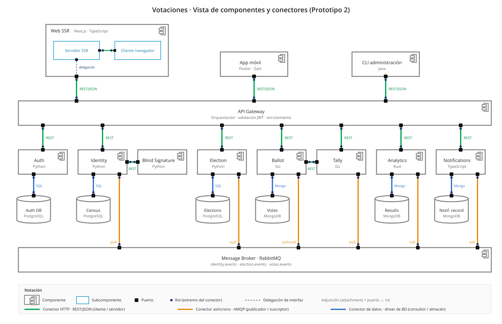
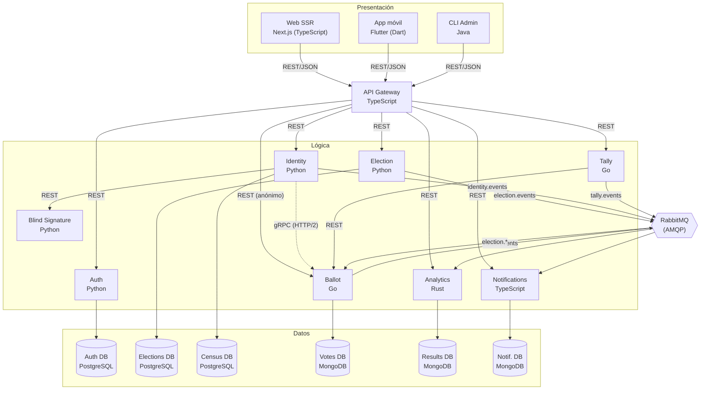
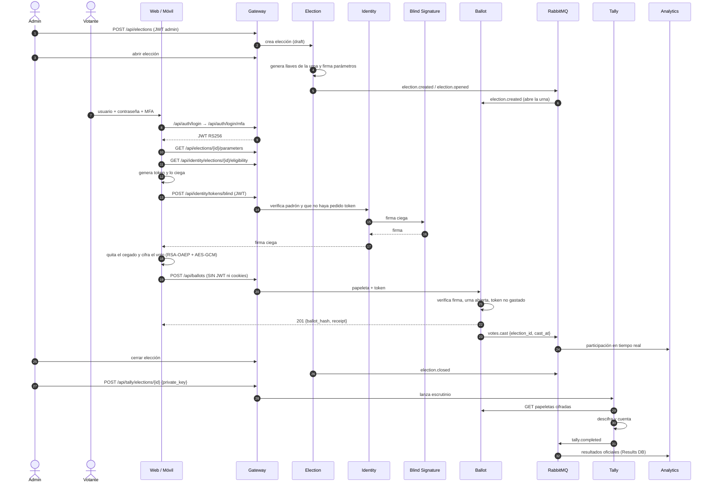

# Prototipo 2 — Sistema de Votaciones (espivota)
## Plan de construcción y reparto de tareas

**Curso:** Software Architecture 2026-II · Universidad Nacional de Colombia
**Enunciado:** *Prototype 2 — Advanced Architectural Structure*
**Entrega del artefacto (`p2_2c.pdf`):** martes 3 de noviembre de 2026, antes de las 23:59 (MiCampus UNAL)
**Presentación:** martes 3 de noviembre de 2026 (video de 10 a 15 minutos)
**Equipo:** 2c · 8 integrantes

> Este documento es el plan **interno** del equipo (qué construir, quién lo construye y cuándo). El artefacto que se entrega al profesor (`p2_2c.pdf`) se arma a partir de las secciones 2, 5, 12 y 13, y se escribe en `docs/entregables/P2/p2_2c.md`.

---

## 1. Objetivo y alcance

El enunciado pide **rediseñar la arquitectura** del prototipo 1 y construir un segundo prototipo. El P1 tenía 3 procesos (web, identity, ballot) y 2 bases de datos; el P2 lo descompone en **ocho componentes lógicos** (uno por integrante), agrega un **API Gateway**, un **broker de mensajería** para procesos asíncronos, dos clientes nuevos (móvil y CLI) y completa el ciclo electoral con **escrutinio y resultados**.

### 1.1 Alcance funcional del prototipo (dentro)

| # | Funcionalidad | Servicio principal |
|---|---|---|
| F1 | Login con usuario, contraseña y MFA; JWT RS256 con rol (`admin`, `votante`) | Auth |
| F2 | Gestión de usuarios y roles | Auth |
| F3 | Crear, editar, abrir y cerrar elecciones con sus opciones y ventana de tiempo | Election |
| F4 | Generar y custodiar el par de llaves de la urna (pública para cifrar, privada para escrutar) | Election |
| F5 | Padrón electoral: inscribir votantes y validar su elegibilidad | Identity + Census |
| F6 | Emisión de **token anónimo con firma ciega** RSA (RFC 9474) | Identity → Blind Signature |
| F7 | Cifrado híbrido del voto en el cliente (RSA-OAEP + AES-GCM), en web y móvil | Web SSR / App móvil |
| F8 | Recepción anónima de la papeleta, verificación de la firma ciega, antidoble voto y recibo Ed25519 | Ballot |
| F9 | Escrutinio oficial: descifrar y contar las papeletas de una urna cerrada | Tally |
| F10 | Participación en tiempo real y resultados finales | Analytics |
| F11 | Notificaciones generadas por los eventos del sistema | Notifications |
| F12 | Administración por consola (urnas, escrutinio, resultados) | CLI Admin |

### 1.2 Fuera del alcance de P2

- Proveedores externos de correo, SMS o *push* (las notificaciones solo se registran en su base de datos).
- Alta disponibilidad, réplicas, balanceo de carga y orquestación (Kubernetes).
- Pruebas de conocimiento cero completas sobre la validez de la papeleta (el campo `proof` existe, pero la verificación es básica).
- Recuperación de contraseña y MFA real (el código MFA de desarrollo es fijo).

---

## 2. Arquitectura (estructura de Componentes y Conectores)

El diagrama oficial está en `docs/entregables/P2/cc-view-p2.svg` (fuente en `cc-view-p2.html`). La versión en Mermaid sirve como referencia interna.





### 2.1 Cumplimiento de los requisitos no funcionales

| Requisito (enunciado) | Cómo se cumple |
|---|---|
| Arquitectura **distribuida** | 9 procesos de aplicación, 6 bases de datos y 1 broker, cada uno en su contenedor y comunicados por red. |
| ≥ 2 componentes de **presentación** distintos (uno web) | **Web** (Next.js), **App móvil** (Flutter) y **CLI Admin** (Java). |
| El front-end web sigue una subarquitectura **SSR** | Next.js App Router: el *Servidor SSR* renderiza las páginas y hace de proxy de sesión hacia el Gateway; el *Cliente navegador* cifra el voto y ciega el token. |
| Componentes de **lógica** ≥ número de integrantes (8) | Auth, Election, Identity, Blind Signature, Ballot, Tally, Analytics y Notifications (8), más el API Gateway. |
| ≥ 1 componente de **comunicación/orquestación** entre componentes lógicos | **API Gateway** (TypeScript): punto de entrada único, enrutamiento, validación de JWT, CORS y límites de tasa. |
| ≥ 4 componentes de **datos** (relacional + NoSQL) | PostgreSQL: Auth, Elections, Census. MongoDB: Votes, Results, Notif. (6 en total). |
| ≥ 1 componente para procesos **asíncronos** | **RabbitMQ** con exchanges `topic` (`identity.events`, `election.events`, `votes.events`, `tally.events`), colas con DLQ y *publisher confirms*. |
| Conjunto de **conectores HTTP** | REST/JSON sobre HTTP/1.1 (clientes → Gateway → servicios, Identity → Blind Signature, Tally → Ballot) y gRPC sobre HTTP/2 (Identity → Ballot). |
| ≥ 5 lenguajes de propósito general | **TypeScript, Python, Go, Rust, Java y Dart** (6). |
| Despliegue orientado a **contenedores** | Un `Dockerfile` por componente y un `docker-compose.yml` en la raíz que levanta todo. |

### 2.2 Estilos y patrones arquitectónicos

- **Cliente-Servidor** entre los tres clientes y el backend.
- **Microservicios**: ocho servicios con responsabilidades separadas, desplegables por separado.
- **API Gateway**: los clientes solo conocen el Gateway; ningún cliente habla con un servicio ni con una base de datos directamente.
- **Base de datos por servicio**: cada base de datos tiene un solo dueño (Auth DB → Auth, Elections DB → Election, Census → Identity, Votes → Ballot, Results → Analytics, Notif. DB → Notifications).
- **Publicar-Suscribir (event-driven)**: productores y consumidores desacoplados por RabbitMQ; la *routing key* es igual a `event_type`.
- **Outbox transaccional** en Election: el evento se guarda en la misma transacción que el cambio de estado y un *relay* lo publica.
- **Consumidor idempotente** en Analytics y Notifications (deduplicación por `event_id`) y escrutinio idempotente en Tally.
- **SSR** en el front-end web.
- **Separación de identidad y voto** como decisión de diseño: Identity sabe *quién eres*; Ballot sabe *qué se votó*, pero no quién. La ruta de Ballot en el Gateway es anónima (no reenvía JWT, cookies, IP ni User-Agent).

### 2.3 Elementos y relaciones

| Elemento | Tipo | Tecnología | Responsabilidad |
|---|---|---|---|
| `platform` (Web SSR) | Presentación | Next.js + TypeScript | UI de votante y administrador; SSR; cifrado del voto y cegado del token en el navegador. |
| `mobile` | Presentación | Flutter / Dart | App de votante con el mismo protocolo criptográfico que la web. |
| `admin-cli` | Presentación | Java | Operaciones administrativas por consola. |
| `gateway` | Comunicación | TypeScript (Node) | Catálogo de rutas `/api/*`, validación JWT (JWKS), CORS, límites de tasa. |
| Auth | Lógica | Python (FastAPI) | Login + MFA, emisión de JWT RS256, usuarios y roles. |
| `election` | Lógica | Python (FastAPI) | Ciclo de vida de elecciones, llaves de la urna, parámetros firmados, `election.events`. |
| `identity` | Lógica | Python (FastAPI) | Padrón, elegibilidad, solicitud de firma ciega, registro de la urna en Ballot. |
| `blind-signature` | Lógica | Python (FastAPI) | Firma ciega RSA; solo accesible desde Identity (sin puerto publicado). |
| `ballot` | Lógica | Go | Recepción anónima de papeletas, verificación del token, recibos, `votes.events`. |
| `tally` | Lógica | Go | Escrutinio oficial al cierre de la urna; publica `tally.completed`. Sin base de datos. |
| `analytics` | Lógica | Rust | Participación en tiempo real y resultados finales. |
| `notification` | Lógica | TypeScript | Consume eventos y registra notificaciones. |
| `rabbitmq` | Asíncrono | RabbitMQ 4 | Broker de eventos. |
| `postgres`, `postgres-elections`, `postgres-census` | Datos (relacional) | PostgreSQL 16 | Auth DB, Elections DB, Census DB. |
| `mongo`, `mongo-results`, `notifications-mongo` | Datos (NoSQL) | MongoDB 8 | Votes DB (replica set), Results DB, Notif. DB. |

| Conector | Origen → Destino | Protocolo | Datos que viajan |
|---|---|---|---|
| C1 | Web / Móvil / CLI → Gateway | REST/JSON, HTTP/1.1 | Credenciales, JWT, elecciones, papeletas, resultados. |
| C2 | Gateway → servicios | REST/JSON, HTTP/1.1 | Peticiones reenviadas según el catálogo de rutas. |
| C3 | Identity → Blind Signature | REST/JSON + API key | Token cegado → firma ciega. |
| C4 | Identity → Ballot | gRPC, HTTP/2 | Registro de la urna y llaves de verificación del token. |
| C5 | Tally → Ballot | REST/JSON + token interno | Volcado de papeletas cifradas de una urna cerrada. |
| C6 | Productores → RabbitMQ | AMQP 0-9-1 | `election.*`, `census.updated`, `votes.cast`, `tally.completed`. |
| C7 | RabbitMQ → consumidores | AMQP 0-9-1 | Ballot, Analytics, Notifications. |
| C8 | Servicio → su base de datos | Driver SQL / Mongo wire | Datos de cada servicio. |

---

## 3. Diseño del flujo de voto (decisiones que el equipo debe respetar)

### 3.1 Secuencia



### 3.2 Reglas de diseño

1. **Firma ciega:** Identity nunca ve el token sin cegar; Ballot nunca ve la identidad. Identity solo marca que el votante ya pidió su token.
2. **Ruta anónima:** `POST /api/ballots` tiene acceso `anonymous` en el Gateway. El cliente usa `credentials: "omit"` y el Gateway descarta `Authorization`, cookies, IP y User-Agent.
3. **Un voto por token:** Ballot rechaza un token ya gastado con `409 token_already_spent`; un reintento idéntico devuelve el mismo recibo (`200`, `replayed: true`).
4. **Llaves de la urna:** las genera y custodia Election (privada envuelta con AES-256-GCM bajo una KEK). La privada solo se libera a un admin (`POST /elections/{id}/urn-key/private`) para lanzar el escrutinio; Tally la recibe en el cuerpo, la compara con la llave pública y **no la persiste**.
5. **Eventos sin datos sensibles:** `votes.cast` lleva solo `election_id` y `cast_at`; `identity.credential.issued` nunca lleva `user_id`, documento, token ni firma.
6. **Idempotencia:** el `event_id` de `tally.completed` es un UUIDv5 determinista del digest de las papeletas; relanzar el escrutinio no duplica resultados.
7. **Fuente de verdad:** Ballot para las papeletas, Tally para el conteo oficial, Analytics para la consulta de resultados.
8. **Aislamiento:** Blind Signature y Tally no publican puertos al host; las bases de datos no se exponen a los clientes.

> **Limitación a mencionar en el video:** la correlación temporal entre la emisión del token y `votes.cast` podría ayudar a desanonimizar votantes en elecciones pequeñas. Se mitiga con eventos que solo llevan la hora del voto, sin token ni recibo.

---

## 4. Contratos

Los contratos se congelan antes de implementar para que los frentes trabajen en paralelo.

### 4.1 API Gateway — REST/JSON (puerto 8088)

Catálogo completo en `gateway/src/routes.ts` y en `GET /api`.

| Método | Ruta pública | Servicio | Acceso |
|---|---|---|---|
| POST | `/api/auth/login`, `/api/auth/login/mfa` | Auth | público |
| GET / POST | `/api/auth/me`, `/api/auth/logout` | Auth | usuario |
| GET | `/api/auth/users` | Auth | admin |
| GET | `/api/elections/open` | Election | público |
| GET / POST | `/api/elections` | Election | admin |
| GET | `/api/elections/{id}/parameters` | Election | usuario |
| GET / POST | `/api/elections/{id}/status`, `/api/elections/{id}/close` | Election | admin |
| GET | `/api/identity/elections/{id}/eligibility` | Identity | usuario |
| POST | `/api/identity/tokens/blind` | Identity | usuario |
| GET / POST / PATCH | `/api/identity/elections/{id}/voters[/{userId}]` | Identity | admin |
| POST | `/api/ballots` | Ballot | **anónimo** |
| GET | `/api/ballots/elections/{id}/parameters` | Ballot | anónimo |
| POST / GET | `/api/tally/elections/{id}` | Tally | admin / usuario |
| GET | `/api/analytics/summary`, `/api/analytics/elections/{id}[/results\|/participation\|/turnout]` | Analytics | usuario |
| GET | `/api/notifications` | Notifications | usuario |

### 4.2 Eventos — RabbitMQ

Contrato completo en `tally/docs/events.md`; topología en `rabbitmq/definitions.json`. Sobre común: `event_id`, `event_type`, `occurred_at`, `producer`, `schema_version`, `data`.

| Exchange | Evento | Productor | Consumidores |
|---|---|---|---|
| `election.events` | `election.created`, `election.opened`, `election.closed` | Election | Ballot, Analytics, Notifications |
| `identity.events` | `census.updated`, `identity.credential.issued` | Identity | Analytics, Notifications |
| `votes.events` | `votes.cast` | Ballot | Analytics, Notifications |
| `tally.events` | `tally.completed` | Tally | Analytics, Notifications |

Cada cola de consumidor tiene su DLX y DLQ (`analytics.events.dlq`, `notifications.*.dlq`).

### 4.3 Identity → Ballot — gRPC (puerto 9091, solo red interna)

`proto/ballot.proto`, servicio `BallotAdminService`: `RegisterElection`, `AddTokenVerificationKey`, `CloseElection`, `CountBallots`, `GetElectionStatus`.

### 4.4 Modelo de datos

**Elections DB (PostgreSQL, Election)** — detalle en `election/docs/modelo-datos.md`

```
elections(id, name, description, status draft|open|closed, opens_at, closes_at, created_by, opened_at, closed_at)
election_options(election_id, position, label, is_blank)
urn_keys(election_id, algorithm, public_key_der, wrapped_private_key, wrap_nonce, kek_id, release_count)
election_parameters(election_id, signed_parameters, signing_key_id, signature_algorithm, signature)
election_audit(id, election_id, action, actor, occurred_at)
outbox_events(id, event_id UNIQUE, event_type, payload, published_at)
```

**Auth DB y Census DB (PostgreSQL)** — `identity/schema.sql`, `census/schema.sql`: usuarios, roles, sesiones, padrón y marca de token emitido.

**Votes DB (MongoDB, Ballot)** — elecciones registradas, tokens gastados (índice único) y papeletas cifradas con su recibo.

**Results DB (MongoDB, Analytics)** — informes por elección, participación por hora, resultados y `processed_events`.

**Notif. DB (MongoDB, Notifications)** — notificaciones con índice único en `eventId`.

---

## 5. Estructuras arquitectónicas que exige el enunciado

El P1 solo pedía la vista C&C. El P2 pide **cuatro estructuras**, cada una con su vista, la descripción de elementos y relaciones y la descripción de los patrones usados.

### 5.1 Estructura C&C

Sección 2 de este plan. Debe diferenciar conectores HTTP (síncronos) de mensajes AMQP (asíncronos) y mostrar el lenguaje de cada componente, incluido el Gateway.

### 5.2 Estructura de despliegue

Debe mostrar **dónde corre** cada componente, no repetir el diagrama lógico:

- Nodo: máquina anfitriona con Docker Engine y Docker Compose.
- Un contenedor por componente (17 en total) en la red de Compose.
- Puertos publicados al host: 3000 (web), 8088 (gateway), 8000 (identity), 8001 (election), 8080 (ballot), 8090 (analytics), 8091 (notifications), 8092 (móvil en navegador), 15672 (consola de RabbitMQ).
- Sin puerto publicado: Blind Signature, Tally y las bases de datos.
- Volúmenes persistentes: uno por base de datos y los de llaves (`identity-keys`, `election-keys`, `blind-signature-keys`).
- La app móvil también se compila para Android/iOS y se ejecuta fuera de Docker.
- Patrones: **un servicio por contenedor**, **base de datos por servicio**, *health checks* y orden de arranque con `depends_on`.

### 5.3 Estructura por capas

| Capa | Elementos | Puede usar |
|---|---|---|
| Presentación | Web SSR, App móvil, CLI Admin | Comunicación |
| Comunicación | API Gateway | Lógica |
| Lógica | Auth, Election, Identity, Blind Signature, Ballot, Tally, Analytics, Notifications | Lógica (vía REST/gRPC), Mensajería, Datos propios |
| Mensajería | RabbitMQ | — |
| Datos | 3 PostgreSQL + 3 MongoDB | — |

Patrón: **capas estrictas hacia abajo** (ningún cliente salta al servicio o a la base de datos). Dentro de cada servicio se repite una arquitectura en capas: API → aplicación/dominio → infraestructura (persistencia, mensajería).

### 5.4 Estructura de descomposición

Módulos internos de los componentes principales (verificar contra el código de cada carpeta):

| Componente | Módulos |
|---|---|
| Election | `api.py` (HTTP), `service.py` (casos de uso), `rules.py` (estados y ventanas), `models.py` (persistencia), llaves de la urna, *outbox relay* (publicación) |
| Ballot | `cmd/`, `internal/httpapi` (API), validación del token, repositorio Mongo, servidor gRPC, consumidor `election.events`, publicador `votes.events` |
| Tally | cliente de Ballot (`internal/ballotclient`), descifrado, conteo, publicador `tally.events` |
| Identity | `app/api` (rutas), padrón/elegibilidad, cliente Blind Signature, cliente gRPC de Ballot (`app/clients`) |
| Analytics | `http.rs`, `consumer.rs`, `events.rs`, `report.rs`, `store.rs` |
| Notifications | `domain`, `application`, `infrastructure` (arquitectura hexagonal) |
| Gateway | `routes.ts` (catálogo), `router.ts`, `jwt.ts`, `rateLimit.ts`, `server.ts` |
| Web SSR | `app/` (páginas y rutas SSR), `components/`, `lib/` (cliente API y criptografía) |

Patrones: **descomposición por dominio** entre servicios y **arquitectura hexagonal / puertos y adaptadores** dentro de los servicios.

---

## 6. Stack tecnológico

| Componente | Tecnología |
|---|---|
| Web SSR | Next.js (App Router) + TypeScript, Web Crypto API |
| App móvil | Flutter / Dart (Android, iOS y web vía nginx) |
| CLI Admin | Java + Maven |
| API Gateway | TypeScript (Node.js), pnpm |
| Auth, Election, Identity, Blind Signature | Python 3.12, FastAPI, SQLAlchemy, `uv`, `pytest` |
| Ballot, Tally | Go, `net/http`, `mongo-driver`, `grpc-go`, `amqp091-go` |
| Analytics | Rust, Cargo |
| Notifications | TypeScript (Node.js), pnpm |
| Datos | PostgreSQL 16, MongoDB 8 |
| Mensajería | RabbitMQ 4 (management) |
| Contenedores | Docker + Docker Compose |

---

## 7. Estructura del repositorio

```
Votaciones/
├── docker-compose.yml          # stack completo
├── assets/logo.png
├── platform/                   # Web SSR (Next.js)
├── mobile/                     # App Flutter
├── admin-cli/                  # CLI Java
├── gateway/                    # API Gateway (TypeScript)
├── identity/                   # Auth + Identity (Python)
├── election/                   # Election (Python)
├── blind-signature/            # Firma ciega (Python)
├── census/                     # esquema de Census DB
├── ballot/                     # Ballot (Go)
├── tally/                      # Tally (Go) + contratos de eventos
├── analytics/                  # Analytics (Rust)
├── notification/               # Notifications (TypeScript)
├── rabbitmq/                   # definitions.json, rabbitmq.conf
├── proto/                      # ballot.proto (gRPC Identity → Ballot)
└── docs/
    ├── plan-prototipos/
    ├── demo/e2e_vote.py        # flujo E2E por el Gateway
    └── entregables/P2/         # p2_2c.md → p2_2c.pdf, cc-view-p2.svg
```

---

## 8. Reparto de tareas (8 integrantes)

| Integrante | Componentes | Tecnologías | Revisor cruzado |
|---|---|---|---|
| **Cristhian** Cely | API Gateway y Web SSR | TypeScript, Next.js | Andres |
| **Julian** Pira | Auth, Auth DB y CLI Admin | Python, PostgreSQL, Java | Kevin |
| **Fabian** Espitia | Election y Elections DB | Python, PostgreSQL | Sebastian |
| **Kevin** Rodriguez | Identity, Census DB y Blind Signature | Python, PostgreSQL | Julian |
| **Andres** Rosada | Ballot, Votes DB y App móvil | Go, MongoDB, Flutter | Cristhian |
| **Sebastian** Moya | Tally y RabbitMQ | Go, RabbitMQ | Fabian |
| **Camilo** Camargo | Notifications y Notif. DB | TypeScript, MongoDB | Sergio |
| **Sergio** Rey | Analytics y Results DB | Rust, MongoDB | Camilo |

RabbitMQ (infraestructura) es de Sebastian, pero cada productor y consumidor implementa su propia integración.

### Cristhian — API Gateway y Web SSR

| ID | Tarea | Entregable / criterio de aceptación |
|---|---|---|
| CR-01 | Catálogo de rutas para Auth, Election, Identity, Ballot, Tally, Analytics y Notifications (Blind Signature no se expone) | `gateway/src/routes.ts` y `GET /api` |
| CR-02 | Gateway en TypeScript con CORS y límites de tasa | Servicio en `:8088` y en contenedor |
| CR-03 | Enrutamiento REST/JSON hacia cada servicio por variables `GATEWAY_*_URL` | Cada ruta llega a su servicio |
| CR-04 | Validación de JWT RS256 por JWKS en todas las rutas salvo Ballot (anónima) | `401`/`403` correctos; Ballot no recibe JWT ni cookies |
| CR-05 | Web en Next.js con SSR (Servidor SSR + Cliente navegador) | Páginas renderizadas en servidor; proxy de sesión |
| CR-06 | Pantallas de login, elecciones, votación y resultados; cegado del token y cifrado del voto en el navegador | El voto en claro nunca sale del navegador (pestaña Red) |
| CR-07 | Integración con el Gateway y manejo de errores; la papeleta se envía sin sesión | Flujo completo desde la web |
| CR-08 | Dockerfiles del Gateway y la web | Contenedores sanos en Compose |
| CR-09 | Vista C&C y descripción de patrones del artefacto | Secciones 2.2 y 2.3 pulidas |

### Julian — Auth, Auth DB y CLI Admin

| ID | Tarea | Entregable / criterio de aceptación |
|---|---|---|
| JU-01 | Revisar la autenticación del P1 | Inventario de lo reutilizable |
| JU-02 | Servicio Auth en Python | Login + MFA operativos |
| JU-03 | Esquema de Auth DB en PostgreSQL | `identity/schema.sql` + *seed* de usuarios |
| JU-04 | Gestión de usuarios y roles | `GET/POST/PATCH /users` |
| JU-05 | JWT RS256 con JWKS, `iss`/`aud` y expiración acordados con Cristhian | El Gateway valida sin secreto compartido |
| JU-06 | CLI administrativa en Java | Ejecutable con instrucciones |
| JU-07 | Comandos de la CLI: crear, abrir y cerrar urnas, lanzar escrutinio y consultar resultados (todo vía Gateway) | Ciclo administrativo completo por consola |
| JU-08 | Pruebas de autenticación, persistencia y CLI | Pruebas pasando |
| JU-09 | Vista por capas del artefacto | Sección 5.3 pulida |

### Fabian — Election y Elections DB

| ID | Tarea | Entregable / criterio de aceptación |
|---|---|---|
| FA-01 | Modelo de datos de las elecciones | `election/docs/modelo-datos.md` |
| FA-02 | Elections DB en PostgreSQL | `election/schema.sql` cargado al levantar `postgres-elections` |
| FA-03 | Servicio Election en Python | Servicio en `:8001` y en contenedor |
| FA-04 | Crear, consultar, editar, abrir, cerrar y borrar (en `draft`) elecciones, con permisos por rol | Endpoints HTTP con `403` para votantes |
| FA-05 | Estados, fases y ventanas de tiempo | `election/docs/reglas-negocio.md` y `app/rules.py` |
| FA-06 | Publicación de `election.events` con outbox transaccional y *publisher confirms* | Analytics, Notifications y Ballot reciben los eventos |
| FA-07 | Pruebas del servicio y la persistencia | `pytest` pasando |
| FA-08 | Dockerfile y configuración de conexión | Servicio sano en Compose |
| FA-09 | Generar y custodiar las llaves de la urna; liberar la privada al admin para el escrutinio | Tally descifra con la llave liberada |
| FA-10 | Conectar el Gateway al servicio Election (`GATEWAY_ELECTION_URL`) | Las rutas `/api/elections*` llegan a `election`, no a `identity` |
| FA-11 | Vista de descomposición del artefacto | Sección 5.4 pulida |

### Kevin — Identity, Census DB y Blind Signature

| ID | Tarea | Entregable / criterio de aceptación |
|---|---|---|
| KE-01 | Revisar la lógica de identidad y firma ciega del P1 | Inventario de lo reutilizable |
| KE-02 | Esquema de Census DB | `census/schema.sql` |
| KE-03 | Servicio Identity en Python | Servicio en `:8000` y en contenedor |
| KE-04 | Consulta del padrón y elegibilidad | `GET /elections/{id}/eligibility` |
| KE-05 | Blind Signature como servicio aparte, accesible solo desde Identity | Sin puerto publicado; protegido con API key |
| KE-06 | Contrato Identity ↔ Blind Signature | Interfaz documentada en el README |
| KE-07 | Validaciones criptográficas y pruebas del protocolo | Pruebas pasando |
| KE-08 | Publicación de `census.updated` (y, si se confirma, `identity.credential.issued`) | Analytics calcula participación |
| KE-09 | Contenedores y conexiones con PostgreSQL | Servicios sanos en Compose |

### Andres — Ballot, Votes DB y App móvil

| ID | Tarea | Entregable / criterio de aceptación |
|---|---|---|
| AN-01 | Modelo de la papeleta electrónica | `ballot/docs/http-api.md` |
| AN-02 | Servicio Ballot en Go | Servicio en `:8080` y en contenedor |
| AN-03 | Persistencia en MongoDB (replica set) | Papeletas y tokens gastados guardados |
| AN-04 | Recepción y validación, incluida la firma ciega del token | Códigos `201/200/400/403/409/422` según el contrato |
| AN-05 | Antidoble voto y reintentos idempotentes | Segundo uso del token → `409` |
| AN-06 | Publicación de `votes.cast` | Analytics actualiza la participación |
| AN-07 | App móvil en Flutter con el mismo cegado y cifrado que la web | Voto emitido desde el móvil |
| AN-08 | Integración de la app con el Gateway; papeleta por la ruta anónima | Sin JWT en el envío |
| AN-09 | Contenedor de la app (versión web) y documentación para Android/iOS | `mobile/README.md` |
| AN-10 | Consumir `election.events` para abrir y cerrar la urna | La urna acepta/rechaza según el evento |
| AN-11 | Endpoint interno para que Tally obtenga las papeletas cifradas | Protegido con token interno |

### Sebastian — Tally y RabbitMQ

| ID | Tarea | Entregable / criterio de aceptación |
|---|---|---|
| SE-01 | RabbitMQ en la red Docker | Broker sano; consola en `:15672` |
| SE-02 | Exchanges, colas, routing keys y DLQ | `rabbitmq/definitions.json` |
| SE-03 | Contratos de `identity.events`, `election.events`, `votes.events` y `tally.events` | `tally/docs/events.md` |
| SE-04 | Servicio Tally en Go | Servicio sano en Compose (sin puerto publicado) |
| SE-05 | Cliente REST Tally → Ballot | Papeletas obtenidas al cierre |
| SE-06 | Descifrado y reglas de conteo | `sum(results) + invalid == total` |
| SE-07 | Coordinar con Andres (votos) y Sergio (Analytics) | Contratos aceptados por ambos |
| SE-08 | Reintentos, confirmaciones y escrutinio idempotente | Relanzar no duplica resultados |
| SE-09 | Pruebas de publicación, consumo y conteo | `integration_test.go` pasando |
| SE-10 | Publicar `tally.completed` | Analytics y Notifications lo reciben |
| SE-11 | Vista de despliegue del artefacto | Sección 5.2 pulida |

### Camilo — Notifications y Notif. DB

| ID | Tarea | Entregable / criterio de aceptación |
|---|---|---|
| CA-01 | Catálogo de eventos notificables | Lista acordada |
| CA-02 | Servicio Notifications en TypeScript | Servicio en `:8091` y en contenedor |
| CA-03 | Colección de notificaciones en MongoDB | Índice único en `eventId` |
| CA-04 | Consumidores de RabbitMQ | Colas `notifications.*` consumidas |
| CA-05 | Generación y registro de notificaciones | Un evento → un registro |
| CA-06 | Plantillas sin datos sensibles | Revisado por Kevin |
| CA-07 | `GET /v1/notifications` expuesto por el Gateway | Historial consultable |
| CA-08 | Pruebas con eventos repetidos | Sin duplicados |
| CA-09 | Dockerfile y README | Servicio sano en Compose |

### Sergio — Analytics y Results DB

| ID | Tarea | Entregable / criterio de aceptación |
|---|---|---|
| SR-01 | Métricas y resultados a producir | `analytics/CONTRACTS.md` |
| SR-02 | Documentos de Results DB | Modelo documentado |
| SR-03 | Servicio Analytics en Rust | Servicio en `:8090` y en contenedor |
| SR-04 | Consumir `votes.cast` (tiempo real) y `tally.completed` (resultados finales) | Informe actualizado por eventos |
| SR-05 | Agregación de votos y participación | Cálculo correcto |
| SR-06 | Persistencia y consulta en MongoDB | Datos sobreviven reinicios |
| SR-07 | Endpoints HTTP de resultados | Consumidos por la web |
| SR-08 | Pruebas con conjuntos de votos conocidos | Resultados exactos |
| SR-09 | Mensajes repetidos y recuentos | Duplicado descartado; recuento reemplaza |
| SR-10 | Dockerfile y README | Servicio sano en Compose |
| SR-11 | Script E2E de la demo (`docs/demo/e2e_vote.py`) | Flujo completo en verde |

### 8.1 Responsabilidades compartidas

| Actividad | Responsable | Colaboradores | Fecha |
|---|---|---|---|
| Contratos HTTP | Cristhian | Responsables de servicios | 28 oct |
| Contratos de eventos | Sebastian | Fabian, Kevin, Andres, Camilo, Sergio | 28 oct |
| Configuración de RabbitMQ | Sebastian | Productores y consumidores | 29 oct |
| Dockerfile de cada componente | Cada integrante | — | 30 oct |
| Clientes ↔ Gateway | Cristhian | Julian, Andres | 30 oct |
| Votos → Tally → Analytics | Sebastian | Andres, Sergio | 31 oct |
| Eventos de identidad y elecciones | Sebastian | Kevin, Fabian | 31 oct |
| Notifications | Camilo | Sebastian | 31 oct |
| Pruebas E2E | Todo el equipo | Coordina Cristhian | 1 nov |
| Las cuatro vistas | Cristhian, Sebastian, Julian, Fabian | Todo el equipo | 1 nov |
| Consolidar `p2_2c.md` → PDF | Un integrante designado | Todo el equipo | 3 nov |
| Grabar y editar el video | Un integrante designado | Todo el equipo | 3 nov |

### 8.2 Dependencias críticas

| Integrante | Con | Motivo |
|---|---|---|
| Cristhian | Julian | Formato del JWT, JWKS, `iss`/`aud` |
| Cristhian | Todos los servicios | Rutas y contratos HTTP |
| Julian | Fabian, Sebastian, Sergio | Comandos de la CLI sobre urnas, escrutinio y resultados |
| Fabian | Sebastian, Andres | `election.events` y apertura/cierre de la urna en Ballot |
| Fabian | Sebastian | Entrega de la llave privada de la urna a Tally |
| Kevin | Andres | Firma ciega y verificación del token |
| Kevin | Julian | Identificador del usuario en el JWT y su relación con el padrón |
| Andres | Kevin, Cristhian | Mismo protocolo criptográfico en web y móvil |
| Sebastian | Sergio, Camilo | Eventos que consumen Analytics y Notifications |
| Sergio | Cristhian | Respuesta HTTP de resultados para la web |

---

## 9. Cronograma

| Fecha | Hito | Qué se espera al final del día |
|---|---|---|
| **Lun 27 oct** | Análisis y acuerdos | Revisión del P1, alcance, arquitectura validada y reparto de tareas. |
| **Mar 28 oct** | Contratos | Rutas del Gateway, contratos de eventos, esquemas de datos y estructura de carpetas congelados. |
| **Mié 29 oct** | Desarrollo | Primera versión ejecutable de cada componente; RabbitMQ con su topología. |
| **Jue 30 oct** | Persistencia e interfaces | Bases de datos integradas; clientes contra el Gateway; Dockerfiles listos. |
| **Vie 31 oct** | **Primera integración** | `docker compose up --build` levanta todo; votos → Tally → Analytics; eventos de elecciones. |
| **Sáb 1 nov** | Pruebas y vistas | E2E (`docs/demo/e2e_vote.py`) en verde; las cuatro vistas en borrador. |
| **Dom 2 nov** | **Congelamiento de código** | Solo correcciones. Artefacto `p2_2c.md` casi final; guion del video. |
| **Mar 3 nov** | **Entrega** | Video grabado y subido; `p2_2c.pdf` exportado; un solo integrante lo sube a MiCampus antes de las 23:59. |

### Reglas para cumplir el cronograma

1. **No esperar al backend para empezar los clientes:** con los contratos del 28 de octubre se trabaja con respuestas simuladas.
2. **No dejar Docker para el final:** desde el 29 de octubre cada componente corre en su contenedor.
3. **Congelar funcionalidades antes de ampliar el alcance:** un flujo pequeño pero integrado vale más que muchas piezas sueltas.

---

## 10. Convenciones de trabajo

- **Ramas:** `main` (protegida, siempre demostrable) y ramas `feat/<área>-<descripción>` o `fix/...`; fusión por PR con aprobación del revisor cruzado.
- **Commits:** *Conventional Commits* (`feat:`, `fix:`, `docs:`, `chore:`).
- **Cambios de contrato:** cualquier cambio en `gateway/src/routes.ts`, `tally/docs/events.md`, `rabbitmq/definitions.json` o `proto/` se avisa al equipo.
- **Definición de "terminado":**
  1. Funciona dentro de su contenedor en el `docker-compose.yml` de la raíz.
  2. Contrato de comunicación documentado.
  3. Al menos una prueba automatizada o un paso en el E2E.
  4. README con instalación, variables de entorno y ejecución.
  5. PR revisado con la descripción de las pruebas realizadas.
- **Secretos:** las credenciales del `docker-compose.yml` son solo de desarrollo; las llaves privadas viven en volúmenes, nunca en el repositorio.

---

## 11. Contenido del artefacto final `p2_2c.pdf`

El enunciado pide que el artefacto se cree en `.md`, se exporte a `.pdf` y se llame `p2_X.pdf` (X = nombre del equipo). Fuente: `docs/entregables/P2/p2_2c.md`.

**Equipo**

- [ ] Nombre del equipo: **2c**.
- [ ] Nombres completos: Fabián Espitia Sotelo, Juan Sebastian Moya Alvarez, Sergio Nicolas Rey Mora, Kevin David Rodriguez Riveros, José Julián Pira Naranjo, Juan Camilo Camargo Prieto, Andrés Felipe Rosada Mosquera, Cristhian Yamith Cely Oliveros.

**Sistema de software**

- [ ] Nombre: **espivota**.
- [ ] Logo (`assets/logo.png`).
- [ ] Descripción (actualizar la del P1 con Gateway, mensajería, escrutinio, móvil y CLI).

**Estructuras arquitectónicas** (cada una con vista + elementos y relaciones + patrones)

- [ ] **C&C:** vista, elementos y relaciones, estilos y patrones (secciones 2 y 3).
- [ ] **Despliegue:** vista, elementos y relaciones, patrones (sección 5.2).
- [ ] **Por capas:** vista, elementos y relaciones, patrones (sección 5.3).
- [ ] **Descomposición:** vista, elementos y relaciones, patrones (sección 5.4).

**Prototipo**

- [ ] Comandos para descargar y ejecutar el sistema (sección 12).
- [ ] Enlace al video de presentación (10–15 min).

**Entrega**

- [ ] Exportado a `.pdf` y nombrado `p2_2c.pdf`.
- [ ] Subido a MiCampus UNAL por **un solo** integrante antes del martes 3 de noviembre a las 23:59.

---

## 12. Comandos de ejecución (borrador para el artefacto)

Requisitos: Git y Docker con Docker Compose.

```bash
# 1. Descargar el proyecto
git clone https://github.com/ccelyo/Votaciones.git
cd Votaciones

# 2. Construir y levantar todos los contenedores
docker compose up --build -d

# 3. Verificar que los servicios estén sanos
docker compose ps

# 4. (Opcional) Ejecutar el flujo E2E por el Gateway
#    crea urna, inscribe votante, token ciego, voto cifrado, cierre y escrutinio
identity/.venv/bin/python docs/demo/e2e_vote.py http://localhost:8088

# 5. Empezar de cero (borra usuarios, elecciones, votos y llaves)
docker compose down -v
```

| Servicio | URL |
|---|---|
| Web SSR | http://localhost:3000 |
| App móvil (versión web) | http://localhost:8092 |
| API Gateway (catálogo en `/api`) | http://localhost:8088 |
| Identity / Auth | http://localhost:8000 |
| Election | http://localhost:8001 |
| Ballot | http://localhost:8080 |
| Analytics | http://localhost:8090 |
| Notifications | http://localhost:8091 |
| Consola de RabbitMQ | http://localhost:15672 (`guest` / `guest`) |

Credenciales de prueba (`identity/seed_dev_users.sql`): `admin1`…`admin4` y `votante1`…`votante10`, contraseña `prueba123`, código MFA `123456`.

CLI Admin: ver `admin-cli/README.md`. App móvil nativa: ver `mobile/README.md`.

---

## 13. Guion del video (10–15 minutos)

El enunciado pide: diseño arquitectónico de las cuatro estructuras, sistema en ejecución desde el punto de vista **funcional** y de los **componentes desplegados**, y la **consistencia** entre diseño y sistema construido.

| Bloque | Duración | Contenido | Responsable sugerido |
|---|---|---|---|
| 1. Introducción | 1 min | Equipo, espivota y qué cambió respecto al P1. | Fabian |
| 2. Estructura C&C | 2 min | Componentes, lenguajes, conectores HTTP vs. AMQP, estilos y patrones. | Cristhian |
| 3. Estructura de despliegue | 1,5 min | Contenedores, puertos publicados y ocultos, volúmenes. | Sebastian |
| 4. Estructura por capas | 1,5 min | Capas del sistema y capas internas de un servicio. | Julian |
| 5. Estructura de descomposición | 1,5 min | Módulos de Election, Ballot y Analytics. | Fabian |
| 6. Componentes desplegados | 1,5 min | `docker compose ps`, consola de RabbitMQ con exchanges y colas, `GET /api` del Gateway. | Sebastian |
| 7. Flujo funcional | 4 min | Admin crea y abre la elección (web o CLI) → votante entra con MFA → token ciego → voto cifrado (pestaña Red) → recibo → voto desde el móvil → doble voto `409` → cierre → escrutinio → resultados y participación en Analytics → notificaciones. | Andres, Kevin, Camilo, Sergio |
| 8. Consistencia y cierre | 1 min | Cada caja del diagrama corresponde a un contenedor en ejecución; limitaciones conocidas. | Fabian |

**Plan B:** grabar por bloques y unirlos; tener el stack levantado y el E2E ejecutado antes de grabar.

---

## 14. Riesgos, mitigaciones y decisiones pendientes

| Riesgo | Probabilidad | Mitigación |
|---|---|---|
| Integración tardía de 17 contenedores | Alta | Compose único desde el 31 de octubre; E2E automatizado (`docs/demo/e2e_vote.py`). |
| Gateway como cuello de botella o con lógica de negocio | Media | El Gateway solo enruta, valida JWT, aplica CORS y límites; la lógica vive en los servicios. |
| Mensajes duplicados que cuentan dos veces | Media | `event_id` determinista; deduplicación en Analytics y Notifications; Tally idempotente. |
| Desanonimización por eventos o correlación temporal | Media | `votes.cast` sin token ni recibo; ruta anónima en el Gateway; revisión de Kevin. |
| Arranque frágil del broker (vhost/usuario en RabbitMQ 4) | Media | `definitions.json` declara vhost, usuario y permisos; los servicios declaran la topología de forma idempotente. |
| Escrutinio lento supera el timeout del Gateway | Baja | `GATEWAY_UPSTREAM_TIMEOUT_MS=70000`. |
| Falla de MiCampus el día de la entrega | Baja | Subir el PDF temprano y conservar copia local. |

### Decisiones pendientes (resolver antes de cerrar el artefacto)

1. **Election detrás del Gateway:** hoy `GATEWAY_ELECTION_URL` y `GATEWAY_AUTH_URL` apuntan a `identity:8000`. El servicio `election` ya corre en `:8001`; falta apuntar el Gateway a `http://election:8000` y comprobar que la web y la CLI siguen funcionando (FA-10).
2. **Auth como proceso separado:** Auth vive hoy dentro del contenedor `identity`. O se separa, o el artefacto debe explicar que son dos componentes lógicos desplegados en el mismo contenedor.
3. **Conector gRPC Identity → Ballot:** sigue activo (`proto/ballot.proto`). Decidir si se documenta como conector HTTP/2 adicional (recomendado: suma un segundo tipo de conector HTTP) o si se reemplaza por `election.events`.
4. **Fuente de la llave privada para Tally:** el admin la obtiene de Election (`/urn-key/private`) y la envía a Tally en el cuerpo del `POST`. Reflejarlo en la vista C&C como flujo mediado por el admin, no como conector Tally → Election.
5. **Eventos previstos sin consumidor:** `election.opened` e `identity.credential.issued`. Mantenerlos en la vista como previstos o quitarlos.
6. **Ruta de Notifications provisional** en el Gateway: confirmar el contrato de `GET /v1/notifications`.

---

## 15. Checklist final de aceptación

### Arquitectura

- [ ] Al menos ocho componentes lógicos identificables.
- [ ] Al menos dos componentes de presentación distintos (web, móvil, CLI).
- [ ] El front-end web implementa SSR.
- [ ] El API Gateway comunica los clientes con los servicios.
- [ ] Al menos cuatro componentes de datos, relacionales y NoSQL.
- [ ] Un componente funcional para procesos asíncronos (RabbitMQ).
- [ ] Conectores HTTP documentados.
- [ ] Al menos cinco lenguajes, y la vista C&C indica el lenguaje del Gateway.
- [ ] Despliegue mediante contenedores.

### Funcionamiento

- [ ] `docker compose up --build` deja todos los servicios sanos.
- [ ] Las conexiones a las bases de datos funcionan.
- [ ] La mensajería asíncrona está operativa (eventos visibles en la consola de RabbitMQ).
- [ ] Web, móvil y CLI se comunican con el Gateway.
- [ ] El flujo de votación funciona de principio a fin.
- [ ] Los resultados de Tally y Analytics corresponden a los votos emitidos.
- [ ] Se probaron los errores principales (doble voto, urna cerrada, token inválido, rol sin permiso).

### Documentación

- [ ] Las cuatro estructuras documentadas, con elementos, relaciones y patrones.
- [ ] Instrucciones de ejecución verificadas en una máquina limpia.
- [ ] Equipo, nombres completos, nombre, logo y descripción del sistema.
- [ ] `docs/entregables/P2/p2_2c.md` exportado a `p2_2c.pdf`.
- [ ] Enlace al video (10–15 min) incluido en el PDF.
