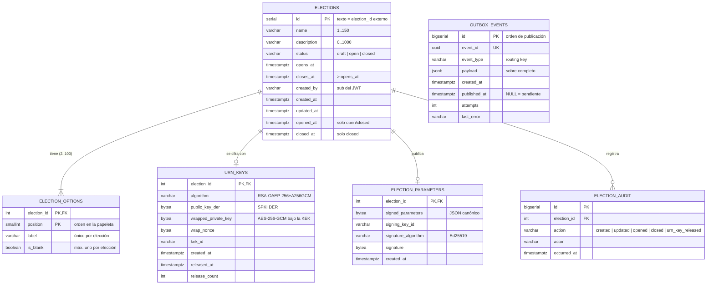

# Modelo de datos de las elecciones (FA-01)

Base PostgreSQL **«Elections»**, exclusiva del servicio Election. El DDL está en
[`../schema.sql`](../schema.sql) (fuente de verdad) y se refleja en `app/models.py`.

`OUTBOX_EVENTS` no tiene clave foránea: es una cola técnica y sus filas deben
sobrevivir aunque el evento se refiera a una elección borrada.

## Entidades

| Tabla | Rol | Notas |
| --- | --- | --- |
| `elections` | Elección y su ciclo de vida | `ck_elections_lifecycle` garantiza que `opened_at`/`closed_at` sean coherentes con `status` |
| `election_options` | Opciones de la papeleta | PK `(election_id, position)` conserva el orden; `uq_election_options_one_blank` (índice parcial) admite un solo voto en blanco |
| `urn_keys` | Llaves de la urna (FA-09) | Se crea al abrir. La privada nunca se guarda en claro |
| `election_parameters` | Parámetros públicos firmados | Bytes exactos que verifica el cliente |
| `election_audit` | Bitácora administrativa | Quién creó, abrió, cerró o pidió la llave privada |
| `outbox_events` | Outbox de `election.events` | Índice parcial sobre los pendientes |

## Decisiones

- **Identificador.** `SERIAL`; hacia fuera viaja como texto (`"7"`), igual que en el
  prototipo 1, para que Ballot, Identity y el token anónimo no cambien de formato.
- **Opciones normalizadas** (no un arreglo JSON): permiten las restricciones de
  unicidad y de un solo blanco en la propia base.
- **`TIMESTAMPTZ`** en todas las fechas; la aplicación trabaja siempre en UTC.
- **Sin datos de votantes.** El padrón (Census) es de Identity y las papeletas de
  Ballot: esta base no puede enlazar a nadie con su voto.
- **Borrado** solo de borradores; `ON DELETE CASCADE` limpia opciones y bitácora.
